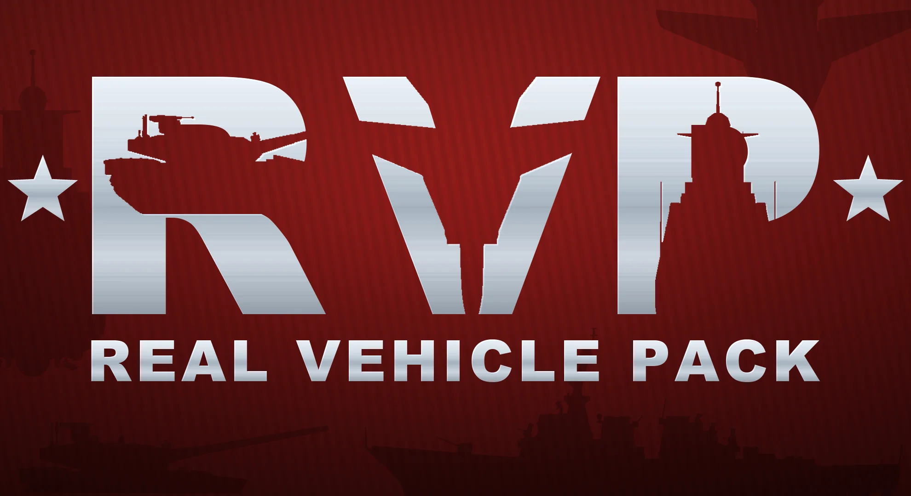
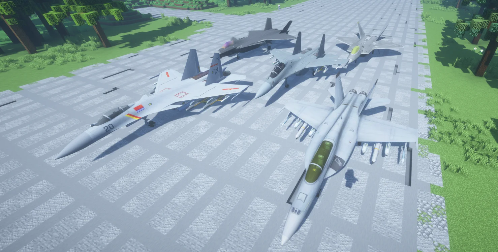

# RVP · RealVehiclePack

**RVP (Real Vehicle Pack)** is a large add-on for **Limitless Vehicle** on Minecraft 1.20.1 / Forge. It adds a wide range of weapons, ammunition, support equipment, and gameplay systems on top of the LV vehicle framework. Signature features include anti-radiation missiles, man-in-the-loop missiles, and extensive ammunition customization.

**RVP（Real Vehicle Pack）** 是 Minecraft 1.20.1 / Forge 上 Limitless Vehicle 的大型附属 Mod，在 LV 的载具框架上增加了大量武器、弹种、辅助设备与玩法。

当前版本 / Current version: `1.0.0_preview_0.6.2.1`

[中文说明](README_ZH.md) | [English](README_EN.md) | [Wiki](https://dtc10eeee.github.io/rvp-wiki/) | [Download](https://github.com/TV90/limitless-vehicle-rvp-addon/releases/tag/1.0.0_preview_0.6.2.1)

## Quick Links

- [Wiki / 玩法百科](https://dtc10eeee.github.io/rvp-wiki/)
- [Release / 下载与安装](https://github.com/TV90/limitless-vehicle-rvp-addon/releases/tag/1.0.0_preview_0.6.2.1)
- [中文 README](README_ZH.md)
- [English README](README_EN.md)
- [Development docs / 开发文档](docs/README.md)

## Gallery

| | |
| --- | --- |
|  |  |
| **Man-in-the-loop TV missile** | **Anti-radiation missile** |
|  |  |
| **Ground vehicles** | **Attack helicopters** |
|  |  |
| **Fighters** | **Destroyer formation** |
|  | |
| **Shipboard missile launch** | |

## Requirements

| Item | Requirement |
| --- | --- |
| Minecraft | 1.20.1 |
| Forge | 47.4.x (built with 47.4.13) |
| Limitless Vehicle | 0.6.2.1 |
| RVP | 1.0.0_preview_0.6.2.1 |

RVP is distributed as a Forge mod. Place `ywzj_rvp-1.20.1-1.0.0_preview_0.6.2.1-full.jar` and the Limitless Vehicle jar into `mods/`. On first launch the built-in vehicle pack is extracted to `limitless_vehicle/rvp/`. Client and server versions must match.

## License

RVP code is distributed under **GPL-3.0**. Vehicle models, textures, and sounds remain the property of their respective authors and are **All Rights Reserved** by default unless a model states otherwise. See [README_ZH.md](README_ZH.md) or [README_EN.md](README_EN.md) for full credits.

## Community

- GitHub: <https://github.com/TV90/limitless-vehicle-rvp-addon>
- Gitee: <https://gitee.com/DTC10/limitless-vehicle-rvp-addon>
- Discord: <https://discord.gg/tE7SXCPUGf>
