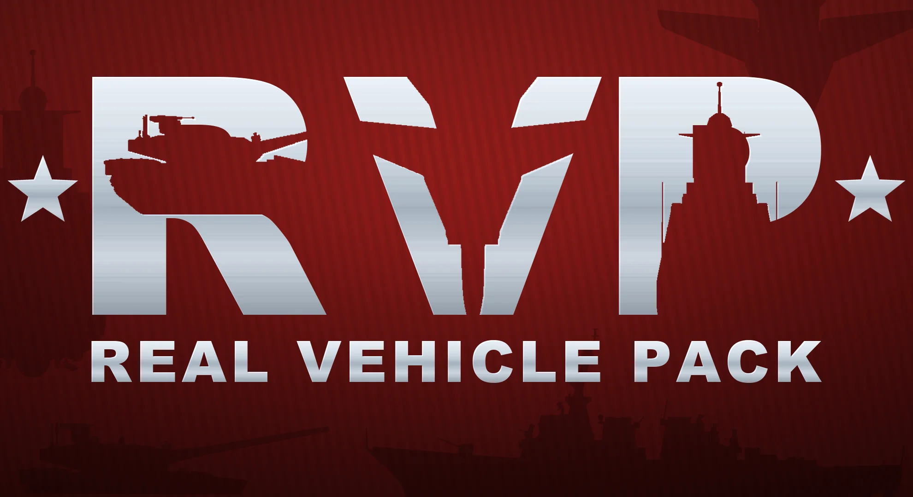
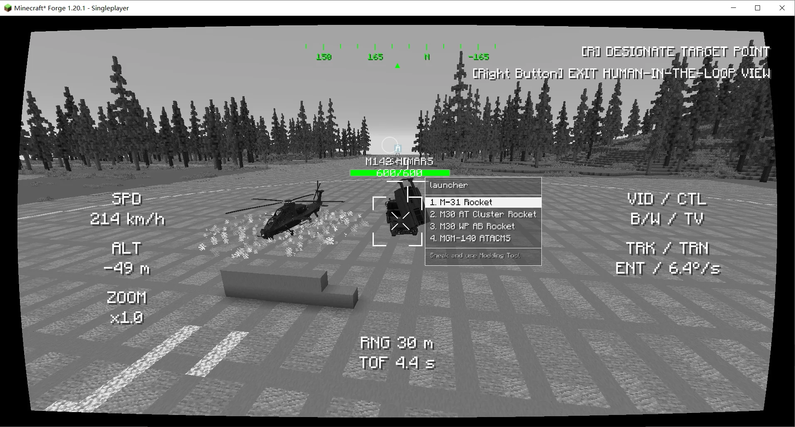
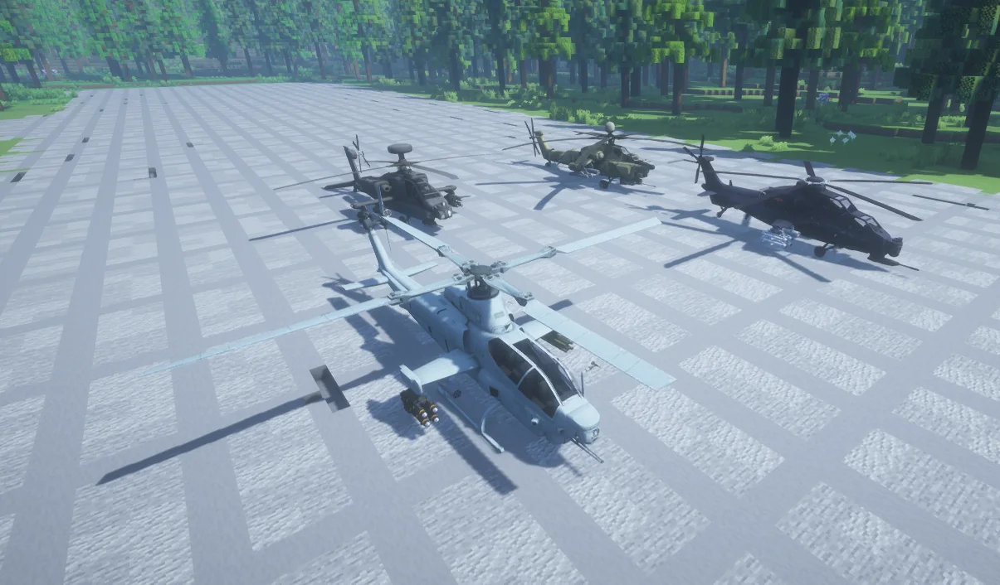

# RVP · RealVehiclePack

**RVP (Real Vehicle Pack)** is a large add-on for **Limitless Vehicle** on Minecraft 1.20.1 / Forge. It adds a wide range of realistic weapons, ammunition types, support equipment, and gameplay systems on top of the LV vehicle framework. Signature features include anti-radiation missiles, man-in-the-loop missiles, and extensive ammunition customization.

Current version: `1.0.0_preview_0.6.2.1`. Requires Limitless Vehicle `0.6.2.1`.

[中文](README_ZH.md) | [Wiki](https://dtc10eeee.github.io/rvp-wiki/en/) | [Download](https://github.com/TV90/limitless-vehicle-rvp-addon/releases/tag/1.0.0_preview_0.6.2.1)

## Highlights

- **Weapon systems**: guns, rockets, missiles, aerial bombs, torpedoes, targeting pods, laser weapons, fire support, and weapon customization.
- **Support equipment**: ERA, APS, active/passive ECM, electro-optical jammer, DIRCM, flares/chaff/smoke, and maintenance equipment.
- **Modular damage**: damage resolved by part and module with independent durability, multipliers, failure effects, and repair order.
- **Vehicle-deployed UAVs**: reconnaissance/attack UAVs, unmanned ground vehicles, 96L6 radar vehicle, UCAV launcher, and shipboard helicopter landing.
- **Tactical map**: GPS designation, radar target list, artillery map, and mini artillery map.
- **Interface and AI crew**: man-in-the-loop HUD, HMD, focus lock, warnings, CCIP, equipment panel, and gunner generator.

Full weapon, equipment, damage, UAV, tactical-map, interface, and vehicle documentation is in the [Wiki](https://dtc10eeee.github.io/rvp-wiki/en/).

## Gallery

| | |
| --- | --- |
|  |  |
| **Man-in-the-loop TV missile** | **Anti-radiation missile** |
|  |  |
| **Ground vehicles** | **Attack helicopters** |
|  |  |
| **Fighters** | **Destroyer formation** |
|  | |
| **Shipboard missile launch** | |

## Download and Installation

| File | Description |
| --- | --- |
| `ywzj_rvp-1.20.1-1.0.0_preview_0.6.2.1-full.jar` | RVP full build, required |
| Limitless Vehicle 0.6.2.1 | Base mod, required; [CurseForge](https://www.curseforge.com/minecraft/mc-mods/limitless-vehicle) |

1. Install Minecraft 1.20.1 + Forge 47.4.x.
2. Place `ywzj_vehicle-1.20.1-0.6.2.1.jar` and `ywzj_rvp-1.20.1-1.0.0_preview_0.6.2.1-full.jar` into `.minecraft/mods/`.
3. Launch the client or server once and wait for the vehicle pack to be extracted to `limitless_vehicle/rvp/`.
4. Enter the game and confirm that RVP vehicles and items appear in the creative inventory.

Client and server must use the same versions. To update, replace the RVP jar; when the version changes, the installer backs up the old pack and extracts the new one. Models, textures, sounds, and data are bundled in the `-full.jar`; no extra resource pack is required.

## Vehicles

The main pack contains 39 controllable vehicles: 6 tanks, 3 IFVs, 7 air-defense vehicles, 11 fighters, 4 attack helicopters, 4 UAVs, 2 destroyers, and 2 other vehicles.

The F-14A and F-14D support variable-sweep wings. Fourteen air vehicles support custom pylons; some vehicles have weapon bays and variants. See the [Wiki vehicle page](https://dtc10eeee.github.io/rvp-wiki/en/wiki/vehicles.html) for the full list.

## Configuration and Compatibility

- `config/ywzj_rvp-client.toml`: sight sensitivity, LOD scale, thermobaric particles, screen shake, volumetric trails, distant vehicle renders, Distant Horizons compatibility.
- `config/ywzj_rvp-lighting-client.toml`: screen-space lighting, explosion/muzzle/engine lighting, bloom, missile halo, EO jammer glow, plume and air scattering.
- `config/ywzj_rvp-common.toml`: sight-axis acceleration, wreck lifetime, beyond-visual-range vehicle sync/authorization/distance, chunk leases.
- `config/ywzj_rvp-hitl-remote.toml`: HITL remote observation budget.
- Allocate 6–8 GB of memory to the client; first launch extracts the vehicle pack from the ~234 MB jar.
- Minecraft 1.20.1 / Forge 47.4.x; Fabric is not supported. Distant Horizons is optional.

## License and Credits

- **Code license**: GNU General Public License v3.0 (GPL-3.0).
- **Art assets**: vehicle models, textures, and sounds remain the property of their respective authors and are **All Rights Reserved (ARR)** by default unless a model states otherwise. Do not extract, sell, or redistribute them separately without permission.
- **Base project**: Limitless Vehicle (GPL-3.0) by YWZJ. RVP is a submod/add-on.
- **Third-party code/assets**: some explosion, particle, and nuclear-visual code is referenced or ported from HBM's Nuclear Tech (GPL-3.0) and HBM's Nuclear Tech Mod: Rebirth (LGPL-3.0); the tactical map references Superb Warfare (GPL-3.0). The project is distributed under GPL-3.0.
- **Vehicle pack authors**: DTC10, fishking0721, TV90, Walrus.
- **Model sources**: ZTZ100 (59 战车, purchased), EBRC (Muhamad Mirza Arrafi, CC BY), S400 radar vehicle (HWHNL, CC BY-NC), T-90M (空中火车, purchased), M1A2 SEP/J-16/J-10C/J-20A/VT4/AbramsX (C5银河/冰是沉默的水, purchased). Full details are in the [Wiki license page](https://dtc10eeee.github.io/rvp-wiki/en/wiki/config.html).

## Community

- GitHub: <https://github.com/TV90/limitless-vehicle-rvp-addon>
- Gitee: <https://gitee.com/DTC10/limitless-vehicle-rvp-addon>
- Discord: <https://discord.gg/tE7SXCPUGf>
- QQ groups: 710540248 / 774087341

When reporting a problem, include the RVP version, base mod version, Minecraft/Forge version, reproduction steps, and relevant excerpts from `logs/latest.log`, `logs/debug.log`, or `crash-reports/`.

## Development Documentation

Development and vehicle-pack configuration documentation: [docs/README.md](docs/README.md).
