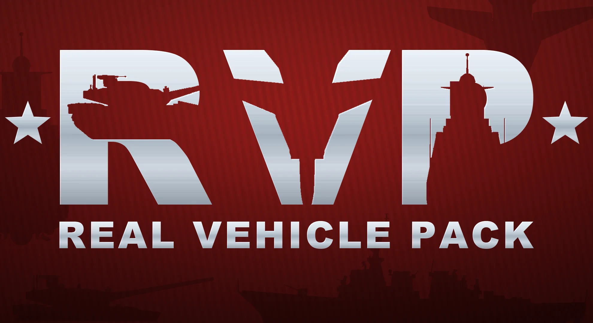
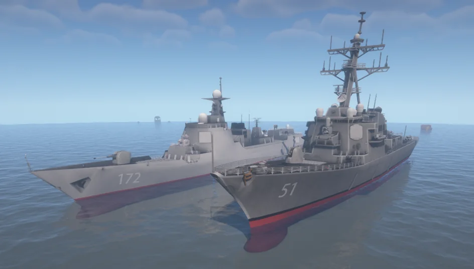

# RVP · RealVehiclePack

**RVP（Real Vehicle Pack）** 是 Minecraft 1.20.1 / Forge 上 **Limitless Vehicle** 的大型附属 Mod。它在 LV 的载具框架上增加了大量贴近现实的武器、弹种、辅助设备与玩法，代表内容为反辐射导弹、人在回路导弹和丰富的弹药改装。

当前版本：`1.0.0_preview_0.6.2.1`。需要 Limitless Vehicle `0.6.2.1`。

[English](README_EN.md) | [Wiki 百科](https://tv90.github.io/limitless-vehicle-rvp-addon/) | [下载 Release](https://github.com/TV90/limitless-vehicle-rvp-addon/releases/tag/1.0.0_preview_0.6.2.1)

## 主要内容

- **武器系统**：枪炮、火箭弹、导弹、航空炸弹、鱼雷、吊舱、激光武器、火力支援与武器改装。
- **辅助设备**：ERA 爆反、APS 主动防护、主动/被动 ECM、光电干扰机、DIRCM、热焰弹/箔条/烟幕与维修设备。
- **模块化损伤**：按部位与模块结算损伤，具有独立耐久、伤害倍率、失效效果和维修顺序。
- **车载无人机与辅助载具**：侦察/攻击无人机、无人战车、96L6 雷达车、UCAV 发射器与舰载直升机着舰。
- **战术地图**：GPS 目标装订、雷达目标列表、炮兵地图与小型炮兵地图。
- **界面与 AI 乘员**：人在回路 HUD、头瞄、焦点锁定、告警、CCIP、设备面板与炮手生成器。

完整武器、设备、损伤、无人机、战术地图、界面与载具说明见 [Wiki](https://tv90.github.io/limitless-vehicle-rvp-addon/)。

## 画廊

| | |
| --- | --- |
|  |  |
| **人在回路 TV 导弹** | **反辐射导弹** |
|  |  |
| **地面载具** | **武装直升机** |
|  |  |
| **战斗机** | **驱逐舰编队** |
|  | |
| **舰载导弹发射** | |

## 下载与安装

| 文件 | 说明 |
| --- | --- |
| `ywzj_rvp-1.20.1-1.0.0_preview_0.6.2.1-full.jar` | RVP 完整版，必需 |
| Limitless Vehicle 0.6.2.1 | 本体，必需；[CurseForge](https://www.curseforge.com/minecraft/mc-mods/limitless-vehicle) |

1. 安装 Minecraft 1.20.1 + Forge 47.4.x。
2. 将 `ywzj_vehicle-1.20.1-0.6.2.1.jar` 与 `ywzj_rvp-1.20.1-1.0.0_preview_0.6.2.1-full.jar` 放入 `.minecraft/mods/`。
3. 启动一次客户端或服务端，等待载具包释放到 `limitless_vehicle/rvp/`。
4. 进入游戏，在创造模式物品栏确认 RVP 载具与物品已出现。

客户端与服务端需安装相同的两个 jar，版本一致。更新时直接替换 RVP jar；版本变化时安装器会备份旧包并释放新包。载具模型、贴图、音效和数据均内置于 `-full.jar`，无需额外资源包。

## 载具

主包包含 39 台可操控载具：坦克 6、步战车 3、防空车 7、战斗机 11、武装直升机 4、无人机 4、驱逐舰 2、其余载具 2。

F-14A 与 F-14D 支持可变后掠翼。14 台空中载具支持自定义挂架；部分载具配置武器舱和变体。完整清单见 [Wiki 载具页](https://tv90.github.io/limitless-vehicle-rvp-addon/wiki/vehicles.html)。

## 配置与兼容性

- `config/ywzj_rvp-client.toml`：观瞄灵敏度、LOD 缩放、温压粒子、屏幕震动、体积尾烟、远距载具渲染上限、Distant Horizons 兼容。
- `config/ywzj_rvp-lighting-client.toml`：屏幕空间照亮、爆炸/炮口/发动机照亮、光晕、导弹外圈、光电干扰机红光、喷焰与空气散射。
- `config/ywzj_rvp-common.toml`：观瞄轴加速、残骸保留时间、超视距载具同步/授权/距离、区块租约与前瞻。
- `config/ywzj_rvp-hitl-remote.toml`：HITL 远程观察预算。
- 客户端建议分配 6–8 GB 内存；首次启动会从约 234 MB 的 jar 解压载具包。
- Minecraft 1.20.1 / Forge 47.4.x；不支持 Fabric；Distant Horizons 为可选兼容项。

## 许可与致谢

- **代码许可**：GNU General Public License v3.0（GPL-3.0）。
- **美术资源**：载具模型、贴图、音效等版权归各自作者所有，默认 **All Rights Reserved（ARR）**；未经许可请勿单独提取、商用或再分发。已注明授权方式的模型按对应条款使用。
- **基座项目**：Limitless Vehicle（GPL-3.0），作者 YWZJ。RVP 是其 Submod/addon。
- **第三方代码/素材**：部分爆炸、粒子与核爆视觉代码参考或移植自 HBM's Nuclear Tech（GPL-3.0）与 HBM's Nuclear Tech Mod: Rebirth（LGPL-3.0）；战术地图功能参考了卓越前线 Superb Warfare（GPL-3.0）。本项目整体以 GPL-3.0 开源分发。
- **载具包作者**：DTC10、fishking0721、TV90、Walrus。
- **模型来源**：ZTZ100（59 战车，已购买授权）、EBRC（Muhamad Mirza Arrafi，CC BY）、S400 雷达车（HWHNL，CC BY-NC）、T-90M（空中火车，已购买）、M1A2 SEP/J-16/J-10C/J-20A/VT4/AbramsX（C5银河/冰是沉默的水，已购买）。完整说明见 [Wiki 许可页](https://tv90.github.io/limitless-vehicle-rvp-addon/wiki/config.html)。

## 社区与反馈

- GitHub：<https://github.com/TV90/limitless-vehicle-rvp-addon>
- Gitee：<https://gitee.com/DTC10/limitless-vehicle-rvp-addon>
- Discord：<https://discord.gg/tE7SXCPUGf>
- QQ 群：710540248 / 774087341

反馈时请附上 RVP 版本、本体版本、Minecraft/Forge 版本、复现步骤，以及 `logs/latest.log`、`logs/debug.log` 或 `crash-reports/` 中的相关片段。

## 开发文档

开发与载具包配置文档见 [docs/README.md](docs/README.md)。
