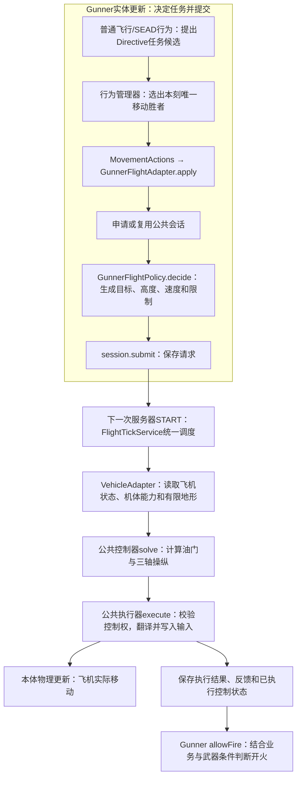

# RVP_Gunner 固定翼行为梳理与双逻辑改进计划（2026-11-02）

状态：**旧逻辑梳理完成；公共飞行能力与Gunner新分支已实现，默认开关关闭，验证记录见配套公共计划第11节。**

2026-11-02 方案修订与实施：按“业务参数化调用公共能力”的方向实现。第 1～4 节保留现状梳理；公共控制/执行合同见 [通用固定翼飞行控制器与执行器设计计划](RVP通用固定翼飞行控制器与执行器设计计划_20261102.md)，本文第 5～9 节描述 Gunner 接入和业务行为；第1～4节记录保留的旧分支，不能当作新分支行为。

寻路现状补充：当前旧/新Gunner固定翼及地面、旋翼驾驶均未接入A*绕障搜索；新公共飞控提供目标/轨迹跟随和有限地形保护。拟新增的独立公共寻路层见 [Gunner通用A*寻路设计计划](RVP_Gunner通用AStar寻路设计计划_20261102.md)，其中说明体积与转弯约束、路线/任务版本分离及尽量执行规则；该方案尚未实现。

依据：当前工作区 RVP Java 代码、项目根 `limitless_vehicle/rvp/data/rvp/gunner/` 的当前 schema v2 配置，以及只读的 `D:/WgameProject/ywzj_vehicle_fish` 本体源码。另用 `javap`（查看 jar 内已编译代码的工具）核对当前 `build.gradle` 所依赖的 `libs/ywzj_vehicle-1.20.1-0.6.2-all.jar` 的油门、目标角度操纵与地面高度查询。本文不使用 `run/**` 或已废止的包作为现状依据。

## 1. 先用人话概括

目前的固定翼驾驶员，大体是一个“持续加油门，按时间轮流追目标和向前飞，同时抬头低头守高度”的程序。它能够调用现有的索敌、雷达、选弹、制导和反制系统，但还没有形成“先保证飞机飞得住，再选择合适路线进入射击位置”的完整驾驶过程。

最影响实际表现的几件事：

- 没目标时没有真正的巡逻路线，也没有执行返航判断；命令中的默认航向 `0°` 会进入本体操纵，并非保持原航向。
- 有目标时，攻击/脱离主要按倒计时切换。靠近目标后虽然暂时不再追它，仍可能保留开火许可。
- 追目标主要改水平方向；抬头低头仍由高度控制决定。目标在高处或低处，不代表飞机会把机头上下对准它。
- 普通飞行持续加油门，不会根据速度主动收油。转弯、低速和地形风险也没有统一的安全控制。
- 有反雷达报复行为，但它使用另一套简化驾驶规则，且触发首刻存在没有提交驾驶命令的空档。

以下专业词都按游戏含义理解：**AGL** 是“离脚下地面的高度”，不是世界坐标 Y；**tick** 是游戏的一刻，正常 20 tick 约为 1 秒；**俯仰** 是抬头/低头，**偏航** 是机头向左/右转，**滚转/坡度** 是左右机翼倾斜。

## 2. 当前是谁在控制飞机

### 2.1 生效条件与调用链

Gunner 必须坐在司机位，飞机必须是本体 `FixedWingVehicle`，使用的 Profile（这名 AI 的行为配置）必须包含 `rvp:fixed_wing_combat_flight`，才会运行普通固定翼驾驶。

当前权威包中，`default`、`enemy`、`friendly`、`ground`、`mixed`、`sead_pilot`、`team` 都包含固定翼飞行行为，且飞行参数相同。**`air` 名字像飞行员，实际上没有任何移动行为，不能靠它获得固定翼驾驶。** `static_gunner`、`ciws_only` 也没有普通固定翼飞行行为。

服务端每刻的主要过程是：

```text
GunnerEntity.tick
  → RVP_GunnerBehaviorManager.tick
  → 确定本刻目标
  → 补给、反制、雷达、维持已发射武器的制导
  → 普通飞行 / SEAD 等行为提出驾驶和开火请求
  → 仲裁：每个控制通道选一个胜者
  → RVP_GunnerMovementActions.apply 写入 ControlUnit
  → 本体 FixedWingVehicle.tickMove 把输入变成实际操纵与运动
```

`ControlUnit` 可以理解为“本刻按哪些驾驶键、鼠标指向哪里”。RVP 通常提交期望角度，由本体算具体操纵；当前普通 Gunner 飞行没有自己连续控制三个操纵轴。

`GunnerBrain` 现在主要提供座位、武器站等查询，**不是当前飞行算法所在处**。`RVP_GunnerVehicleTickService` 则每 5 tick 同步阵营与姿态，也不负责驾驶。

一个额外边界：行为管理器对“坐在司机位但本刻没有移动请求”的 Gunner 会提交全默认值命令。这个所谓“停车”命令用在固定翼上并不会让飞机立即停住，反而会把目标俯仰、航向写成 `0°`；`air` 等配置的效果不能理解成“保留飞机现有自动驾驶”。

### 2.2 接管、补给和“家”的含义

包含 `driver_supply` 时，首次接管会启动发动机、补满能源与有效武器，并在尚无记录时，把**当时飞机所在位置**记为 home（后面回航使用的参考点）。它不是机场、跑道或专门的降落点。

此后弹药按武器装填等待规则补回，属于现有无限弹药机制；**燃料只在首次接管补满，普通持续补给不持续补油**。目前没有低油量返航、机场补给、自动降落流程。

换车、相关座位能力变化、换 Profile 或配置重载会触发旧行为退出和运行状态清理；清理还会清除 home，随后有补给资格时再记录接管位置。不能把 home 理解成永远不变的出生机场。

## 3. 普通固定翼现在具体怎么飞

### 3.1 没有目标

立即进入 `tickFixedWingCruise(..., false, ...)`，设置持续加油门和高度控制，然后返回。

这一条路**不会执行后面的 home 距离检查，也没有设置 `yRot`（目标航向）**。由于本刻创建的是全默认值命令，动作层又先清空旧输入，本体最终读到的是 `yRot=0`、`yRotKeep=false`，即明确要求朝世界航向 `0°`，在 Minecraft 中对应南方。实际转向过程仍受本体操纵与气动影响，不能保证马上转过去。

因此它不是“围着家巡逻”，也不是“沿当前航向飞并在远处自动回家”。普通攻击/脱离倒计时在无目标期间也不会推进。

### 3.2 发现目标：先飞一段，再轮流攻击和脱离

第一次有目标时先进入脱离阶段。当前 JSON 配的时长还会在 Java 中乘倍率并限制上下限，不能把 JSON 数字直接当最终时长。

| 阶段 | 当前权威包配置 | Java 实际处理 | 正常 20 tick/秒时约为 |
| --- | --- | --- | --- |
| 首次脱离 | 300～400 tick | 乘 0.45，限制在 40～180 tick | 6.75～9 秒 |
| 攻击 | 200 tick | 乘 1.4，限制在 140～420 tick | 14 秒 |
| 后续脱离 | 200 tick | 乘 0.55，限制在 40～140 tick | 5.5 秒 |

这里是名义倒计时时长，阶段入口和归零判断还有逐刻边界差异。

从脱离切到攻击时，还要求当前 AGL 至少 **175 格**。不足就再等 20 tick 后重试；但已经处于攻击阶段时，不会因为重新低于 175 格而立即退出攻击。若把巡航最高高度配置到低于 175 格，还可能与这一写死的攻击入口要求冲突。

这些切换没有检查“是否已经转到合适方向”“武器是否能开火”“速度够不够”“是否已经安全拉开”。目标切换也不会专门重置普通飞行阶段；它可能用上一目标剩下的阶段继续处理新目标。SEAD 活跃时普通飞行暂停，之后恢复原状态。

### 3.3 攻击时追哪里，脱离时往哪里飞

攻击阶段的参考点是：目标当前位置，加上目标 **10 tick（约 0.5 秒）**的速度预测，再向上加 12 格。

但这个参考点最终**只取水平方向来设置航向**。俯仰角由下面的高度控制另外设置，所以“参考点加高 12 格”不等于飞机会抬头对准那里。这也不是根据机炮弹速求出的完整拦截路线；现有机炮武器瞄准另有弹道解算，不能与驾驶算法混为一谈。

脱离阶段，或水平距离太近时，参考点改成“当前机头方向前方 128 格，再向上 30 格”。意思更接近**先沿当前机头方向继续飞**，不是明确计算“背对敌人逃开”。返航混合仍可能随后改变它。

“太近”的规则是 `max(停车距离 × 4, 48格)`。固定翼行为自己的参数视图没有开放停车距离，当前实际使用默认 12 格，所以普通配置下就是水平距离小于 **48 格**；这不是可随着 `ground_engagement_move.stop_distance` 联动的空战参数。

**距离太近只改航向参考点，不会修改攻击阶段或 `allowFire`。** 所以可能出现“驾驶已经开始飞过目标，射击侧仍得到攻击许可”。

### 3.4 如何守高度

当前通用配置为离地 **150～500 格**。

- 攻击阶段期望 AGL 为 175 格，并限制在配置的最低/最高高度之间。
- 非攻击阶段的期望高度缓慢上下变化：取高度范围的 20%～80%，当前即约 **220～430 格**；每架机按实体编号错开波动，完整周期约 25 秒。
- 高度不足就抬头，高度过高就低头；目标俯仰限制在 **抬头 18°～低头 10°**。
- 非攻击阶段额外加 4°抬头倾向，所以波动数值只是期望值，不代表实际高度会严格贴住。
- 地面且世界 `Y<68` 时，另有写死的抬头 10°处理。其他位置也会受到普通高度差驱动，但没有按速度划分滑跑、抬轮、离地、爬升的起飞流程。

这里的地面高度由本体 `EntityUtil.getGroundY` 从当前位置向下找首个非空气方块得到。它**只看脚下，不向飞行前方看山、墙或建筑**，也没有把下降速度、转弯掉高度、当前速度纳入同一个保护过程。

### 3.5 油门、转弯和起落架

普通巡航、攻击、脱离都设置 `forward=true`。在本体固定翼中这代表**持续加油门**，通常每刻增加 5 个百分点，有加力能力的飞机还能进入加力推力。因此不是“保持一个合适巡航速度”。

飞行中的左右转弯主要依赖本体对目标航向的自动偏航、滚转操纵；RVP 普通驾驶没有独立限制倾斜角、按速度安排转弯半径或处理低速失速（速度或机翼迎风姿态不合适，导致升力不足）。地面有目标时还会按航向差大于 6°补左右转向输入。

普通 Gunner 飞行没有专门管理起落架、减速板，也没有跑道路径和自动着陆。当前能力应理解成“尝试加速起飞并持续战斗”，不能理解成完整机场操作。

### 3.6 作战半径与返航

只有**有目标、进入普通固定翼驾驶后半段**，才检查 home。当前配置下限 40 格、上限 550 格；使用的是到 home 的**三维直线距离**，高度差也算进去。

超出 550 格后进入方向混合计算，但真正朝家的方向权重在约 **715 格（550×1.3）**之后才开始增加，到约 **1265 格（550×2.3）**时完全采用回家方向。可理解为越飞越远时，逐渐从追击改成回头。

所以 550 格不是硬围栏。再加上飞机转弯需要距离，不能把 1265 格理解成实际轨迹绝对不会越过的边界。距离小于 40 格时则给向外飞的偏置。

返航只改参考方向，不强制退出攻击、不专门禁止开火，也不会带着飞机降落。**一旦失去目标，这一整段返航判断反而不执行。**

## 4. 索敌、开火、反制怎样影响驾驶

### 4.1 看见目标和能不能打是两回事

普通索敌会考虑敌我、队伍、Profile 允许的目标类型、武器适用性和隐身影响。对于飞机，基础搜索半径乘 6，再与本车/外置中继雷达扫描距离取较大值。

例如 `default` 的基础 192 格变为 1152 格，`enemy` 和 `sead_pilot` 的 1024 格变为 6144 格；这只是搜索上限之一，**不保证那个距离能发现、锁定或开火**，候选也来自已加载实体。

普通选敌在过滤后分层处理可拦截弹药、电子战假目标、敌方 Gunner 载具、玩家及其他目标；同一层中，GPS 远目标偏好启用且适用时会偏好最远目标，其余通常兼顾距离和朝向。另有高优先级 CIWS 行为，即近防拦截行为，可以把权威目标抢成来袭弹药。

**当前飞行直接使用这一个权威目标。** 因此它可能为了地面单位或拦截目标改变整机航向，没有独立的“飞机当前任务目标”与“武器眼下射谁”。

### 4.2 进入攻击阶段不等于已经开火

非攻击阶段有目标时，普通飞行提交 `FIRE_HOLD`，即占住武器开火通道，阻止普通交战；攻击阶段放开。现有基准配置中，飞行行为和普通交战都是优先级 500，飞行列在前面，因此禁射候选胜出。

需要注意：行为管理器会把函数内写的优先级替换为 **JSON 中行为实例的优先级和顺序**。所以这不是无法绕过的安全门；若提高普通交战优先级，或在同优先级下改变顺序，禁射可能失效。

放开之后，武器层还要选弹、检查弹药/冷却、瞄准、雷达/红外/坐标等发射条件。非制导武器要通过瞄准误差检查；RVP 制导武器使用自身锁定和发射条件。导弹准备失败时存在回退到机炮等武器的处理。

对空 RVP 制导武器还有约 100 tick 的等待纪律和再次发射限制，但该等待计时在锁定准备检查之前开始，**不能称为严格的“连续真实锁定满 5 秒”**；红外另有服务端连续跟踪等待。已发射武器的照射/指令制导维持在支持阶段运行，即使普通飞行暂时禁射，也不等于停止帮助旧弹制导。

动作结果 `DISPATCHED` 表示已经向本体发射链提交请求，不是已经验证真实弹体生成；后续仍有本体武器舱、弹药和事件判断。诊断和改进验收不能用请求次数直接代替实际发射次数。

### 4.3 普通反制和 SEAD 接管

配置及部件支持时，会释放热焰诱饵、箔条或启动主动电子干扰。它们分别用于干扰红外、雷达或相关探测/制导。**普通反制不等于飞机会按来袭导弹方向做一套规避机动。**

SEAD 在这里指压制敌方防空的反雷达报复行为。当前不只 `sead_pilot` 有它，多种通用 Profile 都包含 `rvp:sead_revenge`；还须是飞行器司机、被敌方雷达锁定、有可用 AntiRadiation 武器且不在冷却中才触发。

当前过程大致是：

1. 每 10 tick 检查锁定来源，范围默认 1024 格。条件允许时先请求射一发 AntiRadiation，再请求抛箔条。
2. 背对雷达源飞约 100 tick，约 5 秒。
3. 转回雷达源，最多等待约 160 tick，之后还有 40 tick 的锁定发射窗口；条件允许就再请求报复一发并退出。
4. 整轮有 400 tick 超时保险，退出后默认 400 tick 冷却，约 20 秒。

该行为以较高优先级占用驾驶和开火，普通飞行暂停。固定翼使用写死的 **180 格 AGL**，持续加油门，没有走普通的高度范围和 home 半径约束。

一个明确的接管边界：触发首刻只提交了反制和开火请求，就把状态改为飞离；本刻尚未调用 `tickSeadFly`。在当前常见行为顺序下，后面的普通固定翼看到 SEAD 已激活就跳过，管理器只好提交全默认值的“停车”命令。结果是**首刻缺少连续驾驶输入，并可能出现目标航向/俯仰归零**。后续各刻才有 SEAD 驾驶命令。

### 4.4 远离玩家后的飞行边界

不能沿用旧文档简单断言“Gunner 飞远必定不加载区块”。当前已有 `RVP_RemoteVehicleChunkLeaseService`，可把 Gunner 驾驶载具纳入临时区块加载，并按速度保护前方路径。

但它受远距可视功能是否开启、可视授权观察者、加载模式和预算限制，不等于所有 AI 都无条件永久运行。新驾驶算法也不能因要预看地形，就自行无限生成/加载远处地形。

## 5. 改进目标与范围

目标是让新逻辑做到：**能稳定飞、知道在哪里巡逻、会在适合攻击的位置开火、危险时优先保住飞机，失去目标后能回到任务区域。**

Gunner 第一版保留现有敌我规则、补给规则、武器数据与发射链，主要改业务目标/航路、公共飞行能力接入和驾驶员开火许可。该业务的新旧开关只针对 **RVP Gunner 驾驶固定翼**。

公共能力由 `org.ywzj.rvp.flight` 下的通用固定翼控制器、通用执行器提供，Gunner 以目标、高度、速度、约束和控制参数调用；UAV 后续作为第二个业务通过独立开关接入同一公共能力，不能复制另一套操纵代码。直升机和地面载具不走首版固定翼执行后端。

新逻辑全部写在 RVP。无需修改本体源码、结构模型或新增 Mixin；武器类型依据现有数据能力判断，不按具体武器 ID 或具体机型 ID 特判。首版不承诺自动降落、机场补油、复杂空战特技或全地图寻路。

## 6. 新旧逻辑的代码开关

已新增 `entity/gunner/flight/RVP_GunnerFlightOptions.java`，交付值如下：

```java
/** Gunner 固定翼驾驶选项；改值后重新构建并重启游戏或服务器。 */
public final class RVP_GunnerFlightOptions {
    /** false 使用当前原逻辑；true 由Gunner业务适配器参数化调用公共控制器与执行器。默认保留原逻辑。 */
    public static final boolean USE_IMPROVED_FIXED_WING_AI = false;
}
```

具体约定：

1. `false` 时，普通固定翼、对应 SEAD 驾驶和开火许可完整走当前路径。本文指出的问题也留在旧分支，保证可以对照；不把“顺手修复”偷偷塞进旧分支。
2. `true` 时才启用新业务状态、参数化公共飞行请求、SEAD 接入和业务安全开火检查。原固定翼运动写入路径退出，新执行器成为该载具唯一运动写入者；每刻只计算/执行最终选中的一份飞行指令。
3. 采用编译期开关，即改 Java 常量、重新构建、重启。首版不额外加入 JSON 新旧字段、运行时切换命令或存档迁移。运行时热切换不是这个开关的含义。
4. 新分支按Gunner保存一份当前任务和公共会话，普通飞行与SEAD先选出胜出的移动请求，再共用这份状态；公共控制状态按载具控制会话隔离。换车、换Profile、重载、离座或移除时分别清理，不复用旧 `AirFlightState` 的阶段数字，也不复用旧控制凭据。
5. 默认关闭新逻辑完成交付。回退只需把常量改回 `false` 后重新构建、重启，旧方法与当前 JSON 均保留。

当前 schema 的高度、作战范围继续作为新模式的任务约束，由 Gunner 适配器转换为公共参数。新模式中 `attack_phase_tick`、`disengage_phase_tick` 按配置原值作为业务阶段超时上限，不再暗乘倍率，也不强迫待满；`initial_disengage_tick_min/max` 在首版新分支不消费，首次接敌直接按当前几何条件决定接近/脱离；这两个字段继续保留给旧分支。旧模式保持第 3 节的倍率和倒计时含义。公共控制/安全参数在 `flight` 层定义，Gunner 选项只保留自己的开关、任务策略及参数映射；需要数据化时再按当前 schema 正式增加字段。

## 7. 新逻辑具体怎么改

### 7.1 业务定目标，公共控制器计算，公共执行器操作

Gunner 自己决定巡逻、攻击、脱离、返回任务区与反雷达报复等业务阶段，把要求转成 `HoldCourse`（保持航向）、`FlyTo`（飞向航点）、`Orbit`（绕圈）、`TrackPoint`（跟随运动参考点）或 `Takeoff`（按指定方向起飞）。目标附带高度、速度、转弯和控制参数，具体合同以公共计划为准。

公共 `RVP_FixedWingFlightController` 根据只读观察与机体能力计算怎么飞，不依赖 Gunner 的类和 Profile，也不保存攻击阶段；公共 `RVP_FlightExecutor` 唯一负责向本体写入运动字段、油门和连续操纵量，处理输入补偿、符号与释放。业务方不再自己写一份连续操纵适配。

公共层按“尽量而为”执行：参数不合理自动修正，缺少可选部件仍驾驶；请求未刷新继续追随已接受目标，暂时异常在内部恢复，同机占用则保存目标并自动等待交接。只有身份/实体终止和会污染实体数值的致命条件才停止写入，具体规则见公共计划第4.4节。Gunner将 `APPLIED_ADJUSTED` 同样视为真实已写入；开火仍需本刻版本匹配且没有受限/恢复风险，等待或内部继续不冒充已执行。

现有 `RVP_UavLoiterGuidance` 的适用计算提取为公共参数化实现，去掉固定盘旋配置依赖；Gunner 和 UAV 均通过适配入口使用。禁止直接调用对方 tick 服务或让旧动作层和公共执行器同时写飞机。公共计算返回候选下一状态，执行成功才提交，落选请求不能先推进状态。

### 7.2 用公共参数表达速度、姿态与地面净空要求

以下计算和保护归公共控制器实现，Gunner 只提供对应任务要求与参数覆盖：

- 根据本体已有质量、阻力、升力和操纵响应估算可飞速度与可用转弯能力，保留余量；数据不足时使用保守方案并输出原因。
- 速度偏高收油，速度不足加油；加油/收油互斥，维持速度时允许两者都不按。正常巡航不默认长期开加力。
- 高度控制同时看“差几格”和“正在多快地升降”，减少来回抬头低头。急转弯限制机翼倾斜，低速时减小转弯强度。
- 同时采样脚下和沿实际速度、预期航迹前方的有限地形点，检查未来几秒可能的净空。未知地形不当作安全平地，不因采样强制加载整个区域。
- 低空快速下坠时中止攻击并恢复；低速时先改善速度和机翼姿态，只有确有地形余量才缓慢低头加速，避免“防失速直接扎地”或“低速还猛拉机头”。

安全处理优先于追击、返航和 SEAD。安全余量恢复后要稳定若干刻才恢复任务，避免临界点每刻来回切换。

### 7.3 Gunner业务从机械计时改为有进入/退出条件的阶段

下表描述的是 Gunner 任务过程。公共控制器只维护通用的起飞、航路捕获和安全恢复状态，不将 Gunner 的攻击、返航、反雷达阶段混入通用目标枚举。

| 阶段 | 人话含义 | 主要进入/退出条件 |
| --- | --- | --- |
| 起飞与爬升 | 先滑跑，有速度后抬头，离地后稳住 | 区分地面/空中；速度、离地高度稳定后再进任务；不再依赖世界 Y<68 |
| 巡逻 | 在 home 附近按可飞的航路巡逻 | 没有可用任务目标时进入；每刻明确航向、速度、高度，始终检查回航条件 |
| 接近与对正 | 飞到能用所选武器的位置 | 看目标位置与相对运动、射程、机头/武器朝向；满足攻击条件再进入攻击 |
| 攻击 | 在安全且武器适用的区间内争取开火 | 目标过近、即将飞过、风险升高、目标失效或一次攻击结束就退出 |
| 脱离与重整 | 拉开足够距离，再安排下一次进入 | 看实际距离、相对方向和可用转弯空间；计时只作超时保险 |
| 返回任务区 | 停止追远，回到可巡逻的范围 | 水平距离超过外圈时进入，回到较小内圈才退出，减少边界处反复掉头 |
| 安全恢复 | 先把飞机救回来 | 地形、失速/大坡度风险触发；安全状态稳定后返回合适阶段 |

返航使用 home 的**水平距离**，高度另行约束。转弯半径由速度与姿态能力决定，不能假设飞机能沿 550 格边界瞬间折返；巡逻半径也必须是当前机型飞得出的半径。若配置空间小于估算的可行转弯空间，记录限制并采取保守路径，不能悄悄改写用户 JSON。

目标短暂消失时保留最近有效信息一小段时间用于平稳脱离；超过宽限才回巡逻，目标真正失效时立即停止开火。目标改变后重评接近方向，不继承旧目标的攻击倒计时。

### 7.4 驾驶路线认识武器，但仍由原武器链决定能否发射

先做只读的武器候选/能力查询，依据当前数据区分制导对空、制导对地、机炮/非制导武器和 AntiRadiation，安排对应的接近与脱离距离。该查询不落锁、不扣弹、不推动冷却；真正发射时仍由原武器动作层重新选弹、校验和提交。

- 对空：按双方相对速度、方向和可用武器安排接近；机炮路线可借用已有弹道提前量，避免永远追目标半秒后的同一个位置。
- 对地：制导武器先满足发射范围与姿态；机炮和非制导武器需要单独的安全进入/退出路线，不再让所有武器共用“离地 175 格，只转水平机头”的办法。首版对尚无可靠投放解算的弹种不宣称已支持精确投弹。
- 近防：来袭弹药可以抢武器开火目标，**不自动变成整机追逐目标**；驾驶继续有效的原任务或优先处理安全风险。
- 对必须持续照射或指令维持的已发射武器，脱离路线要考虑还能否维持制导；保留现有支持阶段，并且安全恢复可以优先中断不安全机动。

公共结果只反馈是否稳定到位、是否安全恢复、受什么限制，不包含 `allowFire` 或武器信息。Gunner 使用**本刻实际已执行、目标/阶段版本匹配**的公共反馈，与自己的武器/阶段条件合成开火许可；在新模式发射执行边界检查，覆盖普通交战与 SEAD 报复请求，不能仅依靠 `FIRE_HOLD` 的 JSON 排序。无匹配反馈时先禁射。这项限制只作用于该固定翼 AI 驾驶员，不扩散到独立乘客炮手或其他载具。

### 7.5 SEAD 提战术要求，统一控制器负责飞

保留“被雷达锁定 → 反制 → 飞离 → 回转 → 报复发射”的战术意图与现有 AntiRadiation 发射链。新模式中，SEAD 提交想远离/接近哪个雷达的请求，不再直接另算一套 180 格 AGL 驾驶。

普通任务与 SEAD 先在 Gunner 业务层按任务规则选出最终目标，再由同一控制会话提交公共飞行请求；适配器保存对应行为配置与目标/阶段版本，避免串用参数。公共层在统一物理更新前读取观察、计算并执行一次，Gunner 再根据对应执行反馈判断武器许可。

SEAD 触发时保留当前连续驾驶，新意图最早在下一物理刻接入，不能先清空输入制造空档；该约一刻的调度延迟见公共计划。地形风险、低速恢复和合理返航范围仍生效；雷达源消失、条件长期不满足或超时后平稳回原任务，不突然归零航向。热焰/箔条/干扰行为继续通过原动作层处理。

<a id="gunner-shared-flight"></a>

### 7.6 Gunner 实际接入：一次请求怎样变成飞机动作

本节按当前实现说明实际调用方式。用人话说：**Gunner决定“去哪里、飞多高多快、现在是攻击还是脱离”，把要求交给公共会话；公共控制器算怎样操纵，公共执行器把操纵交给飞机；Gunner读取执行反馈后再决定能否尝试开火。**

#### 7.6.1 从哪个入口调用，什么时候生效

先将 `RVP_GunnerFlightOptions.USE_IMPROVED_FIXED_WING_AI` 改为 `true`，重新构建、重启；交付默认值仍为 `false`。普通飞行还需要Gunner处于固定翼司机位、Profile允许驾驶，且行为计划包含 `rvp:fixed_wing_combat_flight`。Profile就是该Gunner的行为配置。申请前仍遵守已有UAV自动控制业务锁，通过这些检查后才进入公共会话流程。



`Directive` 是Gunner内部的任务候选，携带行为标识、目标实体、Profile视图，以及普通/SEAD模式；它还不是公共飞行请求。普通飞行行为先用 `offerParameters` 提供配置，再提交候选；SEAD也提交同类候选，模式值 `0/1/2` 分别表示普通、反雷达飞离、反雷达回转。行为管理器按JSON中的优先级与顺序选定移动胜者，随后经 `RVP_GunnerActionIntentExecutor`、`RVP_GunnerMovementActions.apply` 转给 `RVP_GunnerFlightAdapter.apply`。落选候选不调用任务策略，不推进任务阶段。

适配器只在没有有效会话时调用 `RVP_FlightTickService.acquire`。持有者使用Gunner的UUID，授权回调持续核对这名Gunner仍存活、仍驾驶同一载具、配置代次未变化，并符合UAV控制规则；公共层另外绑定服务器、维度和接管时操作者。会话可以跨刻复用；如果另一合格业务正在持有公共控制权，申请得到的是可保存请求的等待会话，交还后自动接管。

Gunner在实体更新时提交，因此通常从**下一刻START**起生效。START是服务器这一刻的开始阶段，早于载具实体的物理更新；正常20刻/秒时约延迟0.05秒。第N刻START执行上次已接受请求，第N刻Gunner更新再提交新请求，第N+1刻START读取新观察并执行它。现有START业务准备回调注册给UAV；Gunner沿上述实体更新入口提交。

#### 7.6.2 Gunner把哪些业务场景翻译成什么目标

`RVP_GunnerFlightAdapter` 读取本机位置、速度、离地高度、home、目标位置/速度和当前武器能力，组装 `RVP_GunnerFlightPolicy.Input`；`decide` 返回公共请求、下一份Gunner任务状态及业务攻击几何许可。home是任务返回参考点；AGL表示离地高度，单位为格。

| Gunner阶段 | 交给公共层的目标 | Gunner负责提供的几何数据 |
| --- | --- | --- |
| 起飞 `TAKEOFF` | `Takeoff`（按指定方向起飞） | 进入起飞阶段时锁定的航向；公共层根据当前速度决定何时抬头 |
| 巡逻 `PATROL` | `Orbit`（绕圈） | home为圆心，向右绕圈；作战范围上限R>0时请求半径为 `max(80, R×0.45)`，否则为250格 |
| 接近 `APPROACH`、攻击 `ATTACK`、反雷达回转 `SEAD_TOWARD` | `TrackPoint`（跟随参考点） | 目标位置、速度和最近采样刻；制导武器预测0.25秒，其他武器0.5秒，跟随间隔为0；这只是航向参考，武器瞄准仍走原链 |
| 脱离 `DISENGAGE`、反雷达飞离 `SEAD_AWAY` | `HoldCourse`（保持航向） | 朝远离任务目标的方向飞；没有可用目标位置时使用当前航向 |
| 返回任务区 `RETURN` | `FlyTo`（飞向航点） | home为航点，通过距离为 `max(40, R×0.25)`，离开航向取当前指向home的方向；回到R的75%内圈后由Gunner重新选任务 |

任务选择有业务优先顺序：地面/过低离地高度先起飞；超出任务范围先返回；之后才处理SEAD、无目标巡逻或普通接近/攻击/脱离。公共控制器只认识表中的通用目标，不认识这些Gunner阶段。当前Gunner阶段由自身的距离、目标和计时条件决定；公共反馈用于发射许可，尚未直接传入 `decide` 决定阶段切换。公共层安全恢复期间，Gunner的业务计时仍按服务器刻推进。

近防拦截可能把武器目标切换成来袭弹药。策略把它标成“仅拦截”，保留原导航目标的最近位置、速度和武器范围，避免整架飞机突然掉头追弹。原导航目标明确死亡，或连续超过60刻没有新的导航样本时，策略清理该导航任务并重新选择巡逻/返回等目标；公共层自身不会替Gunner索敌。

#### 7.6.3 哪些参数来自Profile，哪些由Gunner策略给出

以下是当前新分支的实际映射，公共层仍会根据真实飞机能力、地形与参数边界作尽力调整。

| 来源 | Gunner转换后交给公共层的内容 |
| --- | --- |
| `cruise_altitude_min/max` | 通常取两者中点作为目标AGL；普通 `ATTACK` 默认取最低AGL。最高AGL加上本机脚下地面高度，转换为本刻世界Y上限；最低AGL用于任务目标，并不是公共层额外的绝对高度下限 |
| 目标类别/武器能力 | 跟随飞机目标时改用目标世界Y；非制导对地 `ATTACK` 使用“目标Y + `max(30, min(最低AGL, 距离×0.2))`”；制导对地攻击保持上述业务AGL |
| `combat_radius_max` | 用于Gunner的水平越界/75%内圈返回判断，以及巡逻圈、返回航点参数；公共控制器接收到的是已算好的圆或航点，不读取这个JSON字段 |
| 武器数据给出的最小/最大有效距离 | 留在Gunner策略中决定何时进入攻击、何时拉开和是否允许尝试攻击；公共控制器不读武器数据或武器ID |
| `attack_phase_tick`、`disengage_phase_tick` | 作为Gunner任务阶段的超时上限；不传成控制器的捕获/恢复等待刻数 |
| Gunner当前策略数值 | 巡逻速度为 `Speed.safeCruise(1.25)`，其他阶段为1.35；巡逻最大倾斜角30°，其他阶段45°；最低地形净空20格，其他限制沿用 `Limits.cruiseDefaults()` |
| Gunner当前控制预设 | 每次提交使用 `RVP_FlightTuning.responsiveFlight()`（响应较快的控制参数组），新鲜窗口为3刻；起落架与减速板默认 `KEEP`，即保持原状 |

速度倍率是“本机估算最低可飞速度的多少倍”，不是格/秒或公里/时。控制预设调整的是杆量/油门的响应、平滑、地形前视与到位容差，不是Gunner攻击阶段时长。新鲜窗口只用于提示数据是否陈旧：停止更新后公共层仍继续最后接受的目标，并在内部持续尝试。

Profile来自普通飞行胜出指令的配置视图；SEAD优先借用普通固定翼行为经 `offerParameters` 提供的配置，没有时使用SEAD指令自己的Profile。`initial_disengage_tick_min/max` 和 `combat_radius_min` 目前由旧分支继续消费，新分支没有把它们暗中转换为公共控制参数。上述速度倍率、倾斜角、净空与控制预设目前在Gunner策略/适配代码中选择，尚未增加新的JSON调参字段。

#### 7.6.4 实际提交代码与两个层次的状态

下面摘取适配器的实际调用骨架；`input` 是已组装的业务观察，`state` 是当前Gunner的运行态容器，会话已通过上文授权申请取得。

```java
// 调用Gunner策略：只决定任务和生成参数化请求，不计算三轴或写飞机。
var decision = RVP_GunnerFlightPolicy.decide(input, state.policy);
// 调用公共会话保存请求；3是新鲜窗口，不是3刻后关闭自动飞行。
if (!state.session.submit(decision.request(), RVP_FlightTuning.responsiveFlight(), 3)) {
    return RVP_GunnerActionResult.GATED;
}
// 请求被接受后记录Gunner任务；公共控制状态由公共层在真实写入后保存。
state.policy = decision.state();
state.attack = decision.attackGeometry();
```

公共请求的 `goalId` 使用Gunner UUID字符串，`revision` 是Gunner任务版本：换导航目标或阶段时递增，目标正常移动、每刻刷新位置时保持不变。它让公共层延续同一任务的操纵平滑，也让发射侧识别“反馈对应旧任务还是当前任务”。公共会话还另有 `generation`，即接管代次，用于阻止旧持有者继续写飞机；它与任务版本、配置重载代次各管一件事。

`RVP_GunnerActionResult.EXECUTED` 在这个入口表示“飞行请求已提交并接受”；真实动作要看 `session.executionResult()`。两份状态分别归各自所有者：Gunner保存阶段、导航目标与任务版本；公共 `RVP_FlightExecution` 保存上次已写入的杆量、观察和捕获/恢复状态。公共调度读取 `Observation`（真实飞机快照）和 `Airframe`（本刻机体能力），调用 `RVP_FixedWingFlightController.solve` 生成 `Command`；随后 `RVP_FlightExecutor.execute` 核对身份，把抬头/右转/右倾换成本体符号，预扣本体稍后会追加的键盘增量，再通过 `RVP_FlightVehicleAdapter.write` 写三轴与油门。只有真实写入后，公共层才保存候选控制状态。

新模式的 `RVP_GunnerMovementActions` 在转交适配器后直接返回，原来清空 `ControlUnit` 并写目标角度的分支不会再执行；行为管理器也跳过旧全零停车兜底。因此每刻公共层的操纵不会再被同一个Gunner的旧写入覆盖。

#### 7.6.5 飞控反馈怎样影响Gunner开火和退出

普通交战与AntiRadiation报复发射，都在 `RVP_GunnerActionIntentExecutor` 调用 `RVP_GunnerFlightAdapter.allowFire` 后再进入原武器链。当前检查为：

1. 会话仍有资格，实际武器目标与适配器记录一致，本次结果为 `APPLIED` 或 `APPLIED_ADJUSTED`，即确实写过操纵。
2. 反馈属于当前服务器刻、当前Gunner `goalId` 和任务版本；换目标/阶段而新请求尚未执行时先不放行。
3. 状态不是 `RECOVERING`（安全恢复中）或 `LIMITED`（按限制调整、仍在驾驶）。后者会限制Gunner开火，公共驾驶本身继续。
4. 普通目标还需Gunner策略允许攻击；制导武器的航向/高度误差分别不超过40°/40格，其他武器分别不超过8°/15格。近防弹药目标在满足前3项后，继续交由原武器射界、锁定等条件检查。

`WAITING_FOR_CONTROL`（目标已保存、等待交接）与 `CONTINUING`（暂时异常、内部继续）均无需Gunner反复申请，但不代表本刻已写入，不能据此放行发射。`CAPTURED`（稳定到位）也只是公共飞行状态；当前发射检查按上列条件判断，并不简单要求所有场景都等到 `CAPTURED`。

离座、死亡、换车、换Profile或资源重载时，行为管理器清理Gunner运行态并调用 `RVP_GunnerFlightAdapter.release`；它关闭公共会话，公共层仅清理仍属于原持有者的运动残留。载具卸载、操作者变化、资格撤销与服务器停止，公共服务也会清理相应会话。业务确定结束时显式释放；普通请求陈旧、缺少可选部件或临时读写异常由公共层自己修正/继续，不销毁任务让业务重试。

查代码时按这条职责顺序定位即可：[`RVP_BuiltinGunnerBehaviors`](../../src/main/java/org/ywzj/rvp/entity/gunner/behavior/builtin/RVP_BuiltinGunnerBehaviors.java) 提候选 → [`RVP_GunnerFlightAdapter`](../../src/main/java/org/ywzj/rvp/entity/gunner/flight/RVP_GunnerFlightAdapter.java) 申请/提交/读反馈 → [`RVP_GunnerFlightPolicy`](../../src/main/java/org/ywzj/rvp/entity/gunner/flight/RVP_GunnerFlightPolicy.java) 决定任务和参数 → [`RVP_FlightTickService`](../../src/main/java/org/ywzj/rvp/flight/RVP_FlightTickService.java) 安排执行 → [`RVP_FlightExecution`](../../src/main/java/org/ywzj/rvp/flight/RVP_FlightExecution.java) 调用公共控制器与执行器。改任务几何、阶段与业务参数时看Gunner策略；改所有调用方共享的操纵计算/本体输入翻译时看公共层。

## 8. 建议落点与实施顺序

公共控制器、执行器、参数和控制状态集中在 `org.ywzj.rvp.flight`，不是 Gunner 私有组件。Gunner 侧仅增加必要的业务适配、任务状态和 `RVP_GunnerFlightOptions`；其动作层负责把新请求交给公共会话，不能继续直接写固定翼运动字段。公共详细实施顺序见配套计划，以下仅列 Gunner 接入：

| 步骤 | 主要工作 | 完成判据 |
| --- | --- | --- |
| 1. 保留原路径，接入开关 | 在现有固定翼/SEAD入口分支；增加新任务状态和公共请求适配；基准用例冻结当前行为 | 开关关闭时普通飞行、SEAD、发射节奏与当前版本一致，不申请公共控制会话 |
| 2. 调用公共稳飞能力 | 配置高度/速度/转弯/安全参数，申请控制会话，退出旧固定翼写入路径 | 同一公共控制器/执行器完成无敌场景起飞、平飞、转弯和恢复，Gunner不再维护操纵算法 |
| 3. 巡逻与回航 | 将home水平范围、目标丢失宽限和任务恢复转成Orbit/FlyTo等请求 | 无目标也会检查回航；越界后回任务区；目标改变不会沿用旧攻击阶段 |
| 4. 接入战斗与 SEAD | 能力只读查询、武器对应攻击路线、近防目标与导航目标分离、实际执行反馈与开火检查 | 过近/危险不发射，合法机会仍使用原武器链；SEAD接入连续；修改行为优先级不能绕过新安全限制 |
| 5. 对照验收 | 同初态比较新旧，完成定向测试、全量构建与客户端实机 | 旧分支可回退，确认真实飞行和出弹情况后再由用户决定是否把默认开关改为新模式 |

涉及现有文件的必要接点主要是 `RVP_BuiltinGunnerBehaviors`、行为管理器、发射执行边界和 `RVP_GunnerMovementActions`。武器只读查询、开火许可与业务诊断仍放Gunner相应层；公共参数和物理适配不放这里。已新增 `RVP_GunnerFlightPolicy` 负责纯业务航路、`RVP_GunnerFlightAdapter` 负责参数映射和公共反馈到武器许可的转换。旧方法、旧常量、旧模式JSON参数含义保留。UAV固定翼随后通过自己的开关接入公共层，分别回归其控制权、信号、存档和旋翼独立路径。

## 9. 验证与验收

现有 `RVP_GunnerBehaviorBaselineTest` 有不少通过查源码片段冻结旧逻辑的用例，可保护旧入口，但不能证明飞机真的飞得好。新逻辑应增加可重复的数值/阶段回归，并用实际实体飞行补充验证。

| 测试组 | 必须覆盖的情况 |
| --- | --- |
| 旧逻辑对照 | 开关关闭，固定随机种子和同初态，比较无目标、有目标、阶段边界、近距48格、半径混合、SEAD全过程的命令与开火许可；保留当前问题作为旧分支特征 |
| 公共参数与执行适配 | 三轴正负方向、零输入、输入补偿后本体实际消费值；地面转向与空中操纵区别；航向跨 ±180°以及目标正后方；明确油门百分比且无二次增减；同业务传不同参数效果符合合同 |
| 连续飞行 | 不同本体现有气动参数、速度和高度；平飞/转弯/大坡度/低速/快速下降；至少120秒连续计算看高度、速度、姿态和半径趋势 |
| 起飞与地形 | 低地/高地起飞、空中接管、前方山坡/建筑、侧滑时按实际航迹预看、前方区块未加载；不能把未知高度当安全，也不能无预算生成区块 |
| 任务状态 | 长期无目标、短暂丢失/恢复、目标死亡/换目标、机炮与导弹路线、过近与飞过目标、水平回航和内外圈切换 |
| 开火与反雷达 | 提高/重排交战优先级仍不能绕过新业务许可；只有本刻已执行且目标/阶段版本匹配的公共反馈才可放行；SEAD切换、飞离、回转、源消失和超时；在途制导维持；独立乘客炮手不受限制 |
| 生命周期与兼容 | 换车/换座/Profile重载/离座/移除；玩家自动盘旋与Gunner接管互斥、每机每刻一个运动写入者；旧写入者未退出不得授予公共控制；旧模式、直升机和地面行为回归 |
| 业务复用 | Gunner和UAV适配器分别传入自己的目标/参数，调用同一公共控制器与执行器；公共层不出现武器许可、Gunner任务阶段或固定UAV盘旋参数 |
| 实机与性能 | 同地图/同机型/同目标布置对照新旧；至少连续飞行2分钟，记录最低净空、速度、回航轨迹、实际生成弹体及异常状态；多架机只做有限采样，复用观察缓存 |

连续计算应依据当前依赖 jar 的控制顺序与关键公式，避免测试模型和生产代码各写一套相互自证。即便通过，也只是计算回归，不代替方块碰撞、部件损坏、真实网络与实体加载流程。

代码实施后，在项目根执行仓库规定的完整构建：

```powershell
$env:JAVA_HOME='C:\Users\FishKing0721\.jdks\ms-17.0.16'
$env:JAVA_TOOL_OPTIONS='-Djdk.net.unixdomain.tmpdir=D:\WgameProject'
./gradlew build
```

客户端实机目录：`E:\MC\RVP-test\ywzj rvp测试用客户端A1.1\.minecraft\versions\rvp测试用客户端A1.1`。配置和数据现状仍以项目根 `limitless_vehicle/` 为准；用户游戏目录由用户同步。验收结论分别列清“源码确认”“自动测试确认”“实机确认”，不能用编译通过替代飞行验收。

## 10. 本次梳理的源码定位

以下行号以本次梳理时的工作区为准，后续编辑可能移动。

| 位置 | 负责什么 |
| --- | --- |
| `GunnerEntity.java:117` | 服务端每刻进入行为管理器 |
| `ai/GunnerBrain.java:43` | 司机位及武器站解析 |
| `behavior/api/RVP_GunnerBehaviorContext.java:158` | 固定翼、司机等能力与本刻观察 |
| `behavior/runtime/RVP_GunnerBehaviorManager.java:51、118、247` | 阶段顺序、JSON优先级覆盖、无移动请求兜底 |
| `behavior/builtin/RVP_BuiltinGunnerBehaviors.java:370、420` | 固定翼入口、非攻击禁射请求 |
| 同上 `:1217、1340、1445` | 普通固定翼驾驶、高度控制、攻击/脱离倒计时 |
| 同上 `:1819、1913、2012` | SEAD流程、独立驾驶、报复开火 |
| `behavior/action/RVP_GunnerMovementActions.java:60` | 清空旧输入并写入本体操纵 |
| `behavior/action/RVP_GunnerSupplyActions.java:35、56` | 首次补给/home、持续补弹 |
| `ai/GunnerTargeting.java:54、189、638` | 普通选敌、飞机搜索倍率、近防目标 |
| `behavior/action/RVP_GunnerWeaponActions.java:54` | 武器选择、等待/冷却、瞄准、锁定与发射请求 |
| `behavior/runtime/RVP_GunnerObservationService.java:197` | 本刻离地高度缓存 |
| `server/remotevisibility/RVP_RemoteVehicleChunkLeaseService.java:85` | 有条件的远距载具区块加载 |
| `uav/RVP_UavLoiterGuidance.java:88、138、144` | 可考虑复用的连续操纵、输入补偿、可飞速度估算 |
| `uav/RVP_UavLoiterTickService.java:236` | 已有连续操纵适配的参考；不能当新Gunner驾驶服务直接调用 |
| 本体 `FixedWingVehicle.java:252、317` | 油门、目标角度操纵与实际气动 |
| 本体 `ControlUnit.java:61`、`EntityUtil.java:190` | 输入归零规则、向下查询地面 |

上表未写完整前缀的 Gunner 文件，均在 `src/main/java/org/ywzj/rvp/entity/gunner/` 下；其他 RVP 文件在 `src/main/java/org/ywzj/rvp/` 下。相关旧说明见 [Gunner JSON 配置指南](RVP_Gunner_JSON配置现状与详细指南_20260928.md)，当前行为以本次核对的源码为准。
