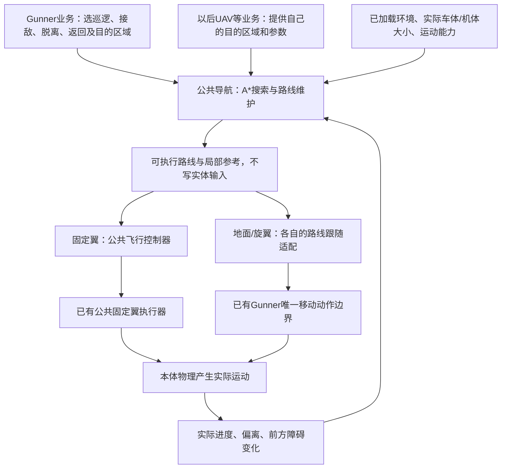

# RVP Gunner 通用 A* 寻路设计计划（2026-11-02）

状态：**方案文档，尚未实现A*代码。本次只核对现状并制定方案；当前Gunner与公共飞控行为、代码开关均未改变。**

关联：[Gunner固定翼行为与公共飞控接入](RVP_Gunner固定翼行为梳理与双逻辑改进计划_20261102.md#gunner-shared-flight)、[通用固定翼控制器与执行器](RVP通用固定翼飞行控制器与执行器设计计划_20261102.md)。

## 1. 当前究竟有没有寻路

**当前Gunner驾驶载具没有接入A*或类似的绕障路径搜索。** 已有的是“决定往哪里移动、按方向操纵、遇卡住倒车”，以及固定翼的轨迹跟随和有限地形保护；没有建立可通行空间、搜索绕行分支并生成避障路线的完整流程。

| 当前代码 | 实际在做什么 | 尚缺什么 |
| --- | --- | --- |
| `GunnerEntity.tick` | 坐在载具中时进入行为管理器；离开有效载具后清理并最终移除 | 未调用原版导航驱动车辆；继承`Mob`不能证明已使用原版寻路 |
| `RVP_BuiltinGunnerBehaviors.tickGroundEngagement`、`tickLauncherGroundDriving` | 看目标方向与距离决定前进、左右转、停车/侧移 | 没有搜索墙后通道、可通过宽度和绕行路线 |
| `tickGroundWander`、`tickStuckRecovery` | 随机大转弯、前进，位置变化太小时倒车转向脱困 | 脱困没有路径记忆，不能据此保证绕出U形障碍 |
| 旧`tickFixedWingDriving`、`tickRotaryDriving` | 直接选目标方向/高度，再写驾驶要求 | 没有绕山、绕楼、多航点搜索 |
| 新`RVP_GunnerFlightPolicy.decide` | 将巡逻/攻击/脱离/返回转成`Orbit/FlyTo/TrackPoint/HoldCourse/Takeoff` | 这些目标描述想怎么飞，不包含障碍搜索 |
| `RVP_FixedWingFlightController`、`RVP_FlightVehicleAdapter` | 跟随目标，检查脚下和两条前视方向的有限高度样本，必要时恢复速度/姿态 | 高度前视不能代替三维体积避障，也不会搜索建筑两侧通路 |

核对范围包括Gunner驾驶链、公共固定翼包、UAV入口和本体相关源码中的导航调用。项目里猫靠近载具的`getNavigation().moveTo`属于猫的原版导航；生成Gunner时的`Entity.moveTo`是设置生成位置；火力支援的`RVP_FireSupportAirstrikeRoutePlanner`是按已给投放点生成数学曲线。这三者都不是Gunner载具绕障寻路。带`Path`字样的区块加载工具也只负责加载范围。

源码入口：[`GunnerEntity`](../../src/main/java/org/ywzj/rvp/entity/gunner/GunnerEntity.java)、[`RVP_BuiltinGunnerBehaviors`](../../src/main/java/org/ywzj/rvp/entity/gunner/behavior/builtin/RVP_BuiltinGunnerBehaviors.java)、[`RVP_GunnerFlightPolicy`](../../src/main/java/org/ywzj/rvp/entity/gunner/flight/RVP_GunnerFlightPolicy.java)、[`RVP_FlightVehicleAdapter`](../../src/main/java/org/ywzj/rvp/flight/RVP_FlightVehicleAdapter.java)。

## 2. 用人话说明新增什么

新增一层**公共寻路器**：业务说“去这个区域、靠近这个目标或进入这个盘旋圈”，寻路器看已知环境，安排“先经过哪边、从哪个高度通过、在哪里转弯”。地面/飞行控制负责沿路线驾驶，执行器负责把操作写到载具。



公共导航放在`org.ywzj.rvp.navigation`，支持不同业务参数化复用，不依赖Gunner、武器或UAV任务类。Gunner保留敌我、索敌、武器射程、攻击/脱离阶段与信号/座位规则。固定翼继续使用现有公共飞控；地面与旋翼使用自己的输入合同，不把固定翼执行器强转成全载具执行器。

首版覆盖地面车与固定翼，随后补旋翼。各部分独立开关，逐项验收；不修改本体、不新增Mixin/访问器、不改载具结构模型、当前JSON或武器发射链。

## 3. 公共接口与职责

以下类型和方法名都是**拟新增设计**，不是当前已经存在的API。优先不可变Java记录与现有服务端事件调度，首版不增加通用JSON配置格式。

| 拟新增组件 | 职责 |
| --- | --- |
| `RVP_AStarSearch` | 不依赖Minecraft的搜索核心：候选队列、累计代价、估计剩余代价、父节点、分批继续和路线恢复 |
| `RVP_NavigationTypes` | 请求、能力、环境快照、路线段、进度、调整原因等公共数据 |
| `RVP_NavigationWorldSampler` | 服务端分批读取已加载区块，复制碰撞形状、承载面、未知区域与短期动态障碍 |
| `RVP_NavigationService` | 每服务器的任务队列、预算、公平调度、缓存、版本核对与自动重规划；不写运动输入 |
| 地面/固定翼/旋翼搜索适配 | 各自生成下一步可用动作，检查整个动作是否能通过；共享A*核心 |
| `RVP_NavigationFollower`及载具适配 | 按实际运动推进路线，产生局部参考；验证前方通路，处理偏离和安全等待 |
| `RVP_GunnerNavigationAdapter` | 将胜出的Gunner任务转成导航请求，关联原任务身份，提交局部参考给对应控制层 |

请求至少包含：

| 数据 | 含义与要求 |
| --- | --- |
| 载具/维度/业务身份、授权来源 | 与实际控制会话或Gunner运行态绑定，每次发布/使用结果前重验；不能靠网络传一个UUID冒充驾驶者 |
| `goalId`、`missionRevision` | 原业务目标与任务版本；目标正常移动不等于更换任务 |
| 起始位置、速度、航向、姿态 | 来自实际载具快照；不在实体原地起点上“假装已经对正” |
| `GoalRegion`目的区域 | 位置容差、允许到达方向/高度/速度；接敌可以是射程区域，不能总把敌人占据的位置当终点 |
| `VehicleEnvelope`载具体积 | 当前车体/机体及有效部件的包围体，含净空与跟随误差余量 |
| `MotionCapabilities`运动能力 | 可转方向、转弯/制动能力、坡度/台阶/支撑要求，或最低速度、倾斜/爬降限制；可按业务覆盖偏好 |
| `NavigationTuning`参数组 | 搜索范围、网格精度、预算、重规划阈值、障碍余量和软偏好；越界值修正、漏项补默认值 |

导航服务只规划和维护路线，不另行抢占运动控制权。已有有效控制者时按现有资格/会话等待；恢复资格后自动继续已保存请求。纯计算预览不得绕过真实执行授权。

## 4. A*怎样搜索，怎样保证搜出的路线可用

### 4.1 搜索核心

A*每次优先检查“走到这里花费，加上估计还剩多远”最小的候选，通常写成`f = g + h`。`g`为已经走过的代价，`h`为剩余代价的估计。基础理论见[Hart、Nilsson、Raphael原论文](https://www.cs.auckland.ac.nz/courses/compsci709s2c/resources/Mike.d/astarNilsson.pdf)。

本项目首版的设计规则：

- 路程为基础代价；额外叠加非负的转弯、倒车、陡坡、低净空及偏离原路线代价，参数可调。额外代价不能把实体占据的障碍变成可穿透区域。
- 地面用到目的区域的水平直线距离，飞行用三维直线距离作为保守估计；按所选代价单位换算。先不使用会高估的加权估计，也不宣称限预算、离散运动和后续平滑仍能得到全局最短路线。
- 方向、前后档或姿态会影响后续动作时，必须属于节点状态的一部分；不能把“位置一样但车头朝向相反”合并为一个节点。
- 记录更优代价后更新父节点；必要时允许重新展开，候选顺序用固定规则打破同分，便于同初态回放。
- 搜索状态保留到下一刻，继续扩展已有队列。达到预算只暂停计算，不丢弃业务请求。

### 4.2 检查整段动作与载具体积

“起点、终点没撞”不代表中间能通过。每条连接都检查沿途车体/机体扫过的空间，包括转弯甩出的车尾、机翼、垂直爬降以及跟随误差。采样间距随障碍精度、载具大小和曲率收紧，必要时以保守包络覆盖采样之间的空隙，不能从薄墙或拐角穿过去。

优先只读本体现有`AbstractVehicle.getOBBs()`，即随车体转动的碰撞盒，含未脱离部件；复制中心、半长和旋转数值后在RVP中变换，不能保存可变JOML对象引用或修改本体盒子。粗筛可用AABB，即轴对齐的外包盒；窄通道再用更细的盒体判断。碰撞信息缺失时取保守外包体并提示估算，不用Gunner这个乘员的体积替代整车。

地面查询使用方块碰撞形状与可承载表面，支持台阶、坡面和同一列多个高度层；桥上与桥下不能只靠一个高度图合并。飞行查询完整空间，检查楼侧、山体、悬空结构和洞顶；现有地表高度前视仍作为近端保护，不作为三维空间地图。

粗路线和路线简化均需重新核对体积与运动约束。固定翼的折线不能只用视觉平滑曲线连接，再默认曲线可飞；简化后也必须验证曲率、爬降、动态输入变化和扫过空间。

## 5. 三类载具分别怎样扩展下一步

### 5.1 地面载具

采用带航向的地表搜索：状态包含`x、z、承载面高度、车头方向、前进/倒车档`。这里是“地表加航向”的状态空间，桥上/桥下保留不同层；下一步为本车能够执行的直行、前转、后退及允许时的原地转向。

这借鉴Hybrid A*（把车辆能执行的连续运动放进离散搜索）的思想；该方法的原始汽车规划工作见[Dolgov等人的论文说明与摘要](https://ai.stanford.edu/~ddolgov/dolgov08gppSTAIR.html)。本项目的台阶、方块碰撞、载具模型和下述固定翼扩展是拟自行实现与验证的适配，不能用汽车论文代替Minecraft实机证据。

- 根据实际公开运动字段、现有控制响应和调用参数估计转向/制动能力；读取不到时采用保守值并反馈，不按机型ID维护白名单。
- 每个动作核对车宽/车高、可越台阶、坡度、侧倾、支撑范围、落差和地面连续性。只看中心点有地面会漏掉半辆车悬空。
- 轮式车不生成横移/瞬间掉头；仅能力允许时生成原地转向。水域按明确的载具能力参数处理，未确认能力时绕行。
- 终点使用可停靠区域与方向；接敌优先选武器有效距离附近的可达点，视线和射界仍由Gunner/武器层确认。
- 跟随器依实际速度和前方弯道调整期望速度，经现有移动命令输出转向、前进/制动要求；不得直接改速度或传送。制动效果需按本体实际消费顺序验证。

### 5.2 固定翼

固定翼不能悬停或在航点直角掉头。采用带位置、航向及机动状态的三维运动搜索：至少区分当前倾斜状态与爬降状态；按少量可执行的左弧、右弧、直飞、爬升/下降动作扩展。用本次规划速度作为参考，搜索中要保留维持升力和抬升机翼所需的速度余量。

协调平飞估算的转弯半径可参考`R ≈ v² / (9.8 × tan(倾斜角))`，但不能仅凭此式批准连接：实际滚转建立时间、三轴响应、当前坡度、爬降变化和误差余量也要纳入动作传播/包络验证。动作必须从当前真实姿态接出，不从一个假想已摆平的飞机起算。

具体路线规则：

1. 先尝试已验证的直达或原轨迹，通路畅通时避免不必要搜索。
2. 遇山/楼后搜索左右绕行或可实现爬升通路；高度偏好和路线长度是可调整项，实体碰撞与实际升力/转弯能力始终约束可执行段。
3. 长距离采用粗航路引导加当前窗口内的细机动搜索。粗航路只提供方向；未经已加载环境核对的远段不发布为可执行航段。
4. 到盘旋任务时，先规划入圈过程并核对整圈及转入段；圈受阻则在业务允许的范围内放大半径、抬高或调整圈位，保留原请求与实际采用值。不能只到圆心便视为入圈完成。
5. 起飞阶段单独验证滑跑与离地走廊，随后衔接空中搜索。首版不搜索机场、跑道或自动着陆。
6. 攻击接近段同时带目标方向/速度要求；绕障期间Gunner保留任务，按当前真实路径偏差限制开火，不因有路线就自动发射。

### 5.3 旋翼

使用三维空间A*，按本机悬停/侧移能力和速度上限生成连接，核对机身及旋翼的包络。悬停只在实际能力与净空允许时使用；高速转向和停住仍受减速距离约束，不能把“允许悬停”理解成瞬间停止。

路线参考交给现有旋翼业务控制与移动动作边界；固定翼`RVP_FlightExecutor`继续只服务固定翼。旋翼接入在其路线跟随与实际制动验证完成后独立开启。

## 6. 环境、动态障碍与性能

### 6.1 已知环境与区块

世界查询在服务端线程分批完成；搜索核心只读不可变快照。首版采用分刻计算，不将`ServerLevel`、实体或可变方块/模型对象交给后台线程。“后台继续”指公共调度自动持续处理，不代表创建线程访问世界。

只检查已加载区块，未知区域明确标记。现有远距载具区块租约可提供已经授权的加载范围，但导航不新建无限强加载/世界生成，不把未知格直接当可通行。接近边界时优先在已知区域安排下一段；需要新区域时保留任务，随正常加载自动推进。是否扩大远距租约属于单独的权限与预算选择，不由寻路器绕过。

快照记录实际用到的区块/区域版本与采样刻。方块放置、破坏、爆炸等Forge事件可加速局部失效；活塞、流体等未被完整事件覆盖的变化，靠即将使用的走廊逐刻复检兜住，不能假定某个事件覆盖所有世界变化。

### 6.2 动态障碍与自动重算

移动载具/实体采用短期速度预测加体积余量；近端检测不能等待完整A*结束。原路线前方受阻、实际偏离、目标显著移动、能力/外形变化时触发局部重规划。仅更新目标坐标时合并进当前任务，不每刻重开整份搜索；目标仍处于原终点区域且走廊有效时沿用路线。

局部避让、停车/已验证悬停或固定翼合法绕圈与任务搜索协作。倒车脱困只有后方通路也经过检查才采用；结束后以新实际姿态重接路线。搜索保存已访问区域、近期无进展区与旧路线，防止在U形入口、左右两条绕路间反复切换。首版不承诺解决任意多车互锁，先实现减速让行与有界等待，记录拥塞供后续扩展。

### 6.3 初始预算与调参项

以下是**待压测的起始值**，不是已经测出的服务器容量。全部允许参数化，非法标量修正；资源上限只让请求在内部等待/分批处理，不返回“请重试”。

| 项目 | 建议初值/规则 |
| --- | --- |
| 搜索与碰撞总预算 | 每服务器每刻最多展开2048节点、4096次细碰撞检查，并设约1ms软时间片；先到上限就保存进度，重操作也须分批 |
| 单任务公平份额 | 每轮先给128节点额度，轮转并对等待时间加权；紧急避障优先但不能长期饿死普通任务 |
| 活跃任务/内存 | 最多32个活跃搜索，其余保留请求排队；单任务8192节点起，快照缓存32MiB起，达到上限先输出经过验证的部分结果/调整窗口与精度，不无限增长 |
| 地面精度与范围 | 常规2格水平网格，窄通道细化到0.5～1格；初始窗口128格，按需要扩展至512格；承载面高度单独采样 |
| 固定翼精度与范围 | 以16～32格量级粗引导、有限机动段细查；航向初始24档。窗口从512格起，并至少考虑航速、转弯半径和滚转建立距离；默认范围上限2048格，超出时不强塞一个转不过去的局部弯 |
| 旋翼精度 | 初始4～8格空间网格，近障碍处细化；净空由实际包络决定 |
| 常规重规划间隔 | 地面最短4刻、飞行最短10刻；前方走廊突然失效时立即处理，不卡在普通冷却中 |
| 无变化时再搜索 | 保留请求，按1、2、4…最多40刻间隔自动检查，世界/目标/障碍变化时提前唤醒；同一静态死路不每刻重搜 |
| 碰撞/跟随余量 | 由体积、速度、制动/转弯响应和模型误差计算；业务可增大，不能靠负值穿墙 |

常规路线不每刻整图重搜。细碰撞和快照查询都有独立计数；粗层/细层数据按实际触及范围惰性建立，不先遍历完整512格立方体。时间片用来保护服务器，路线代价与节点排序不使用机器实际耗时。

## 7. “尽量而为”：搜索未完成或目标不可达时怎么办

业务请求被接受后由导航服务持续持有，直到替换、显式关闭或资格/实体失效。结果至少区分下表；这些均是进度/调整反馈，不是要求业务重新提交。

| 状态 | 行为 |
| --- | --- |
| `FOLLOWING` | 已有满足当前目标条件的路线，按实际进度跟随；仍复检近端走廊 |
| `PARTIAL` | 已搜索出可执行的一段，先执行该段并继续剩余搜索；明确尚未到达原目标 |
| `SEARCHING` | 预算暂停或等待更优连接；能沿旧的有效路线继续就继续，不能时采取当前运动类型的可用保护 |
| `WAITING_WORLD` | 缺少下一段环境信息，在已知可用区域等待/移动并自动续算 |
| `ADJUSTED_GOAL` | 原点位落在实体障碍内等情况下，提供最近可达的合适区域，说明与原请求的偏差；原任务保持可追随 |
| `HOLDING` | 当前已知空间没有可执行进展，地面减速停车、旋翼按能力停留；固定翼只采用已验证可飞的继续段/绕圈或爬升连接，并继续观察与重规划 |

部分路线必须以“可继续、可停车或可接入安全机动”的状态结束，而不是挑一个离目标最近、却会冲进死胡同的前沿节点。能否提供下一段要结合当前速度和终端制动/转弯空间；预算用尽不放宽碰撞检查来凑结果。没有足够空间的固定翼不能凭空产生安全盘旋，迫近障碍时继续尽可能恢复，并如实报告剩余风险。

可以放宽路线长度、巡航高度偏好、请求半径、到达容差或局部参考速度，采用经过能力核对的近似结果；不伪造到达、不直接改实体速度、不穿透方块。调整后的局部目标到达与原业务目标完成分别记录。原目标被静态障碍完全隔断时，保留可达区域并在相关变化后自动续算，不让业务反复重试同一个死路。

只有身份/维度/控制代次不符、实体终止，以及真实数值损坏会污染实体时禁止写入并清理；未授权申请不能靠寻路绕过已有控制规则。真正的任务取消、信号暂停和玩家接管同样立即服从业务释放规则。

## 8. Gunner怎样接入，怎样继续调用公共飞控

### 8.1 接入位置与三个阶段

```text
Gunner行为选任务候选
  → 现有仲裁选出唯一移动胜者
  → Gunner任务策略给最终目标/区域、高度、速度、约束
  → Gunner导航适配申请/更新公共导航任务
  → 公共导航给本刻可执行的路线参考，自动继续未完成搜索
  → 固定翼：公共飞控solve → 已有公共执行器execute
    地面/旋翼：对应路线跟随 → 现有唯一移动动作边界
  → 真实运动进度反馈给导航；开火仍由Gunner与原武器链检查
```

先选业务胜者再申请/消费导航任务，避免落选候选推进任务或重复占用搜索预算。地面现有接敌、发射架走位和巡逻分别提供目的区域；烟幕规避/脱困仍经过现有仲裁，普通路线让位后从新实际位置重接，不能两份命令同时写。

固定翼在现有`RVP_FlightTickService`的START顺序中增加有预算的导航更新，使“读取本刻观察 → 更新路线/局部参考 → 求解飞控 → 执行”关系明确；无需依赖两个独立监听器的偶然先后。Gunner实体更新提出的新任务仍在下一次START处理，当前有效路线持续控制。

### 8.2 固定翼不能简单轮流塞`FlyTo`

拟给公共飞行请求增加通用`FollowRoute`目标，携带已验证的局部路径参考：位置、切向方向、曲率、期望高度/速度及有效走廊。切向就是沿路线前进的方向，曲率表示这一段弯得多急。控制器据此沿曲线跟随，继续使用原速度、高度、姿态保护；执行器的三轴/油门合同保持原职责。

使用这种合同是因为单个`FlyTo`只有航点与离开方向：连续换小航点容易切角、反复掉头，也无法完整表达飞机必须沿一段圆弧通过的空间。`FollowRoute`属于所有业务可复用的路径目标，不加入Gunner专属的“攻击寻路模式”。已有`FlyTo/Orbit/TrackPoint`仍可独立使用，导航关闭时沿原语义运行。

### 8.3 任务版本与路线版本分开

当前`RVP_GunnerFlightAdapter.allowFire`要求反馈版本等于Gunner策略版本；控制器也用同一版本维持航点通过状态。新增寻路时必须将两件事分开：

| 身份/版本 | 何时变化 | 负责什么 |
| --- | --- | --- |
| `goalId + missionRevision` | Gunner更换任务阶段/导航目标 | 判断是否仍是同一业务任务，与原武器目标关联 |
| `routeRevision + segmentIndex` | 绕障重算、切换路线段 | 重置该段的通过/捕获状态，核对当前参考确已执行 |
| 控制会话`generation` | 控制权交接 | 防止旧持有者写入，与前两种版本分开 |

拟在请求、指令、反馈和公共控制状态中传递明确的`RouteBinding`（路线绑定信息）；非路线目标使用默认“无路线”绑定。Gunner任务版本在普通绕障重算时保持不变；发射侧同时核对原任务匹配、当前路线绑定已实际执行、当前原目标几何与飞行风险。绕障局部航点的方向误差很小，不能被误当作已经对准敌人，因此保留实际目标的独立方向/距离/高度检查。

### 8.4 明确终点与到位语义

进入射程区域只表示“路线已到合适区域”，不自动切为开火成功。Gunner继续决定攻击/脱离和武器是否适用；公共导航与公共飞控不选择敌人、不扣弹、不批准发射。近防弹药目标继续不改写整机导航任务。

导航状态、当前可执行路线和是否实际执行分别显示。配置/载具/维度/控制者变化、卸载或服务器停止时取消对应临时任务；不把搜索队列、方块快照或旧控制凭据写入存档。UAV既有任务持久化规则继续由UAV维护。

## 9. 新旧开关与回退

拟新增Gunner导航选项，三个独立代码开关默认均为`false`：

```java
// 拟新增常量：本计划尚未创建这些代码。
/** 地面Gunner是否使用公共A*，默认保留当前驾驶。 */
public static final boolean USE_GROUND_ASTAR_NAVIGATION = false;
/** 固定翼Gunner是否使用公共寻路，还需启用已有公共飞控业务开关。 */
public static final boolean USE_FIXED_WING_ASTAR_NAVIGATION = false;
/** 旋翼Gunner是否使用三维寻路，默认保留当前驾驶。 */
public static final boolean USE_ROTARY_WING_ASTAR_NAVIGATION = false;
```

固定翼同时保留已实现的`USE_IMPROVED_FIXED_WING_AI`：

| 固定翼新业务/公共飞控开关 | 固定翼寻路开关 | 使用路径 |
| --- | --- | --- |
| false | false或true | 完整旧固定翼行为；寻路开关不单独接管旧算法，组合不匹配只给差分提示 |
| true | false | 当前已经实现的新Gunner策略 + 公共飞控，尚无A* |
| true | true | 新Gunner策略 + 公共导航 + 公共飞控 |

地面/旋翼导航开关关闭时保留当前算法。新路径一旦接管，寻路暂缺结果时执行第7节的继续/保护流程，不在同一刻回落到旧的朝墙前进逻辑。关闭对应编译期开关、重建、重启即可回退；首版不提供运行时强切换。

## 10. 实施顺序与验收标准

| 阶段 | 工作 | 完成判据 |
| --- | --- | --- |
| 0 现状与合同 | 本文、职责、数据/版本/尽力执行规则 | 本次完成方案，未修改Java、开关、模型或JSON |
| 1 公共搜索与环境 | A*核心、不可变快照、体积碰撞、分刻预算、生命周期 | 小图与基准最短路一致；预算中断后可继续；未知区块不被当空地 |
| 2 地面接入 | 承载面/航向/倒车连接、车体碰撞与跟随、三个地面业务入口 | 宽车绕窄门、U形障碍、桥上下、台阶/落差、可用倒车与让行；旧模式输出保持原样 |
| 3 固定翼接入 | 三维机动搜索、可接出的姿态、FollowRoute与RouteBinding、START衔接 | 绕山/楼、转弯与机翼净空、入圈/整圈、无悬停、任务版本不串用、绕障时开火判断正确 |
| 4 旋翼接入 | 三维净空、减速/悬停、旋翼执行适配 | 悬空障碍、洞顶、地形、旋翼包络与高速停住符合实际能力 |
| 5 回归与实机 | 全量构建、同场景新旧对照、多车预算及生命周期 | 分别提供自动测试和实机证据后再决定默认开启范围 |

必要测试应覆盖：

- **搜索与合同**：同位置不同朝向、代价改善后重新展开、目标区域、不可达最近区域、部分路径与原目标完成分离、连续限预算搜索、公平队列、旧结果晚到、世界变化重算。
- **碰撞与地表**：窄于车宽的门、对角夹角、半砖/台阶、桥上/桥下、车身部分悬空、液体、薄墙、转弯车尾和机翼扫过障碍。只校验端点的实现必须被用例揭穿。
- **跟随与尽力执行**：目标移动、U形陷阱、偏离、暂缺快照、预算耗尽、拥塞、无人续发目标；无需业务重试仍继续，边界前能够制动或接入已验证机动。
- **固定翼**：不同速度/坡度/爬降初态、转弯半径与滚转建立距离、真实飞控执行误差、连续至少120秒的绕障/入圈；不能仅验证数学折线不碰撞。
- **业务与权限**：巡逻/接敌/返回/SEAD、任务版本与路线版本、近防目标不改导航、绕障局部切线不冒充瞄准、换司机/信号暂停/卸载/重启、原武器与功能键保留。
- **资源与回退**：1/8/32架活动载具与排队请求，记录每刻耗时、展开/碰撞次数、内存、最久等待和近端检查期限；关闭开关后不申请新导航任务、不出现双写。

实施时仍按仓库JDK17环境运行完整`./gradlew build`；实机目录按`agents.md`，载具数据只以项目根`limitless_vehicle/`为准。本次仅文档核对链接/边界，不运行构建，也不把已有公共飞控的1243项通过记录算作尚未实现A*的验证。

## 11. 当前方案的边界

优先完成“已知局部环境中绕障并持续执行”，后续再评估全地图预建路网、全量道路导航、破障开路、机场操作、精确攻击航线和多车协同通行。搜索能否找到连接、控制器能否实际跟上、业务是否完成要分开验收；任何阶段都不承诺任意初始速度、极窄空间或突然出现的障碍必定能救回。

后续实现的公共字段、默认值、降级/等待条件和实际性能都需同步本文；涉及`RVP_*Data`时另按项目字段JavaDoc规范说明单位、默认值与生效条件。只有方案明确实施后才新增Java类和测试。
