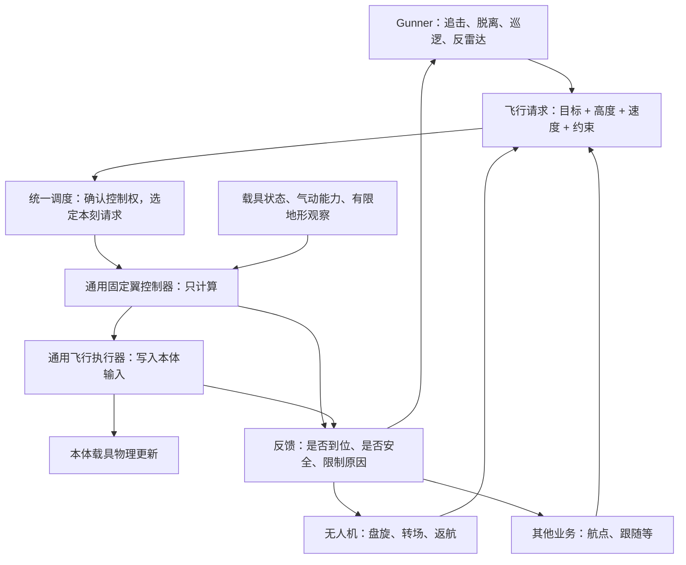

# RVP 通用固定翼飞行控制器与执行器设计计划（2026-11-02）

状态：**公共组件及Gunner/UAV固定翼接入、公共层“尽量而为”执行已实现；交付默认关闭两个新路径开关，验证记录见第11节。**

本计划承接 [Gunner 固定翼行为梳理与双逻辑改进计划](RVP_Gunner固定翼行为梳理与双逻辑改进计划_20261102.md)。原文第 1～4 节继续记录当前代码行为；本文作为后续**公共飞行能力的设计依据**，原文第 5～9 节作为 Gunner 接入方案。

## 1. 用人话说明这次要建什么

建立两个可复用的公共组件：

1. **通用固定翼飞行控制器 `RVP_FixedWingFlightController`**：接收“想去哪、想多高多快、允许怎样转弯”和飞机当前状态，计算这一刻应该给多少油门、怎样抬头低头和倾斜机翼。
2. **通用飞行执行器 `RVP_FlightExecutor`**：接收算好的指令，核对当前控制权，再把它正确写成本体载具能够消费的输入，处理符号、输入增量补偿、退出清理等细节。

Gunner、无人机盘旋、返航、编队跟随等业务都可以用参数调用同一套能力。业务方负责“为什么飞、去哪、什么时候换任务”，控制器负责“怎么飞”，执行器负责“确实把操作交给飞机”。

**公共层采用“尽量而为”合同：能修正就修正，能执行一部分就先执行，暂时缺信息就稳飞并自动继续。除了身份/实体终止和会写坏实体数值的致命问题，不把“无法执行，请重试”退给业务方。** 反馈说明实际做了什么、哪里作了调整；“输入已写入”仍不等于飞机已经到达目标。

这里的“通用”首先指**业务通用、参数可变**。首版控制器面向本体 `FixedWingVehicle`，执行器先提供固定翼实现；旋翼、地面车和弹体不是首版的可用后端。后端就是“最终适配哪一类载具的实现”，以后如需支持旋翼，再增加对应的控制计算和适配，不能把固定翼杆量直接写给直升机。

当前公共飞控沿业务给定的目标/轨迹驾驶，地形前视用于近端保护；尚无A*绕山、绕楼的路径搜索。新增导航层及拟扩展的`FollowRoute`路径目标、任务/路线版本合同见 [Gunner通用A*寻路设计计划](RVP_Gunner通用AStar寻路设计计划_20261102.md)。寻路层负责选通路，公共控制器/执行器继续负责跟随与实际操纵；该扩展目前只有方案。

## 2. 职责、依赖与代码位置



| 层次 | 负责什么 | 留给谁处理 |
| --- | --- | --- |
| 业务方 | 选任务目标、生成航点/盘旋圈、攻击与脱离阶段、任务超时、返航参考点、武器和信号规则 | 怎样把高度差变成操纵量交给控制器；本体字段写入交给执行器 |
| 控制器 | 航向/位置/圆轨迹跟随，速度、高度、姿态控制，可行性估算，避地与低速恢复，返回计算结果和下一份控制状态 | 敌我、开火、补弹、雷达、UAV 母子关系、玩家座位、任务持久化由业务方维护 |
| 执行器 | 校验授权，以当前实际步长翻译指令，尽量执行可用的运动/部件动作，保留未接管的功能字段，释放自己持有的控制 | 不重新选择路线、不索敌、不开火，也不自带另一套高度或速度算法 |
| 薄调度层 | 同一物理刻先收集请求、选定控制者，再读取观察、计算并执行一次；保存控制会话和反馈 | 不判断作战战术，不以“后写覆盖前写”解决冲突 |

公共组件放在 `org.ywzj.rvp.flight`，不能放在 `entity.gunner` 或 `uav` 之下。公共数据、计算和执行代码不依赖 `GunnerEntity`、`GunnerProfile`、`RVP_UavLoiterManager` 或任何客户端专属类型；由对应业务的适配代码把自己的数据转换为公共输入。

两个公共服务之外，可有一个很薄的 `RVP_FlightTickService` 处理服务端时序和会话；输入、输出和参数优先用不可变记录组织，可按职责合并为内部类型，不要求每个名称都新建一个文件。下文已按实现接口修订；公共记录集中在 `RVP_FlightTypes`，目标/高度/速度/限制集中在 `RVP_FlightRequest`。

## 3. 公共控制器的输入与输出

### 3.1 调用形式

已实现的计算入口为：

```text
RVP_FixedWingFlightController.solve(
    observation,       本刻飞机和地形的只读快照
    airframe,          本机型当前可用的气动/操纵能力
    request,           业务传入的飞行目标、速度、高度和约束
    tuning,            控制算法参数
    previousState      此控制会话上次成功执行后保留的计算状态
) → RVP_FlightTypes.Solution(command, feedback, nextState)
```

这是纯计算：不读写实体、不查世界、不修改 `previousState`、不操作武器，也不注册全局状态。相同输入产生相同结果，便于回放与数值验证。地形查询和本体字段读取由调度层的只读观察适配器完成。

`nextState` 只是候选状态；只有执行器成功写入后才提交。等待控制权或本刻未写入时，不偷偷推进控制状态；请求变陈旧后仍可按新观察执行，实际写入后照常推进。业务任务阶段另归业务维护，例如“反雷达飞离结束”不能藏在公共控制器的累计状态中。

### 3.2 数据分组

| 公共数据 | 主要字段 | 来源与含义 |
| --- | --- | --- |
| `RVP_FlightTypes.Observation` | 载具 UUID/维度、物理刻编号、位置、完整速度、姿态和右倾角变化率、当前油门、地面接触、脚下/前方地形样本及其有效性 | 只读观察适配器生成；完整速度与水平速度分开，未知地形明确标记 |
| `RVP_FlightTypes.Airframe` | 质量、推力/加力能力、阻力与升力参数、迎角范围、当前高度下的空气影响、各轴响应、输入步长、可用部件 | 从本体当前数据和实际可用状态读取；不维护机型 ID 白名单；不能把损坏后的能力仍按完好状态使用 |
| `RVP_FlightRequest` | 逻辑目标标识、版本、目标类型、位置/速度样本时间、高度要求、速度要求、业务约束 | 业务方提供；位置等每刻刷新不等于重开任务，真正换目标/阶段才更新逻辑版本 |
| `RVP_FlightTuning` | 各控制环节增益、误差容许区间、变化速率、前视时间、恢复余量与稳定等待时间 | 公共默认值加业务明确覆盖；和业务任务超时、武器冷却分开 |
| `RVP_FlightTypes.State` | 上次已执行的杆量、位置、转弯选择、捕获/恢复状态、上次物理刻、首次执行时的缺省航向/高度；首版采用比例/变化率控制，不设积分累计 | 按控制会话隔离；不保存目标实体或世界强引用 |
| `RVP_FlightTypes.Solution` | 本刻指令、反馈、候选下一状态 | 调度每刻重算；直接执行旧语义指令时仍按当前步长重新翻译，不重放旧补偿值 |

### 3.3 单位与方向必须统一

- 对外位置使用游戏世界坐标，距离为格；速度使用格/秒，现有 `getDeltaMovement()` 的格/tick 在观察边界统一乘 20。逻辑时间按服务器 tick，正常一刻 0.05 秒，不用实际耗时替代游戏时间。
- 航向遵循 Minecraft：`0°` 朝南、`90°` 朝西；角差按最短方向归一到 `[-180°, 180°)`。目标正后方时必须稳定选择转弯侧，不能因左右误差接近零而不转。
- 公共语义约定：抬头角为正、右侧机翼下倾角为正；标准化操纵量 `pitch/yaw/roll` 均为 `[-1, 1]`，分别正值表示抬头、右转、右倾。与本体字段不同的符号只在执行适配处转换一次。
- 油门为明确的百分比指令；普通区间 `0～100%`，加力上限由本机能力和允许加力的参数共同限制。`0` 是明确收油，不能拿来表示“未填写”。
- 目标高度带类型：世界 Y、AGL（离地高度），或 `Altitude.current()`（保持本目标首次执行时高度）。省略高度也采用后者。地面高度未知时不能把 AGL 当世界 Y，也不能当成地面为零。
- 高度约束、爬升率、角度、角速度分别标注格、格/秒、度、度/秒。实现时每个公共字段写清中文含义、单位、默认/必填和生效条件。

## 4. 业务可参数化的目标与约束

### 4.1 通用目标类型

使用明确的目标类型表达意图，不用一个装满可空字段的 Map，也不用 `isCombat`、`isUav` 之类业务布尔值。

| 目标 | 业务传什么 | 控制器做什么 |
| --- | --- | --- |
| `Stabilize` 缺省稳飞 | 可只传高度/速度/部件动作，省略导航目标 | 保持本目标首次执行时航向；缺省高度同样保持首次执行高度，不随漂移重新设定 |
| `HoldCourse` 保持航向 | 航向、目标高度/速度 | 稳住这条航向，处理安全约束；不自动朝 `0°` |
| `FlyTo` 飞向航点 | 航点、通过容许距离、通过后的期望方向 | 进入可飞的接近路线；到达后报告完成，并沿离开方向继续稳定飞行，不在航点悬停或反复掉头 |
| `Orbit` 绕圈 | 圆心、请求半径、左右方向、圆心移动样本 | 计算进入圆的路线和可行半径，捕获后绕圈；保持用户请求半径与实际可行半径分开 |
| `TrackPoint` 跟随运动参考点 | 参考点位置/速度、期望间隔、有限预测时间 | 跟随业务已选定的参考点；不读取敌方实体、不自行做弹道瞄准或选择攻击目标 |
| `Takeoff` 起飞 | 已确认的滑跑方向、爬升高度/速度要求 | 按地面速度、离地和稳定爬升条件推进通用起飞控制；业务提供可用起飞场景，首版不找跑道、不自动着陆 |

安全恢复是控制器对上述目标的保护过程，业务不能用另一种目标类型绕过它。攻击、脱离、返航和编队是业务对这些通用目标的组合；公共目标枚举中不增加 `SEAD_ATTACK`、`GUNNER_PATROL` 或某一武器专属模式。

### 4.2 参数组与覆盖规则

| 参数组 | 建议参数 | 默认/覆盖原则 |
| --- | --- | --- |
| 高度 | 目标类型和值、业务高度范围、最小地形净空、允许爬升/下降速度 | 省略/非有限高度时保持首次执行高度；使用世界 Y 时仍检查净空；业务上限与避地冲突时优先避地并说明调整 |
| 速度 | 指定速度，或按本机最低可飞速度乘安全余量；允许速度范围、允许加力 | 二选一指定目标；默认不启用加力。最低可飞速度是估算，保留余量，不能当绝对安全证明 |
| 转弯/姿态 | 业务最大倾斜角、爬升/下降角、转向变化速率 | 业务可要求更温和；最终还受本机能力、低速和安全约束限制 |
| 航路捕获 | 航点通过距离、航向/高度/速度容差、捕获稳定时间 | 通过工厂默认值构造，允许覆盖；“已到位”要求连续满足，不能只靠计时强行宣告 |
| 控制算法 | 航向/倾斜/高度/升降速度/速度增益、输入变化速率、累计误差上限 | 按组提供命名参数与经验证的公共预设；首版不让调用方传自定义写载具回调 |
| 地形与恢复 | 有限前视秒数、采样数量上限、最低净空、低速余量、恢复退出稳定时间 | 有服务端预算上限；未知地形保守处理，业务不能关闭硬安全边界来强行追击 |
| 执行方式 | 接管申请、请求新鲜窗口、失去目标后的处理、起落架/减速板的可选指令 | 控制权通过服务端授权申请；占用时内部排队；未配置部件指令用 `KEEP`；窗口自动修正为1～20刻，常用3刻，到期仍持续执行 |

参数分三层合成：**本机能力与数值边界 → 公共默认值 → 业务请求覆盖**。业务覆盖改变任务速度、目标和控制风格；超过能力时取尽可能接近的可执行结果，不凭空增加推力或升力。恢复可暂时放宽业务高度/路线偏好，继续保留原目标供条件恢复后追随。

构造时自动修正业务参数：负距离取幅值，越界标量取最近边界，非有限调参补默认值，上下限填反自动交换。缺少/无效目标坐标改为稳飞，缺失速度/限制/部件动作分别补安全巡航、默认限制和 `KEEP`；缺失航向保持实际航向。构造后的不可变请求可读取实际采用值；控制器不会反写原 JSON，也不会反写请求中的半径。

任务目标是否丢失、是否更换目标、是否该返航，仍由业务方决定；公共请求只携带时效、逻辑标识和已解析的目标数据。

### 4.3 参数化调用示意

下面使用已实现的构造器和会话入口；`center`、业务UUID/版本及已获授权的会话由具体业务提供。数值示例用于说明不同业务传参，不替代各机型实机调参。

```java
import org.ywzj.rvp.flight.RVP_FlightRequest;
import org.ywzj.rvp.flight.RVP_FlightRequest.*;
import org.ywzj.rvp.flight.RVP_FlightTuning;

// 无人机业务提供公共Vector圆心；200格请求半径，+1为右盘旋。
var loiterRequest = new RVP_FlightRequest(loiterGoalId, planRevision,
    new Orbit(center, 200.0, 1), Altitude.agl(180.0), Speed.safeCruise(1.25),
    Limits.cruiseDefaults().withMaxBankDeg(30.0));
// 只提交意图；统一调度在物理更新前调用同一个公共控制器与执行器。
loiterSession.submit(loiterRequest, RVP_FlightTuning.smoothCruise(), 3);

// Gunner自行算接近航点和离开航向，给出更积极的转弯约束。
var approachRequest = new RVP_FlightRequest(engagementGoalId, phaseRevision,
    new FlyTo(approachPoint, 25.0, exitHeadingDeg), Altitude.worldY(approachY),
    Speed.safeCruise(1.45), Limits.cruiseDefaults().withMaxBankDeg(45.0));
// 会话由RVP_FlightTickService.acquire按服务端业务资格取得，不能从网络传入伪造。
gunnerSession.submit(approachRequest, RVP_FlightTuning.responsiveFlight(), 3);
```

`safeCruise(1.25)` 表示按本机估算最低可飞速度乘 1.25，并继续受安全范围限制；它不是固定的 1.25 格/秒。`withMaxBankDeg(30)` 是最大倾斜角，不是每刻强制倾斜 30°。`3` 表示请求的新鲜窗口，持续更新能反映运动目标变化；到期会提示陈旧并继续执行，越界窗口自动修正。预设名只提供可覆盖的参数，不在算法里对应不同业务分支。

业务正常使用会话入口；测试或预览规划可以直接调用控制器 `solve`，不会真的动飞机。业务方不得拿预览结果绕过会话授权去执行，也不得一边提交请求一边自行写三轴输入。

### 4.4 “尽量执行”的具体规则

| 情况 | 公共层实际处理 | 业务是否需要重试 |
| --- | --- | --- |
| 半径太小、速度过低、高度与净空冲突 | 放大有效半径、采用可飞速度、优先避地，仍保留并继续追随原目标 | 否，反馈给出偏差/原因 |
| 参数越界、上下限颠倒、漏填参数 | 限幅、交换区间、补默认值；没有可靠导航坐标则保持航向，仍执行高度/速度/部件要求 | 否，可读取构造后的采用值 |
| 请求未续发或目标样本陈旧 | 按本刻真实观察持续执行最后接受的目标；运动外推最多3秒，不无限外推 | 否；业务如要终止须显式关闭或撤销资格 |
| 另一业务正在控制 | 返回可保存请求的等待会话，按申请顺序在交还后自动接管 | 否，不抢写当前持有者 |
| 起落架/减速板不存在 | 只跳过缺失部件，照常写三轴和油门 | 否，结果为修正后已执行 |
| 地形查询失败、区块未加载 | 降级为未知地形观察，保守限制下降，继续导航；不强制加载区块 | 否，每刻自动重新观察 |
| 气动参数暂时无法读取 | 沿用上次机体参数；首次缺失使用保守估算，继续读取实际能力 | 否，反馈标明估算 |
| 端口暂时异常 | 尽量清运动残留，保留会话与原目标，下一刻内部自动继续 | 否，`CONTINUING` 表示已接受并在内部继续 |
| 同刻重复调用、旧提交晚到 | 同刻幂等（重复调用只产生一次写入）；旧时间/旧版本提交被接受但忽略，不覆盖新目标 | 否 |
| 身份/维度/代次不匹配、资格撤销、实体终止、真实位置/速度/姿态或本体步长会污染数值 | 禁止写入并关闭相应控制；这些属于必须保留的致命/身份边界 | 不以反复申请绕过边界 |

这里的“尽量”保证持续尝试和可用部分的执行，不能保证没有推力的飞机仍能爬升、受阻飞机必定避撞或任意机型都达到同一轨迹精度。

## 5. 控制器的计算过程与反馈

计算顺序建议为：

1. 校验观察与请求的新鲜度，合成本机能力、公共参数和业务约束。
2. 按目标类型解算期望航向/轨迹、高度、速度；计算可行的转弯半径与倾斜角。
3. 检查脚下和未来有限航迹的地形净空、速度余量与姿态风险；必要时转为恢复控制。
4. 根据实际升降/转动趋势算出三个轴的操纵量和下一刻油门，施加输入变化速率限制，避免突变。
5. 返回指令、可行性/到位/风险反馈及候选下一状态。

高度先影响期望爬升速度，再根据实际爬升速度修正操纵；航向先影响期望转弯，再根据实际机翼倾斜修正。这样构成闭环，即“看实际效果再调整”，而不是只凭位置差一直打满杆。累计误差要限幅，指令受限或长时间未执行时不能继续越积越大。

低速时减小急转并恢复合适姿态；是否允许低头加速，须检查地形余量。低空快速下坠时优先避地，但升力不足时也不能无限猛抬头。条件冲突时返回明确限制，不承诺任何初始状态都能救回。

公共反馈包含 `TRACKING`（跟随中）、`CAPTURED/REACHED`（稳定到位/已通过航点）、`RECOVERING`（恢复中）、`LIMITED`（已按能力调整并继续执行）、`WAITING`（目标已保存、等待交接）和原因码；另含高度/速度/方向误差、请求与实际可行半径、目标逻辑版本及物理刻。`LIMITED` 不是拒绝；多个调整原因可用分号拼接。

**公共结果不包含 `allowFire`、武器 ID 或攻击阶段。** Gunner 将“本刻已执行且目标版本匹配的公共反馈”与自己的武器范围、瞄准、锁定和阶段条件合成开火许可；无人机可据此显示是否入圈，返航业务可据此决定是否换下一航点。禁止把 `CAPTURED` 理解为任何业务都已完成。

## 6. 通用执行器怎样真正操作飞机

### 6.1 指令合同

`RVP_FlightTypes.Command` 包含载具/维度、会话代次、目标版本、物理刻、标准化的 `pitch/yaw/roll`、明确的油门百分比，以及可选起落架/减速板指令。可选部件采用 `KEEP/ON/OFF`，不能把默认 `false` 当成“未指定”。

动作入口表达为：

```text
RVP_FlightExecutor.execute(port, command)
  → RVP_FlightExecutor.Result
```

只由统一调度构造真实载具 `port` 并调用动作入口；真实适配器在公共包内部，业务方只持有 `RVP_FlightTickService.Session`。执行端口封装本次接管凭据和本体能力，每次写入前重验载具、控制者身份/接管资格和代次。指令来源刻不一致时按当前实际步长重新翻译并记入当前消费刻；不拿旧补偿值直接重放。部件动作随请求传入，新鲜窗口随submit传入。

首版执行器适配固定翼连续操纵指令；参数组合尽量修正后执行。不提供任意 `Consumer<Vehicle>` 回调，也不开放“跳过授权/强制写入”参数。其他类型载具不属于当前适配合同。

### 6.2 本体输入适配

- 将公共“抬头/右转/右倾为正”的语义换成本体真实符号。调用公开三轴 setter 时，对本体稍后叠加的 `inputStep`（每刻的键盘输入增量）做预补偿，并设置配套输入，防止自动鼠标目标操纵覆盖连续控制结果。
- 地面偏航键还会触发本体地面转向，需要独立适配，不能机械照抄空中“固定按某一方向键”的办法。零偏航时保留本体基于气流的尾舵回正。
- 首版计划使用公开 `setThrottleLevel` 写入控制器已平滑计算的本刻油门，并将本组件的加/减油门键都置空，避免本体随后额外加减 5%。变化速率由控制器参数控制，执行器只做能力限幅，不另跑一个速度控制算法。
- 每刻完整填写自己接管的运动字段；保留 `functionalUp/Down/Left/Right` 等武器/功能操作。未经明确指令，不操作发动机、燃料、弹药或部件开关。缺少起落架/减速板时跳过该部件并返回修正执行，保留其余运动操作。
- 执行器不传送、不直接改速度/姿态、不施加额外升力，实际运动继续由本体物理更新产生。

现有本体已有公开油门与三轴 setter，现有 UAV 也已有连续输入补偿实现，因此本方案优先使用组合与 Forge tick 调度，不需要新增 Mixin 或修改本体。

### 6.3 执行结果与释放

结果区分 `APPLIED`（输入已写入）、`APPLIED_ADJUSTED`（修正后已写入）、`ALREADY_APPLIED`（同刻已写过，重复调用已接受）、`WAITING_FOR_CONTROL`（已保存、等待交接）、`CONTINUING`（暂时异常，内部自动继续）。`Result.applied()` 确认本次真实写入，`accepted()` 还包含等待、内部继续和幂等重复；都不等于飞机已经抵达。致命结果仅保留 `NOT_OWNER`、`INVALID_INPUT`（真实数值会污染实体）、`VEHICLE_UNAVAILABLE`。

请求变陈旧但资格仍有效时，按新观察继续原目标，附加 `REQUEST_STALE_CONTINUING`；没有20刻关闭倒计时。`RVP_FlightExecution` 负责同刻降级观察、缓存机体估算、计算失败时尝试稳飞，以及端口暂时异常后的逐刻继续。只有身份/实体终止和真实数值污染才交还；不能重放旧补偿或推进未执行的控制状态。

释放只能清理**当前代次仍由自己持有**的控制：清除自动飞行设置的方向键和连续轴残留，设置明确的当前参考角，保留功能操作；油门默认保留当时值，若业务要求收油须显式安排。不能拿全零目标角作为通用“停车”，也不能许诺清输入后飞机立即停住。无人驾驶后本体自身的默认行为仍可能接管。

旧持有者延迟到达的释放请求，不能清掉新持有者的输入。玩家明确接管、原操作者离座或实体失效时立即撤销本会话，不再擅自进入一段自动飞行。

## 7. 控制权、时序和状态寿命

### 7.1 一架飞机只有一个运动写入者

业务经自己的服务端规则确认有资格后，申请控制会话；公共调度保留可重验的授权来源。Gunner 适配器负责司机身份，UAV 适配器负责已有自动盘旋/信号/接管规则，公共层不通过业务类名或字符串猜权限。

同业务中的普通追击与 SEAD 先由该业务选出一份最终请求，再提交公共层。不同业务争用同一架飞机时，后申请者获得等待会话，可立即保存目标；当前业务交还后按顺序自动接管。`valid()` 包含仍获授权的等待会话，`active()` 表示已轮到实际操纵。不能让两个业务轮流写，也不允许靠调用方自填极高优先级抢驾驶权。

### 7.2 固定在本体物理更新前执行

现有 Gunner 在实体 tick 中运行；现有 UAV 在 `ServerTickEvent.START` 中直接写入。公共执行不能简单沿用各业务自己的时机，否则会出现某次输入已被消费、某次还未消费的差别。

新模式统一由 `RVP_FlightTickService` 在服务器 START 阶段组织：**收集业务已发布请求 → 选定会话 → 读取本刻观察 → 控制器计算 → 执行器写入 → 本体实体物理更新**。业务准备回调由该入口明确先调用后提交，不依赖多个 Forge 事件监听器的隐式先后顺序。

Gunner 实体 tick 中新产生的目标/阶段请求，最早在下一次 START 生效，正常情况下延迟约一刻；目标运动样本带时间，可作有上限的外推。当前刻已生效的驾驶保持连续，不再在 SEAD 触发时清空控制等待接管。若切换目标/阶段尚未取得匹配反馈，驾驶员武器许可先保持关闭。

UAV 后续接入时，把原 START 中的业务准备接入统一入口，并停止原固定翼直接写入路径；旋翼原路径保持独立。对还使用旧 Gunner 写入路径的载具不授予公共自动控制会话，除非原写入者先明确退出；不能出现“新服务在 START 写完，旧实体逻辑又覆盖”。

Gunner接入时还要处理行为管理器的 `kernel_stop` 默认命令及旧动作清理入口：已有有效公共会话时，不得再按“没有旧移动命令”写入全零目标角；失去公共会话时统一执行交还规则。该判断只作用于新分支，旧分支照旧。

每份指令绑定载具 UUID/维度与会话代次，同代次同一当前物理刻最多消费一次。重复 tick 调用不重复推动状态；不直接重放上一刻的输入补偿值。服务器暂停或实体跳刻恢复时按新观察重新算，长间隔重新捕获，不拿实际经过的几十秒一次性积分。

### 7.3 会话与请求分别有寿命

会话身份按服务器实例、维度、载具 UUID、持有者与代次隔离。请求还有单独的新鲜窗口和目标样本时间；窗口不再控制会话寿命。稳定重复提交同一逻辑目标保留控制平滑，换目标/任务版本后重新判断捕获状态。

意图变陈旧而资格仍有效时，继续最后接受的目标，运动样本只作有上限的外推；反馈提示业务数据陈旧，公共层仍逐刻尝试。明确关闭、信号暂停、玩家接管或资格失效立即释放，不由“尽量执行”擅自恢复已撤销的自动飞行。

换车、维度、持有者、配置代次、卸载、死亡和服务器停止时清理临时控制状态。持久任务由业务方保存：例如 UAV 保留原盘旋计划，重新加载后验证资格并重新申请会话；不把旧控制凭据或累计误差写进存档继续用。

## 8. 现有业务怎样接入

| 业务 | 自己继续负责 | 转成什么公共请求 | 如何使用反馈 |
| --- | --- | --- | --- |
| Gunner 普通飞行 | home、索敌、攻击/脱离阶段、武器适用性 | 起飞用Takeoff，巡逻用Orbit，接近/攻击用TrackPoint，脱离用HoldCourse，返回用FlyTo | 结合本刻已执行且版本匹配的反馈与武器规则产生驾驶员开火许可；受限/恢复时继续驾驶并禁射 |
| Gunner SEAD | 雷达源、反制、报复阶段、AntiRadiation 发射链 | 用同一 Gunner 会话发布远离或接近雷达源的目标与约束 | 确认实际生效版本，再执行自己的反击门控；没有独立三轴写入 |
| UAV 固定翼盘旋 | 圆心/跟随母车、信号、玩家控制切换、任务存档和地图同步 | Orbit 加明确高度/速度/倾斜限制，转场用 FlyTo | 显示请求/有效半径、入圈和恢复状态；通用层不保存母子关系 |
| 后续航点/返航/跟随 | 航点顺序、返回位置、跟随对象和间隔 | FlyTo/TrackPoint 的参数组合 | 抵达或受限后由业务决定下一任务 |

Gunner 和 UAV 都不直接调用对方的业务服务。已存在于 `RVP_UavLoiterGuidance` 的气动/操纵计算，在迁入公共层时去掉对 `RVP_LoiterConfig.LOITER_BANK` 等业务常量的依赖，改用参数；提取后由适配入口转调公共实现，避免保留两份公式。

上述合并针对新路径；为满足新旧对照，旧分支可以保留原算法。不能为消除重复而擅自改变旧模式。旧计算如要转调公共方法，必须先证明默认参数下输出等价，否则保留到相应业务独立迁移。

迁移必须分批：先完成公共能力，再让 Gunner 新分支接入；UAV 是第二个验证通用性的调用方，接入另列明确步骤和回归条件。公共组件的设计不能变成“只改 Gunner，UAV 以后再复制一套”。

### 8.1 Gunner实际如何调用这两个公共组件

Gunner使用 `RVP_FlightTickService.Session`（经授权、可跨刻复用的控制会话）提交任务；公共服务在下一刻开始时替它调用控制器与执行器。当前链路为：

```text
Gunner行为提出普通/SEAD任务候选
  → 行为管理器选出本刻唯一移动胜者
  → RVP_GunnerMovementActions.apply
  → RVP_GunnerFlightAdapter：申请/复用会话，读取业务观察与武器能力
  → RVP_GunnerFlightPolicy.decide：任务阶段转为目标、高度、速度和限制
  → session.submit(request, RVP_FlightTuning.responsiveFlight(), 3)
  → 下一刻START，RVP_FlightTickService读取新的飞机/机体/地形观察
  → RVP_FlightExecution调用公共控制器solve，再调用公共执行器execute
  → RVP_FlightVehicleAdapter写入本体输入，本体物理产生实际运动
  → Gunner读取执行结果与反馈，经allowFire判断后进入原武器链
```

这里的3是请求新鲜窗口，过后仍继续目标；`submit`被接受与本刻操纵已写入分别检查。普通任务与SEAD共用一个Gunner会话，Gunner任务状态在请求被接受后保存，公共控制状态在真实写入后保存。公共层按“尽量而为”修正并持续执行；是否准许开火由Gunner结合本刻、目标版本、姿态/高度误差和原武器规则决定。

完整的生效条件、逐阶段目标表、Profile到公共参数的映射、实际提交代码、两刻时序和开火/释放规则，见 [Gunner接入说明第7.6节](RVP_Gunner固定翼行为梳理与双逻辑改进计划_20261102.md#gunner-shared-flight)。该节按现有源码解释实现，两个业务的新路径开关仍默认关闭。

## 9. 新旧逻辑开关与实施顺序

继续保留 Gunner 的 `USE_IMPROVED_FIXED_WING_AI=false` 代码开关。`false` 完整走当前路径，不申请公共会话、不触发新操纵写入；`true` 才由 Gunner 适配器调用公共能力。改值后重新构建、重启。

该开关归 Gunner 接入层，不放进通用控制器的计算分支。公共控制器不带“旧 Gunner 模式”。UAV 后续接入设置自己的代码开关，独立对照；两种开关控制业务路由，一架载具仍只允许一个写入者。

| 阶段 | 工作 | 通过条件 |
| --- | --- | --- |
| 0. 文档 | 确认公共合同、单位、参数、执行时机、调用示例与回退边界 | 已完成，本文已同步实际接口 |
| 1. 公共数据与计算 | 在 `flight` 建只读快照、目标、参数和控制器，提取可复用数学计算 | 相同输入可回放；不同参数确实改变目标/响应；不存在 Gunner/UAV 业务类依赖 |
| 2. 公共实际执行 | 固定翼执行适配、授权会话、统一时序、结果和释放清理 | 油门不被本体二次增减、三轴符号与补偿正确、功能输入保留、每机每刻只写一次 |
| 3. Gunner 新分支 | 旧开关、业务目标构造、普通/SEAD同会话、反馈与武器许可 | 旧模式可对照；新模式稳飞、巡逻回航、接近脱离连续，武器条件留在业务层 |
| 4. UAV 固定翼接入 | 独立开关、Orbit参数映射、停用原固定翼写入、保留已有业务与存档 | 第二个业务能通过公共参数接入，不改控制器业务分支；旋翼与玩家原流程回归通过 |
| 5. 回归交付 | 连续计算、真实实体、多人/信号/卸载和性能验证 | 分别记录自动测试和实机证据，再决定各业务默认开关 |

新增代码全部在 RVP，使用本体现有公开接口；不修改结构模型、不改本体源码、不新增 Mixin/注入点、不用武器或机型 ID 特判。现有 `ControlUnitMixin` 的原运动包守卫只增加公共会话的只读锁定查询，仍保留原操作者校验和功能输入转发，没有新增目标或注入位置。参数首先是强类型 Java 调用合同，暂不额外添加通用 JSON schema、旧键别名或迁移逻辑；需要数据化时再补当前 schema 的正式数据字段说明。

## 10. 验证与文档同步要求

| 验证面 | 核心检查 |
| --- | --- |
| 依赖边界 | 公共控制器不读实体/世界、不出现业务类型、武器开火字段和业务配置常量；执行器是新模式的唯一运动字段写入口 |
| 参数效果 | 同一初态下分别改变速度、高度、转弯限制、控制平滑和半径，结果按合同变化；默认预设可覆盖，实际半径不会反写请求半径；静止TrackPoint带间隔时转为同半径要求的绕圈，固定翼不悬停 |
| 输入合同 | 单位换算、方向、±180°、正后方、NaN/无穷、缺失/矛盾高度、无效样本、不支持后端和部件动作 |
| 控制连续性 | 不同本体气动参数下至少120秒的平飞、转弯、捕获、低速/快速下降恢复；最终计算能力受限时报告原因 |
| 执行消费 | 真实本体顺序下三轴补偿、地面转向、零偏航回正、油门百分比与加力上限、功能键保留；APPLIED与抵达/成功分开统计 |
| 控制权/时序 | 同机双业务、旧写入者冲突、重复提交/执行、过期指令、延迟释放、下一刻接管、目标版本不匹配时Gunner禁射 |
| 生命周期 | 玩家接管、离座、信号暂停/恢复、卸载重载、换车/维度/配置、服务器停止；旧控制凭据不能复活或清掉新会话输入 |
| 两个真实业务 | Gunner和UAV用不同参数接入同一控制器/执行器；不是两个使用相同类名、各自保留写入算法的实现 |
| 旧模式和范围 | 各开关关闭时原路径输出一致；旋翼、地面车、原武器发射与存档规则保持各自语义 |

控制数学与接口测试不能替代实际实体物理、碰撞和网络事件。实现后按仓库 `agents.md` 指定环境运行完整 `./gradlew build`，再到用户指定客户端验收；权威载具数据仍只看项目根 `limitless_vehicle/`。

任何参数新增/改名、默认值或生效条件变更，都同步本公共计划与相应业务接入说明。交付时列明哪些接口已实现、哪些业务已接入、哪些仍只有设计，以及自动测试/实机各自确认到什么程度。

## 11. 实施记录与验证（2026-11-02）

### 11.1 已落地的公共接口与业务接入

- `flight/RVP_FixedWingFlightController`：纯数值计算，支持保持航向、通过航点、左右绕圈、运动参考点跟随、指定方向起飞；候选控制状态仅在执行成功后提交。
- `flight/RVP_FlightExecutor`：通过固定翼端口校验身份/维度/会话代次，以当前实际步长重新翻译三轴符号和输入增量补偿，明确写入油门，保留功能键；同刻幂等，缺少可选部件只跳过该项。
- `flight/RVP_FlightVehicleAdapter`：公共包内部的本体观察/执行实现，最多沿两个方向各采4个已加载地形点；读取实际机体字段、当前功率和迎角范围，不加载整片未知地形。
- `flight/RVP_FlightSessions`、`RVP_FlightTickService`、`RVP_FlightExecution`：服务端排他控制、同机内部等待与统一START调度。业务先发布意图，公共层统一观察、计算、执行；陈旧请求持续执行，观察/气动缺失自动降级，端口暂时异常保留目标逐刻继续；身份/实体/致命数值才交还，旧代次不能清新持有者输入。
- `entity/gunner/flight/RVP_GunnerFlightPolicy`、`RVP_GunnerFlightAdapter`：纯业务阶段与实际参数映射分开；普通飞行与SEAD共用一个会话，来袭弹药不替换导航任务；发射许可由Gunner结合本刻已执行、版本匹配的公共反馈判断。
- `uav/RVP_UavLoiterTickService.prepareSharedFlight`：第二个参数化调用方，传入圆心/请求半径/高度/速度/坡度参数；保留原计划持久化、信号暂停和地图同步，配置变化重开会话。Gunner成为司机时停用UAV自动计划并保留几何信息，避免与旧/新Gunner路径争抢。

实际公共数据采用 `RVP_FlightTypes` 的嵌套记录；业务目标、高度、速度和限制采用 `RVP_FlightRequest` 的嵌套记录。调用方可用 `Limits.withMaxBankDeg`、`withAltitudeLimits`、`withWorldAltitudeRange`、`withSpeedRange` 覆盖参数，使用 `RVP_FlightTuning` 构造完整控制参数；矛盾区间自动交换，标量越界自动修正，构造后的请求给出实际采用值。导航坐标限于水平±30000000格、高度±100000格，目标速度分量限于±2000格/秒，避免极大有限值外推溢出；无效目标坐标降级稳飞，真实飞机的非有限位置/速度/姿态仍禁止写入。

默认控制参数为：航向到坡度倍率0.6，坡度误差倍率0.035，滚转速度阻尼0.001，高度误差到爬升速度倍率0.08，爬升速度误差倍率0.16，速度误差倍率0.3；单刻输入变化≤0.12、油门变化≤2个百分点，地形前视2秒，到位要求连续20刻。默认最大坡度35°、抬头18°、低头10°、爬升/下降速度各4格/秒、最低净空20格，默认不开加力。更积极的预设与全部参数范围见代码中的中文字段注释。

速度区间与最低可飞速度冲突时反馈 `SPEED_LIFT_CONFLICT`，世界高度上限与地形净空冲突时反馈 `ALTITUDE_CLEARANCE_CONFLICT`；安全优先于业务偏好。接近迎角边界时温和限杆，真正越过本体升力范围才进入保持一段时间的安全恢复，避免正常转弯在边界附近反复中断航路。

### 11.2 默认开关、兼容与实施差异

最终交付源码与jar均为：

```java
// RVP_GunnerFlightOptions.java：false保留完整旧算法，true调用公共飞行能力。
public static final boolean USE_IMPROVED_FIXED_WING_AI = false;
// RVP_UavFlightOptions.java：独立控制UAV固定翼新路径。
public static final boolean USE_SHARED_FIXED_WING_FLIGHT = false;
```

上面是各对应文件中的常量声明；修改后须重建、重启。Gunner与UAV开关互相独立，未开启的业务不申请新公共会话。旧算法、当前JSON schema及原字段仍保留。

Gunner首次脱离随机时长和 `combat_radius_min` 在首版新分支不消费：新分支首次接敌按几何条件决定接近/脱离，巡逻圈与回航内圈由最大水平作战范围派生；旧分支继续原语义。当前武器选择仍走原适用性与发射链，驾驶路线只区分数据能力；本次不实现精确投弹或完整空战特技。Gunner新意图在下一物理刻执行，正常延迟约一刻；无匹配反馈时禁止驾驶员发射。

没有改本体源码、载具包JSON、结构模型或增加Mixin/注入点。现有 `ControlUnitMixin` 只扩展原守卫的只读控制权查询，防止人工运动包覆盖公共执行器；原操作者校验和武器功能输入保留。既有工作区中的其他代码/构建/技能改动保持原样。

### 11.3 自动验证与专用服务端冒烟

按仓库指定JDK17和 `JAVA_TOOL_OPTIONS` 执行完整 `./gradlew build`，最终 **BUILD SUCCESSFUL，228个测试类、1243项测试，0失败、0错误、0跳过**；公共接口/业务回归共30项用例，其中本次“尽量执行”新增10项，连续飞行用例包含5个120秒场景。已验证参数效果/冲突修正、无效业务样本降级与真实飞机坏值拦截、缺省航向/高度不漂移、极大有限坐标、正后方与±180°、高速跨航点、半径放宽、未知地形、低速/迎角恢复、地面输入、三轴真实消费、旧指令按当前步长翻译、同刻幂等、排队/延迟关闭、导航目标与近防目标分离，以及旧Gunner/UAV回归。

新增 `RVP_FlightExecutionTest` 直接使用生产控制器和执行器，确认：只提交一次后连续200刻仍按原目标执行；地形查询失败在同刻降级继续；机体读取失败沿用缓存；观察/写入暂时异常后无需业务再次提交，下一刻自动恢复；真实飞机非有限姿态不产生写入。会话测试另验证多业务按序接管、等待时保存目标、陈旧请求持续保留、旧版本提交幂等忽略及空提交补稳飞参数。

连续模型直接调用生产控制器和执行器，再按本体关键气动公式与姿态更新顺序积分，每个场景120秒。以下“最后窗口”为最后20秒；半径误差相对于本刻可行半径，**不是承诺精确沿用户请求100格圆周飞行**：

| 场景 | 全程最低世界Y | 最后窗口世界Y | 最大半径误差 | 水平速度范围（格/秒） | 稳定到位 |
| --- | ---: | --- | ---: | --- | --- |
| 右盘旋，目标Y99，初速20 | 99.75 | 100.69～100.70 | 4.09 | 32.12～32.12 | 400/400刻 |
| 左盘旋，目标Y200 | 190.31 | 204.05～204.54 | 8.59 | 31.83～31.89 | 400/400刻 |
| 初始倾斜28°，途中圆心平移180格 | 93.20 | 100.53～100.66 | 4.13 | 32.08～32.12 | 400/400刻 |
| 初始倾斜55°，目标Y99 | 99.56 | 100.69～100.70 | 4.09 | 32.12～32.12 | 400/400刻 |
| 保持航向40°，目标Y150 | 150.00 | 150.00～150.00 | 不适用 | 33.93～33.93 | 400/400刻 |

首版曾临时开启两个新开关验证新分支，随后恢复默认关闭并完整构建；开启状态专服日志出现 `Done (2.561s)!`。本次尽量执行修订后，再以最终默认关闭状态运行 `./gradlew runServer --offline --console=plain`，出现 `Done (4.094s)!`；公共START服务与原运动包注入点正常加载，未见飞行组件异常或客户端类型导致的服务端崩溃。日志仍有14条资源缺失/路径/包数据解析类ERROR；本次未更改这些资源，也不据沙盒数据诊断权威包现状。测试JVM与wrapper已结束，25565端口已释放；本次冒烟只确认启动，不冒充新逻辑实机飞行验证。

客户端真实飞机飞行、方块碰撞/损坏、多人接管、信号反复切换、卸载重载及正常停止/重启仍待实机验收。计算回归和启动冒烟不替代这些实体/网络流程；用户游戏目录未安装本次jar或同步资产。

最终产物：`build/libs/reobf/ywzj_rvp-1.20.1-0.1.0l_beta_0.6.2-reobf-all.jar`。已用jar目录和已编译常量核对，含公共控制器/执行器/尽量执行流程/调度类，两个开关均为false。SHA256：`6873D19E7D82875DEE5760C8AC3EA969289FC9DE6D261C1DD09783ABDA20A968`。本次完整构建日志为 `build/rvp-flight-best-effort-build.log`，定向测试日志为 `build/rvp-flight-best-effort-tests.log`，最终默认状态启动日志为 `build/rvp-flight-best-effort-server.log`；首版开启状态启动日志仍在 `build/rvp-flight-server-enabled.log`。产物基于当前工作区，未替用户提交或重置其他既有改动；本次范围外已修改文件的SHA256核对保持不变。
