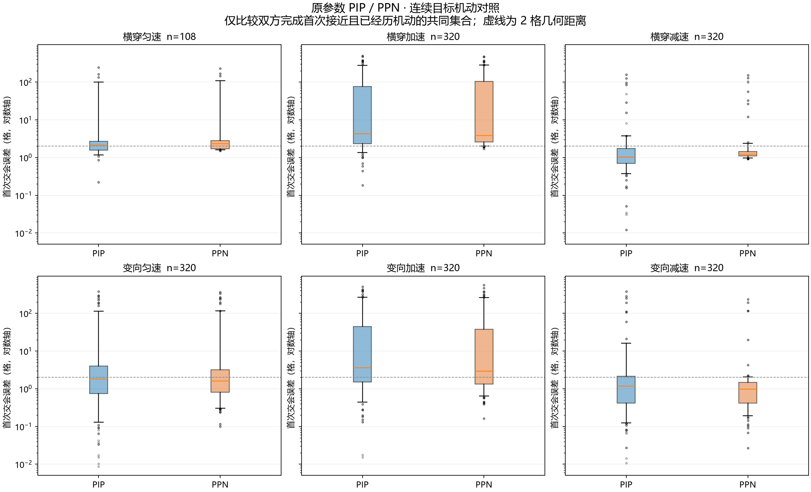
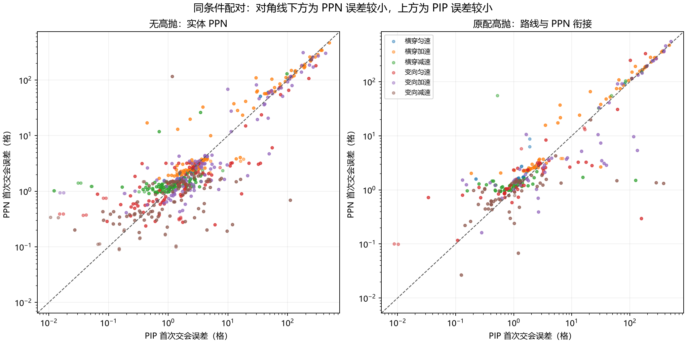

# RVP PIP 与 PPN 六类连续机动交会误差对照

日期：2026-11-05。已运行 **1728 组原参数配对、3456 次真实实体仿真**。
本轮只扩充测试、构建任务和报告工具，未修改游戏内制导逻辑、本体源码、武器 JSON、模型或客户端部署。

前置实现见同目录 [实体寻的 PPN 闭环与高抛衔接](RVP实体寻的PPN闭环与高抛衔接_20261105.md)。

## 1. 本轮结论

**PIP 在三类横穿中更常得到较小误差，PPN 在三类变向中更常得到较小误差。**
PPN 总体中位误差下降，但同条件逐组比较时，PIP 更小的组数仍较多；不能只用一个总体中位数认定全部场景改善。

有效共同集合为 **1708 组**。其余 20 组都是 FIM-92 在预定机动开始前已经交会，不计入机动后的算法比较；
它们仍保留在原始数据中。双方均完成首次接近，没有超时、寿终或全程无制导样本被隐藏。

PIP 指先算预测相遇点再追过去；PPN 指按真实目标的视线转动速度产生侧向修正。
本报告比较的是当前 RVP 完整控制链：包括原门控和第二脉冲等待期；高抛组包含 PIP 路线到 PPN 的衔接，不能称为全程纯 PPN。

## 2. 六类结果

下表距离单位均为格，越小越好。中位数表示一半样本的误差不超过它；P90 表示九成样本的误差不超过它。
“较小组数”比较同一场景的两个算法；差距不超过 0.001 格记作近似，原始数值不截断。

| 目标运动 | 有效配对 | PIP 中位 | PPN 中位 | PIP P90 | PPN P90 | PIP较小 / PPN较小 / 近似 |
| --- | ---: | ---: | ---: | ---: | ---: | ---: |
| 横穿匀速 | 108 | 2.142 | 2.310 | 46.749 | 60.705 | 71 / 36 / 1 |
| 横穿加速 | 320 | 4.224 | 3.828 | 196.531 | 196.823 | 219 / 101 / 0 |
| 横穿减速 | 320 | 1.033 | 1.234 | 2.788 | 1.709 | 212 / 108 / 0 |
| 变向匀速 | 320 | 1.827 | 1.597 | 53.509 | 24.478 | 151 / 169 / 0 |
| 变向加速 | 320 | 3.595 | 2.954 | 181.731 | 185.315 | 120 / 200 / 0 |
| 变向减速 | 320 | 1.165 | 0.965 | 5.048 | 1.717 | 150 / 170 / 0 |

横穿加速的总体中位数虽为 PPN 更小，逐组比较却有 219 组是 PIP 更小；这两项统计衡量的内容不同。
变向减速的九成误差范围由 5.048 格降到 1.717 格；加速横穿与变向加速则仍存在较多大距离脱靶。

总体有效集合：

| 指标 | PIP | PPN |
| --- | ---: | ---: |
| 中位误差 | 1.896 | 1.634 |
| 平均误差 | 28.404 | 27.171 |
| P90 | 104.002 | 104.781 |
| 最大误差 | 505.312 | 561.458 |
| 2 格以内数量 | 883 / 1708 | 948 / 1708 |
| 5 格以内数量 | 1290 / 1708 | 1371 / 1708 |
| 同条件误差更小数量 | 923 | 784 |

另有 1 组近似相等。2 格和 5 格这里只是几何距离阈值，未执行引信、碰撞或伤害，不能把这些数量称为真实命中率。
本次特意加入高速、加减速和较晚变向，较前一轮 14 个基本场景困难，不能沿用“最差小于 2 格”的前轮结论。

## 3. 高抛与不同武器

| 范围 | 有效配对 | PIP 中位 | PPN 中位 | PIP P90 | PPN P90 | PIP较小 / PPN较小 |
| --- | ---: | ---: | ---: | ---: | ---: | ---: |
| 无高抛 | 1132 | 1.976 | 1.630 | 59.378 | 68.689 | 524 / 607 |
| 原配高抛 | 576 | 1.679 | 1.695 | 162.123 | 162.519 | 399 / 177 |

**当前高抛衔接在多数配对中仍增加误差。**即使有些较大误差改善，也不能概括成高抛性能全面提高。
本轮保留全部原参数并记录问题，没有根据结果调增益或重写高抛策略。

| 武器 | 有效配对 | PIP 中位 | PPN 中位 | PIP P90 | PPN P90 | PIP较小 / PPN较小 / 近似 |
| --- | ---: | ---: | ---: | ---: | ---: | ---: |
| MICA-NG / ARH | 288 | 2.332 | 1.880 | 191.988 | 171.569 | 158 / 130 / 0 |
| FIM-92 / IR | 268 | 1.546 | 1.706 | 60.948 | 62.766 | 174 / 94 / 0 |
| 9M317M / SARH | 288 | 2.306 | 1.508 | 5.375 | 3.772 | 77 / 210 / 1 |
| IRIS-T SL / AIR | 288 | 2.041 | 1.499 | 54.285 | 82.959 | 115 / 173 / 0 |
| AIM-120D / 高抛 | 288 | 2.201 | 1.838 | 253.275 | 249.765 | 193 / 95 / 0 |
| PL-15 / 高抛 | 288 | 1.448 | 1.608 | 28.015 | 10.632 | 206 / 82 / 0 |

9M317M 在本矩阵中的 PPN 改善最稳定：最大误差从 49.050 格降至 4.747 格。
IRIS-T SL 则是中位数改善、较差一成样本扩大，说明小误差表现与大脱靶必须同时看。
这些是本矩阵的观察，尚未针对具体大脱靶逐项确诊原因。

## 4. 场景设计

同一武器内，PIP 和 PPN 的完整武器 JSON、发射初态、随机种子、目标轨迹、时间步长完全一致。
固定发射点 Y=164、地面 Y=64、平台初速度 80 格/秒，仅原武器启用速度继承时才叠加。
不修改发动机、机动过载、攻角、阻力、制导角度或原增益参数。

| 武器配置 | 初始目标距离，格 |
| --- | --- |
| `ebrc_mica_ng` | 350 / 600 / 850 |
| `ah1z_fim92` | 230 / 350 / 450 |
| `bukm3_9m317m` | 500 / 900 / 1400 |
| `irist_sl` | 350 / 600 / 850 |
| `f16_aim120d` | 900 / 1200 / 1400 |
| `pl_15` | 900 / 1200 / 1400 |

| 目标档位 | 初速 | 加速末速 | 减速末速 | 变向角 | 持续时间 |
| --- | ---: | ---: | ---: | ---: | ---: |
| moderate | 35 | 55 | 20 | +60° | 3 秒 |
| sharp | 55 | 80 | 25 | -90° | 2 秒 |
| reverse | 65 | 90 | 30 | 180° | 3 秒 |

速度单位为格/秒。正转角从 +X 朝 +Z，镜像时初始横向速度和转角同时反号。
变向均为有限时间内连续完成，速度和航向在段连接处连续；位置由同一速度函数解析积分，避免位置、速度来自不同路线。
机动结束后保持末速度和末航向，不突然停住或无期限加速。

机动起点为**原 PIP 同条件匀速首次接近时间**的 25%、60%、85%。原 PIP 和 PPN 使用相同的绝对起点，
PPN 不另按自身飞行时间调整目标路线。该批 108 个匀速 PIP 参考均完成首次接近，没有用到名义时间回退。

匀速横穿为 `6 武器 × 3 距离 × 3 档位 × 2 镜像 = 108` 组；
其余每类增加 3 个机动时机，共 324 组，合计 1728 组，不重复计入匀速下无关的时机。
这是一套固定测试矩阵，左右镜像也用于发现方向偏差，不代表 1728 个独立随机实战样本。

## 5. 评分与基线可靠性

先运行原 PIP，再让 PPN 读取同一份不可变 `plan.json`。校验两边完整武器快照、场景内容指纹和实际运行时 class 指纹。

- 原 PIP 源码内容编号：`974ba042786f8f7b455f868a7400bf2a87734357`。
- PIP 测试 class SHA-256：`06ce3457d1e94c9d799ae540c2041fa6e43c8345ca5aea2aff93aa371fbdaa0c`。
- PPN 当前 class SHA-256：`609fbef464a605370a9de7266f7cfcbc915b2eb1e9e3631ef3c6c0facce32e64`。

SHA-256 是文件内容指纹，用来核对实际加载的代码和输入没有被换掉。
PIP 源码只读提取到 `build/` 后单独编译，仅在 PIP 测试进程中优先加载；不切换工作区源码、不增加游戏内算法开关、也不打进发布 jar。
已将该测试进程与前轮保存的 14 个原 PIP 回放核对：**武器快照一致，全部位置、速度、姿态和状态帧逐帧完全一致**。

误差定义为首次有效制导后，第一次接近过程结束时，相对运动段中的最小间隔。
使用连续段投影，能捕捉高速越过发生在两刻之间的最近点；距离开始回升后停止，不让绕圈重逢改善首次评分。

试验发现 IRIS-T SL 等低初速、延迟点火场景在制导启用前存在小幅距离波动；
评分已明确从首次有效制导开始建立接近过程，并有专用回归防止把第 5 刻的波动冒充第 20 刻之后才启用的制导交会。
全程没有制导输出记录为 `NO_GUIDANCE`，超时、寿终、触地保留截断状态和观测最小距离；它们不被伪装为已完成交会。

机动前已经交会的配对只在单独统计中出现。主表要求双方均完成首次接近，且非匀速类别双方均已开始机动。
因此既保留难例，也避免把尚未发生的变向算成变向性能。

## 6. 产物、复现与验证

测试长期保留在 `src/test/java/`、`src/test/resources/` 与 `scripts/`。
JUnit 和仿真依赖只走测试配置；原 PIP 基准只编译到 `build/pip-guidance-classes/`，不加入生产源码或发行 JAR。
普通 `build` 运行单元回归，1728 组批量对照仍需显式运行 `guidanceManeuverComparison`。
已检查普通版、完整版两个发行 JAR：均不含本测试的类、场景、脚本或旧 PIP 基准，正式 PPN 运行时代码正常保留。

- [完整生成报告](../../build/projectile-maneuver-comparison/report.md)
- [逐场景 CSV](../../build/projectile-maneuver-comparison/paired-results.csv)
- [分类、逐武器与高抛汇总 JSON](../../build/projectile-maneuver-comparison/summary.json)
- [固定场景清单](../../build/projectile-maneuver-comparison/plan.json)
- [原PIP逐帧复现校验](../../build/projectile-maneuver-comparison/reference-validation.json)
- [PIP 原始结果](../../build/projectile-maneuver-comparison/pip.json)、[PPN 原始结果](../../build/projectile-maneuver-comparison/ppn.json)
- [矩阵配置](../../src/test/resources/projectile-guidance-comparison/matrix.json)
- [完整构建与批量日志](../../build/guidance-maneuver-full.log)

生成场景 JSON 位于 `build/projectile-maneuver-comparison/scenarios/`，可单独导出真实实体回放。
批量评分器不使用测试停止球，普通工作台导出器仍保留自己的停止条件，二者停止帧数可以不同。

```powershell
$env:JAVA_HOME='C:\Users\FishKing0721\.jdks\ms-17.0.16'
$env:JAVA_TOOL_OPTIONS='-Djdk.net.unixdomain.tmpdir=D:\WgameProject'
$env:PYTHONIOENCODING='utf-8'
./gradlew build guidanceManeuverComparison
python -B scripts/test_report_guidance_maneuvers.py
```

最终结果 `BUILD SUCCESSFUL in 1m 11s`，**1755 项 Java 测试失败/错误/跳过均为 0**；
另 3 项统计口径测试通过。新增测试覆盖连续目标脚本的位置/速度一致性、镜像、段连接、极小转角、坏输入和发射等待的错误交会识别。
本轮没有调整测试误差门槛来让难例通过，批量大脱靶原样报告。

可选图表用标准 matplotlib 绘制，本轮绘图库仅安装在 `build/guidance-plot-deps`，不增加模组运行依赖：

```powershell
$env:PYTHONPATH=Join-Path (Get-Location) 'build/guidance-plot-deps'
python scripts/report_guidance_maneuvers.py build/projectile-maneuver-comparison --plot
```

本次图表已归档到当前目录的 `PPN对照_20261105/`，PNG 用于正文，SVG 用于放大或导出，不依赖 `build/` 临时输出。



[误差分布 SVG](PPN对照_20261105/error-distribution.svg)

箱体表示中间一半样本，横线为中位数，须覆盖 5%～95%，点为该范围外样本；纵轴按倍数变化，虚线为 2 格。



[逐场景配对 SVG](PPN对照_20261105/paired-errors.svg)

每个点是一组同条件试验。对角线下方 PPN 更小，上方 PIP 更小；横纵坐标都按倍数变化。

环境仍是理想目标观测、固定平地和已就绪区块。自主捕获在原配置距离提供理想事件，未模拟真实雷达搜索、照射、反制、网络、引信和玩家操控。
不据此宣称实机命中率，也未将本轮产物部署到游戏实例。
