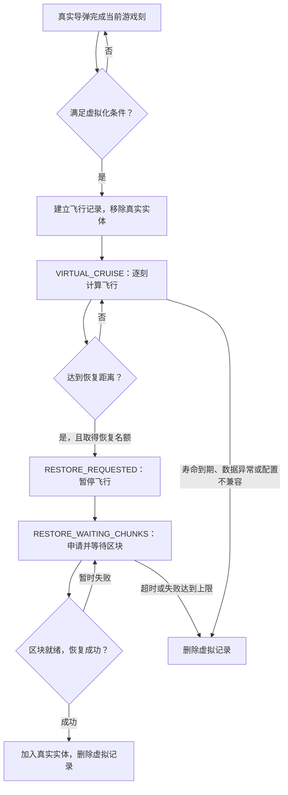

# RVP 导弹航程采用虚拟中段弹道的具体实施方案

> 状态：下文保留阶段 B / 气动 S2 的历史设计与排查记录；当前已接入实体运动链，实际状态以第 0 节为准。
> 适用项目：`limitless-vehicle-rvp-addon`，Minecraft 1.20.1 Forge。  
> 约束：所有新逻辑只写在 RVP 子模组，不修改 `ywzj_vehicle` 本体源码。

## 0. 当前状态契约更新（2026-11-03）

这里的 Tick 是每秒 20 次的游戏计算步；GPS 指飞向指定坐标，PRESET 指按预先配置的曲线飞行，NBT 是 Minecraft 的存档格式。攻角是机头与实际飞行方向的夹角；双轴惯量表示机头上下、左右转动都有加速和刹停过程。

- 当前生产实现为 `RVP_EntityTrajectoryIntegrator`，标识 **`rvp_entity / VERSION=1`**。每条虚拟记录保留一个**不加入世界**的 `RVP_MissileEntity` 作为计算对象，只调用正式实体的制导与运动方法；不运行世界实体 Tick、沿途碰撞、引信、尾迹或区块申请。旧 `RVP_RvpTrajectoryIntegrator` 仅保留为独立数学试验参考，不再驱动游戏内虚拟飞行，也不能据它判断实体轨迹是否一致。
- 真实态和虚拟态共用 `tickKinematicGuidance()`，固定执行“清理本刻临时状态 → 实际制导 → 攻角兜底”，随后均动态调用 `tickMotion()`。推力、二脉冲、风偏、阻力、重力、恒速、速度上下限及高度倍率全部由实体原方法结算；不再在虚拟态复制计算顺序。双轴惯量和低动压机头限幅也随同真实执行器推进。
- 新增 `RVP_VirtualMissileKinematics`，保存当前速率基准、更新次数、上一刻竖直速度与有效标记、PRESET 三个参考点及初始化标记、冷发射接管标记、风向、发射载机速度和冷发射速度。PRESET 保留的是**实际点火位置**，不会在虚拟化、停服重启或恢复实体时重算。二脉冲顶点判定、GPS 垂直重置也只接受真实执行链产生的状态。
- 恢复实体与建立计算对象共用 `createEntity()`，完整恢复位置、速度、机头、两轴角速度和运动记忆。已删除额外按速度重对齐姿态的恢复入口；即使未启用攻角，`rotate_to_motion=false` 的机头也必须原样保留。计算对象按记录缓存，武器配置对象被热重载替换时按完整快照重建。
- 准入范围仍为固定 GPS（可含 PRESET）。冷发射/延迟点火未结束、水中、部署分量、智能引信接管、DIRCM 或主动 ECM 干扰期间继续保留真实实体。普通 GPS 配置了目标离地高度门时也保留真实实体，PRESET 本身绕过此门；未配置高度门时不查询高度图。近地引信和距离自毁同样不得进入虚拟段，避免漏掉真实世界触发或航程计数。
- `virtual_midcourse_data.cruise_altitude` 当前不消费，实际巡航行为统一读取 `guidance_data` 的 GPS 巡航或 PRESET 配置，防止只在虚拟态切换另一条高度曲线。无需新增武器 JSON 字段。
- 单条记录格式 **1→2**，新增必需的 `kinematics`；SavedData 容器格式仍为 1。旧记录缺失真实飞行历史，直接拒绝读取，不自动迁移；格式 2 内实现标识或版本不匹配的记录以 `INCOMPATIBLE_INTEGRATOR` 终止，巡航和等待恢复两个阶段都检查。升级时应确保没有在途虚拟弹。

### 0.1 逐刻验证与边界

`RVP_VirtualEntityTrajectoryParityTest` 使用完整生产实体 Tick 作为参考，只隔离外部碰撞、区块票据和网络。另一支通过实际虚拟飞行入口计算；15 类用例涵盖普通 GPS、零重力、无发动机阻力、GPS 巡航垂直重置、攻角惯量、冷发射后 PRESET、恒速、独立机头、高度倍率、转向区间切换、风场扰动、变推力和四种二脉冲触发。

每刻精确比较位置、速度、姿态、角速度、飞行距离、飞行刻、寿命和完整制导/发动机快照；运动记忆按 NBT 编码值比较（NBT 将正负零统一）。中途两次保存/重新读取记录并丢弃缓存，同时在途改靶；末尾通过正式恢复入口重建实体，再比较 20 刻。环境禁止高度图查询，避免用虚拟段的隐式地形加载换取一致。

本次按根目录指定 JDK 17 和环境变量执行 `./gradlew build`，全量 1378 项自动测试通过，其中上述逐刻对照为 15 项。未启动游戏客户端或专用服务器实射。

验证的是**相同外部输入、相同有效飞行刻下的自由飞行轨迹**。虚拟段仍不模拟未加载地形碰撞、入水或沿途干扰；等待恢复区块时仍按原规则暂停，不保证按墙钟时间与始终实体飞行同时到达。实机的网络显示和区块恢复时序仍需游戏内观察。

### 0.2 虚拟记录接入雷达与拦截（2026-11-04）

虚拟中段仍然只保存飞行记录、运行不入世界的导弹计算对象。现在这个对象也作为雷达和拦截的目标：**弹体转虚拟后可以继续被扫描、锁定和拦截，命中后删除同一条权威记录，不会在末段重新冒出来。**

**2026-11-04 临时关闭地形高度查询**：`RVP_VirtualMissileTargets.VIRTUAL_TARGET_TERRAIN_HEIGHT_ENABLED=false`。虚拟目标恢复无视地形：雷达、导引头、自动炮手及兼容锁定/近炸入口跳过离地高度限制，目标同步只发送高度占位值 0，避免扫描、同步、保活反复计算地形。真实实体沿用原规则。高度图、未加载区域基础地形估算及同步代码均保留；以后把该常量改回 `true` 并重新编译即可恢复。此前原版主世界独立实测单次约 2 毫秒，因此在补齐缓存与查询预算前保持关闭。

- `RVP_VirtualMissileTargets` 汇合真实实体与同维度虚拟记录，接入服务端雷达补扫、外置雷达、Gunner（自动炮手）共享索敌、主动雷达导引头重捕获、普通/扫掠近炸、弹间直击和 APS（主动防护系统）。仍使用弹体原有的碰撞箱、速度、发射者、敌我和引信过滤；没有按武器名称写特殊分支。
- 雷达继续读取 `ammo_radar_rcs_factor`：RCS 在这里表示雷达信号强弱，迎头、侧向和尾向信号决定有效探测距离。方位限位、扫描线及 `scan_vehicle_only`（仅扫描载具）仍然生效；最低/最高离地高度对虚拟目标随上述总开关暂时跳过。外置雷达复用主雷达的弹药补扫方法。
- 同次服务器运行期间，真实→虚拟→真实沿用同一实体 ID 与 UUID。切换时迁移已有雷达接触、雷达硬锁、武器站锁定和在途拦截弹的目标引用，不通过重新索敌掩盖断锁。配置热重载重建计算对象时也执行交接。发射车或射手重新加载后补回来源引用，临时查不到时保留已知引用。会话 ID 不入存档；重启后重新分配，不能拿历史实体 ID 查另一枚弹。
- 本体直击会根据当前位置与上一刻位置修正受击盒。因此创建计算对象时初始化位置历史，转换时沿用原真实弹的历史；配置重载、真实恢复保留历史，等待恢复而暂停运动时更新为静止目标。避免新计算对象把世界原点当作上一刻位置。
- 客户端通过 `S2CVirtualMissileTargets` 每 2 游戏刻接收雷达包络内的虚拟目标完整集合，复用本体远程目标表与现有界面，不把代理加入客户端世界。缺席目标会撤销，恢复实体单独标识并交接；停止接收超过 20 刻或更换世界时清理缓存。
- 直击、近炸与 APS 沿用实体弹原有引爆方法。最终移除计算对象时，以 UUID 加对象引用核对权威记录，删除记录、归还已有恢复区块票据并撤销接触。仅同 UUID 的旧真实对象不能误删记录；等待恢复区块的弹也可以被拦截。
- 保留的地形查询开启路径：地面高度在已加载区域读取实际高度图；虚拟目标位于未加载区域时读取生成器的基础地形高度，客户端使用服务端同步值，避免雷达扫描强制加载沿途区块。**未加载区域的基础高度不包含玩家建造、挖掘等后天改动**，这部分高度门与始终加载实体存在边界差异。当前总开关关闭，虚拟目标不会进入该路径。

本次不修改虚拟飞行的运动公式或武器 JSON；单条记录格式仍为 2，轨迹实现仍为 `rvp_entity/1`。网络协议更新到 **42**，客户端和服务端需要同时更新。没有新增 Mixin 类或注入点；既有雷达动作注入只改为调用统一目标查询。

验证使用生产雷达过滤、目标交接、本体受击盒、直击结算、扫掠近炸和 APS 引爆链；另保留原 15 类逐刻轨迹对照。2026-11-04 按项目指定 JDK 17 与环境变量运行 `./gradlew build`，全量 **1393 项测试通过**，含本次新增 15 项：目标与拦截 12 项、网络往返 2 项、导引头真实/虚拟搜索及自锁/己方弹过滤 1 项。自动测试隔离网络及真实区块调度，未代替游戏客户端与专用服务器实射。

临时关闭地形查询后再次执行同一构建命令，**1394 项测试全部通过**：新增禁止地形访问的同步高度/兼容过滤验证，并验证虚拟目标可绕过明确不满足的雷达、导引头高度门；真实弹原有高度门仍生效。

### 1 虚拟中段的服务器端管理

现在的虚拟中段由服务器统一接管：**每枚导弹保存一条飞行记录，服务器每个计算步继续算它的运动；接近目标后，先准备恢复区域的区块，再把记录还原成真实导弹。**

当前生产实现是 `rvp_entity/1`。它直接调用实体的制导、受力和运动代码，管理器负责安排计算、保存状态、申请区块和处理失败。

这里先说明三个用语：

- **Tick，游戏刻**：服务器的一次计算步，正常速度下每秒 20 次。
- **UUID**：一枚弹的长期身份编号，转虚拟、恢复、重启后保持不变。
- **区块 Ticket，区块票据**：请求 Minecraft 暂时保留并准备某些区块，让其中的实体能够正常运行。
  现在的虚拟中段由服务器统一接管
  整个生命周期如下：




**服务器上的管理分工是全服调度、按维度保存、逐弹记账。**

| 代码 | 负责什么 |
|---|---|
| [RVP_VirtualMissileManager](D:/WgameProject/limitless-vehicle-rvp-addon/src/main/java/org/ywzj/rvp/virtualflight/server/RVP_VirtualMissileManager.java:124) | 统一处理所有维度的虚拟弹，推进飞行、分配恢复名额和区块票据 |
| [RVP_VirtualMissileSavedData](D:/WgameProject/limitless-vehicle-rvp-addon/src/main/java/org/ywzj/rvp/virtualflight/server/RVP_VirtualMissileSavedData.java:21) | 接入 Minecraft 原版存档系统，每个维度保存自己的虚拟弹记录 |
| [RVP_VirtualMissileState](D:/WgameProject/limitless-vehicle-rvp-addon/src/main/java/org/ywzj/rvp/virtualflight/server/RVP_VirtualMissileState.java:26) | 保存一枚弹的身份、飞行状态、当前阶段和恢复计数 |
| [RVP_EntityTrajectoryIntegrator](D:/WgameProject/limitless-vehicle-rvp-addon/src/main/java/org/ywzj/rvp/virtualflight/server/RVP_EntityTrajectoryIntegrator.java:20) | 使用未加入世界的导弹对象，执行正式实体的飞行计算 |

这些工作在**服务器主线程**上按顺序执行，没有给每枚导弹单独开线程。

真实导弹在完成当前刻的运动、引信和寿命处理后，才尝试转入虚拟态。因此，快照记录的是已经完成的一步，不会在当前步算到一半时突然交接。

转入之前，服务器先检查武器配置。当前主要支持 **GPS 坐标制导，以及 GPS 下的 PRESET 预设曲线弹道**。武器必须显式配置 `virtual_midcourse_data.enabled=true`，默认不会自动开启。

以下情况会保留真实实体：

- 配置了末段制导、独立攻顶弹道、人在回路操控或线导。
- 需要沿途近炸、近地引信、子母弹布撒、跳弹或距离自毁。
- 普通 GPS 配置了目标离地高度限制，需要查询地形；PRESET 本身绕过这道限制。
- 导弹仍绑定动态目标实体，或者没有有效目标坐标。
- 冷发射、延迟点火尚未结束，或当前处于水中、特殊部署运动、智能引信接管状态。
- 当前受到定向红外干扰或主动电子干扰，或者正在等待区块。

然后还要通过时间、距离和运动状态检查：

| 准入条件 | 默认要求 |
|---|---|
| 已完成真实飞行时间 | 至少 0 刻，可通过配置提高 |
| 离开发射点 | 至少 800 格 |
| 距目标 | 至少 1600 格 |
| 运动数据 | 位置、目标、速度必须有效，速度不能为零 |

这些判断集中在[虚拟化资格检查](D:/WgameProject/limitless-vehicle-rvp-addon/src/main/java/org/ywzj/rvp/virtualflight/server/RVP_VirtualMissileEligibility.java:47)，依据配置和当前状态决定，不根据武器名称硬编码。

**真正交接时，服务器先建立记录，再移除实体。** 顺序是：

1. 跨维度检查 UUID，防止同一枚弹重复登记。
2. 提取位置、速度、机头朝向、寿命等快照。
3. 提取下一刻计算还会用到的运动记忆。
4. 把记录加入当前维度的 `SavedData`，并标记为需要保存。
5. 标记这次移除属于“转虚拟”。
6. 移除真实实体，并通知常规区块路径管理器释放它的路径占用。

这里的“加入存档记录”是**先写进服务器内存中的存档容器**，并非立即强制写入硬盘。实际落盘仍由 Minecraft 的保存流程负责。

每枚弹保存的信息可以分成四组：

| 信息组 | 主要内容 |
|---|---|
| 身份和来源 | 飞行 UUID、武器、维度、发射者和载具 UUID、原始发射点 |
| 当前飞行状态 | 位置、速度、机头朝向、上下及左右转动的角速度、航程、飞行刻、剩余寿命 |
| 跨刻运动记忆 | 当前速率基准、上一刻竖直速度、二次点火时间、风向、冷发射数据、PRESET 实际点火参考点 |
| 管理状态 | 当前阶段、已虚拟飞行多久、恢复等待多久、恢复失败次数、实现版本 |

上一刻竖直速度用于判断导弹是否刚到达弹道顶点；PRESET 参考点决定整条预设曲线的位置。这些数据如果丢失，恢复时即使位置、速度对上，后续轨迹仍可能改变。

**进入虚拟巡航后，管理器在每个服务器游戏刻的开始执行一次。** 对所有维度的记录，依次进行以下处理：

1. 清理维度错配、损坏或重复 UUID 的记录。
2. 从当前武器索引重新取得配置。
3. 检查武器是否仍存在、仍允许虚拟化。
4. 检查记录的运动实现和版本是否兼容。
5. 对巡航中的弹执行一次飞行计算。
6. 检查寿命、数值和最大虚拟飞行时间。
7. 判断是否需要准备恢复。

热重载删除武器、关闭虚拟化，或者给武器加入当前不支持的行为后，管理器会终止对应虚拟记录。它不会继续拿旧配置无限飞行。

一次虚拟飞行计算的执行顺序是：

```text
保存上一帧位置和朝向
→ 飞行时钟、更新次数加一
→ 清理本刻临时标记
→ 执行正式制导
→ 推进没有制导指令时仍需处理的机头运动
→ 执行正式运动方法
→ 剩余寿命减一
→ 把实际结果写回虚拟记录
```

这里保留了一个 `RVP_MissileEntity` 计算对象，但**没有把它加入世界实体列表**。通常会持续复用这个对象；存档重读、武器配置对象被替换，或者外部显式替换轨迹时，再从记录重建。

因此，二次点火、风偏、空气阻力、重力、恒速和高度相关速度限制，都由实体原来的代码计算。虚拟段省下的主要是沿途区块加载、世界碰撞查询、实体调度和网络同步开销。

**恢复实体的时机由距离和速度共同决定。** 当前公式是：

```text
恢复触发距离 =
    max(配置的恢复距离,
        当前水平速度 × 提前恢复刻数)
```

比较时使用的是导弹到目标的三维直线距离。

默认恢复距离为 768 格，提前恢复为 2 刻。例如水平速度为每刻 30 格，动态提前距离只有 60 格，实际仍在 768 格内触发；如果把提前量设为 60 刻，动态提前距离就变成 1800 格。

达到条件后，服务器每刻最多选 **4 枚**弹进入恢复流程。未取得名额的弹仍处于巡航态，下一刻继续飞、继续参与筛选。

取得名额之后，各阶段的行为如下：

| 阶段 | 是否继续移动 | 是否继续扣飞行寿命 |
|---|---|---|
| `VIRTUAL_CRUISE`，虚拟巡航 | 是 | 是 |
| `RESTORE_REQUESTED`，已申请恢复 | 否 | 否 |
| `RESTORE_WAITING_CHUNKS`，等待恢复区块 | 否 | 否 |

也就是说，**当前实现会让弹停在恢复位置，等待区块准备好**。等待期间增加的是恢复等待计数。它不会继续沿弹道向前飞，也不会在恢复后补算这段等待时间。

**恢复区块按全服务器预算分配。** 每枚弹需要准备：

- 恢复位置周围的一片方形区块区域。
- 按当前速度前进一刻后，终点所在的区块。

恢复半径默认是 1，即中心周围的 **3×3 区块**；允许范围是 0～2，最大为 5×5。终点区块如果已经包含在区域内，不会重复计算。

当前管理限制是：

| 项目 | 当前值 |
|---|---:|
| 每刻新进入恢复流程的导弹 | 最多 4 枚 |
| 每刻新增的恢复区块票据 | 最多 16 个 |
| 已取得票据的有效期 | 40 刻，等待期间持续刷新 |
| 恢复失败上限 | 3 次 |
| 两次失败重试之间的间隔 | 20 刻 |
| 默认恢复等待超时 | 200 刻 |

正常每秒 20 刻时，200 刻约为 10 秒；服务器卡顿时，现实等待时间会更长。

票据采用轮流分配：一轮先给每枚等待中的弹一个名额，有剩余预算再分下一轮，下一刻还会改变轮转起点。这样可以减少队列前面的弹长期占满预算的情况。

**16 个限制的是每刻新增申请量。** 已批准的票据会继续刷新，不占新增预算；它也不是所有虚拟导弹的数量上限。

**区块取得票据之后，还要确认它真的能够运行实体。** 管理器会检查恢复区域、当前位置和预计下一刻终点，要求相关区块已经加载，并进入可以更新实体的状态。仅仅“已经发出加载申请”还不够。

确认就绪后，恢复过程依次进行：

1. 再次检查全服务器是否已有相同 UUID 的真实实体。
2. 重新建立类型正确的 RVP 导弹。
3. 恢复快照和运动记忆，保留原机头朝向。
4. 尝试重新绑定已经加载的发射者、载具及目标。
5. 寻找可放置弹体的位置。
6. 调用 `addFreshEntity`，正式加入世界。
7. 提交常规弹体路径保护请求。
8. 成功后删除虚拟记录。

恢复时使用同一个长期 UUID，新建实体的临时实体 ID 可以变化。

放置位置优先使用虚拟轨迹的原位置。如果那里已经被方块等物体占据，会交替尝试向上和沿速度反方向调整，原位之外最多搜索 32 个候选位置。因此，**恢复处存在真实障碍时，当前安全位置搜索可能让弹的位置发生小幅调整**。相关实现见[实体恢复与安全位置检查](D:/WgameProject/limitless-vehicle-rvp-addon/src/main/java/org/ywzj/rvp/virtualflight/server/RVP_VirtualMissileManager.java:328)。

UUID 冲突、找不到安全位置或世界拒绝加入实体，都算一次恢复失败。未达到 3 次时等待 20 刻重试；达到上限，或者等待累计达到超时值，就删除虚拟记录。

虚拟巡航中寿命耗尽、超过最大虚拟飞行时间、坐标异常，也会删除记录。**这条终止路径只结束记录，不会在未加载区域直接结算爆炸。**

**保存和重启由原版存档系统接管。** 各维度保存自己的 `rvp_virtual_missiles` 数据，使用 NBT——Minecraft 的二进制存档格式。

新增、删除、进入恢复阶段和恢复失败等操作会立即标记“需要保存”；正常运行还会每 20 刻定期标记一次。这个标记表示数据需要落盘，不代表每秒强制写一次硬盘。

正常重启后：

- 从保存的飞行位置、速度和记忆继续。
- 停服期间不会继续飞，也不会按停服时长补算。
- 临时计算对象重新建立。
- 区块票据重新按预算申请，不把旧票据当作仍然有效。
- 已保存的恢复等待次数、失败次数继续保留。

当前单条记录格式为 **2**，容器格式仍为 **1**。旧格式缺少必要运动记忆，会拒绝读取；当前格式中运动实现或版本不匹配，也会被终止。

**目标更新目前仍以坐标快照为基础。** 虚拟化准入要求导弹没有绑定动态目标实体，所以不能把它理解为已经支持在未加载区域持续搜索、锁定移动载具。

记录提供了替换目标坐标的接口。GPS 雷达上行管理器原本打算定期把射手当前雷达锁定目标的位置写入这里，下一次制导计算读取新坐标，并避免重新生成 GPS 散布。

不过，这次核对发现这条上行管理器有一个现存问题：首次更新时间缺省为 `Long.MIN_VALUE`，随后直接做 `gameTime - last`。在正常非负世界时间下，这个减法会超出 Java 长整数范围，绕成负数，导致首次更新被当作“间隔未到”而跳过；更新时间又因此无法写入。实体、虚拟两条更新分支都有同样写法。见[实体分支](D:/WgameProject/limitless-vehicle-rvp-addon/src/main/java/org/ywzj/rvp/weapon/gps/RVP_GpsRadarUplinkManager.java:121)和[虚拟分支](D:/WgameProject/limitless-vehicle-rvp-addon/src/main/java/org/ywzj/rvp/weapon/gps/RVP_GpsRadarUplinkManager.java:153)。

上一轮的轨迹对照验证了**收到相同目标坐标后如何飞行**，没有覆盖这个上行管理器首次触发的问题。另外，上行标志目前不写入存档，重启后的弹会保持最后保存的坐标。

日常观察可以使用管理员命令：

```text
/rvpvirtualflight status
/rvpvirtualflight on
/rvpvirtualflight off
```

`status` 查看活动数量、转入和恢复次数、失败、超时及累计计算耗时；`on/off` 控制独立调试日志。**它们不会开启或关闭武器虚拟化功能**，功能仍由武器 JSON 配置决定。

当前还需要明确三个运行边界：

- 所有巡航中的虚拟弹仍然每刻计算一次，尚无虚拟弹总数上限或每刻物理计算耗时上限；恢复预算只限制恢复申请。
- 虚拟段不处理未加载区域的地形碰撞、入水和沿途干扰，也没有可供普通碰撞命中的真实弹体。
- 恢复等待会暂停飞行，安全位置搜索也可能调整位置。因此，逐刻一致指的是相同输入下的自由飞行计算；实际到达时间和恢复位置还受区块准备及现场碰撞条件影响。
