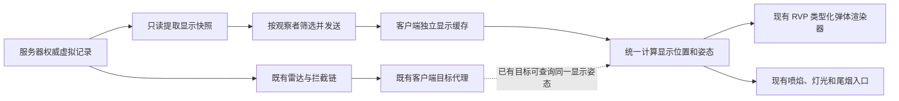

# RVP 虚拟弹接入只供显示的弹体对象：开发方案

日期：2026-11-04。**状态：独立视觉消息首版已实施；完整构建与自动回归通过，游戏画面和专用服务器联机仍待实机验收。实施记录见第 12 节。**正文保留原方案的设计依据和建议措辞；同目录的虚拟弹 S2C 合并优化仍是独立开发项。

后续扩展：[全类型导弹虚拟中段接入](../plan/RVP全类型导弹虚拟中段接入_20261104.md)已放宽 `RVP_MissileEntity` 的制导/载荷准入，保留武器显式开关，并接续既有电视操控。当前协议为 **44**，显示条目增加制导阶段；本文关于首版仅支持 GPS 的描述属于当时范围。

适用环境：`limitless-vehicle-rvp-addon`，Minecraft 1.20.1 / Forge。

## 1. 要解决什么问题

RVP 的导弹转入虚拟中段后，服务器继续计算它的飞行，也已经允许雷达发现和拦截它；但这不等于客户端一定能画出这枚弹。需要补上一个**只负责显示模型、喷焰和尾烟的客户端对象**，让玩家能看见正在虚拟飞行的导弹，同时保留虚拟中段节省沿途区块加载的作用。

这里的“弹体对象”可以直接使用现有 `RVP_MissileEntity` 的客户端实例。**创建一个 Java 对象，不等于把它加入 Minecraft 世界。**显示管理器持有这个实例，渲染时把它交给现有弹体渲染器；平时不运行它的实体更新、制导、碰撞或引爆逻辑。

必须区分以下三种对象，不能因为它们都长得像导弹，就共用同一份可变状态：

| 对象 | 在哪里 | 负责什么 | 是否加入世界实体列表 |
| --- | --- | --- | --- |
| 权威记录与计算对象 | 服务器 | 决定导弹飞到哪里、是否仍存在，并参与现有雷达和拦截结算 | 否；恢复真实弹后才入世 |
| 雷达目标代理 | 客户端，现有 `RVP_ClientVirtualMissileState` | 给雷达界面、锁定输入等提供已经授权的目标表示 | 否；目前写入本体远程目标表 |
| 本文的显示对象 | 客户端，拟新增独立缓存 | 根据服务器快照画模型、喷焰、尾烟 | 否；也不写入远程目标表 |

“权威”指服务器说了算；“代理”指用一个本地对象代表远处的弹；“快照”指某一时刻的位置和状态；Tick 是游戏刻，正常速度下每秒 20 刻；UUID 是一枚弹长期不变的身份编号。

首版只覆盖**当前已经具备虚拟中段资格的 RVP 导弹**。不扩大准入弹种，不改 GPS / PRESET 制导、弹道公式、伤害或区块恢复规则。GPS 在这里指飞向指定坐标，PRESET 指配置好的预设飞行曲线；本文也不把 TVMissile（电视制导导弹）等当前不支持的弹种加入虚拟中段。

## 2. 实际上怎么做

| RVP 做法 |
| --- |
| 独立管理显示对象，不依赖原版实体追踪和沿途区块 |
| 明确身份、更新先后、主动撤销与断流清理 |
| 使用现有实体渲染器，补齐收包之间的平滑显示 |
| 传显示所需的小快照，不发送完整制导存档 |
| 停止新尾烟与保留已经排出的烟分开处理 |
| 只借鉴显示对象管理；首版不引入另一套弹道预测器 |

“插值”是在两个已知位置之间补出画面；“外推”是暂时没有新包时，用最后速度向前估计。两者都只改变画面，不能反过来改服务器的飞行结果。

## 3. RVP 现状与真正缺口

当前虚拟中段的完整说明见[已有实施文档第 0 节](RVP导弹虚拟中段弹道具体实施方案.md)。本节以当前代码为准，不沿用旧数学积分器的历史设计。

| 现有代码 | 已有能力 | 本次接入需要补什么 |
| --- | --- | --- |
| [RVP_EntityTrajectoryIntegrator](../../src/main/java/org/ywzj/rvp/virtualflight/server/RVP_EntityTrajectoryIntegrator.java) | 复用不入世的 `RVP_MissileEntity`，执行正式制导和运动，结果写回权威快照 | 读取计算后的显示数据；同步服务不能再推进一次飞行 |
| [RVP_VirtualMissileManager](../../src/main/java/org/ywzj/rvp/virtualflight/server/RVP_VirtualMissileManager.java) | 管理转虚拟、巡航、暂停等待区块、恢复和终止 | 在交接和终止后通知显示同步服务，保持及时撤销 |
| [RVP_VirtualMissileTargetSync](../../src/main/java/org/ywzj/rvp/virtualflight/server/RVP_VirtualMissileTargetSync.java) | 每 2 刻向具备本车 / 中继雷达来源的观察者发送目标集合 | 这是雷达目标同步，不能直接充当所有玩家的视觉广播 |
| [RVP_ClientVirtualMissileState](../../src/main/java/org/ywzj/rvp/client/state/RVP_ClientVirtualMissileState.java) | 缓存虚拟目标并写入 `LocalVehiclePlayer.serverEntities`，维护锁定引用 | 保留原职责；显示权限不能借此进入目标表 |
| [RVP_RemoteAmmoVisualBroadcastService](../../src/main/java/org/ywzj/rvp/network/remotevisibility/RVP_RemoteAmmoVisualBroadcastService.java) | 为真实远距弹授权显示并同步燃烧；当前候选来自 `level.getAllEntities()` | 虚拟弹不在世界实体列表中，不能靠现有候选遍历自然收集到 |
| [RVP_RemoteAmmoVisualRenderer](../../src/main/java/org/ywzj/rvp/client/render/remotevisibility/RVP_RemoteAmmoVisualRenderer.java) | 在 `AFTER_ENTITIES` 手动绘制远程克隆，并处理投影、尾烟和喷焰 | 接入独立显示缓存；虚拟分支不能沿用乘车限制或 512 格下限 |
| [RVP_ClientProjectileRenderInterpolator](../../src/main/java/org/ywzj/rvp/client/state/RVP_ClientProjectileRenderInterpolator.java) | 使远程弹模型、HUD 和雷达框共用短时外推位置，最长 5 刻 | 同 UUID 的已授权目标，应能复用显示对象的同一份显示姿态 |
| [RVP_ClientEntityRenderers](../../src/main/java/org/ywzj/rvp/client/RVP_ClientEntityRenderers.java) / [VehicleProjectileRenderLogic](../../src/main/java/org/ywzj/rvp/client/render/VehicleProjectileRenderLogic.java) | 已注册 RVP 类型化弹体渲染器，按 weapon display 取模型和贴图 | 复用现有注册；补齐没有生成包时的客户端模型实例与动画初始化 |
| [RVP_RocketEngineLightQuery](../../src/main/java/org/ywzj/rvp/client/light/RVP_RocketEngineLightQuery.java) | 统一处理喷口、程序喷焰、发动机光；远程克隆依赖权威燃烧快照 | 识别独立显示对象，直接消费其权威燃烧状态，不能读取实体默认值猜测 |

还要注意三个现有条件：

1. 远程弹药当前绘制范围为水平距离 **512～4096 格**。虚拟弹可能进入 512 格以内，也可能在恢复区块时暂停，不能因为这条真实远距弹规则直接消失。
2. 真实弹视觉广播当前在服务端检查离地高度 10 格；渲染类还留有值为 100 的说明常量，实际授权检查在服务端。本文不顺手调整真实弹规则，也不拿说明常量推导虚拟弹授权。
3. `RVP_VirtualMissileTargets.VIRTUAL_TARGET_TERRAIN_HEIGHT_ENABLED` 当前为 `false`。新显示同步不得通过高度图查询或加载地形，重新引入已经关闭的虚拟目标地形成本。

## 4. 推荐结构：独立同步和缓存，共用绘制设施




新增视觉同步和客户端缓存，接到 `RVP_RemoteAmmoVisualRenderer` 的现有世界绘制入口；不另起一套世界末尾渲染器，不把纯显示对象放进 `LocalVehiclePlayer.serverEntities`。首版可用独立视觉消息验证；与虚拟目标消息的合并方案见[虚拟弹网络优化开发文档](RVP虚拟弹网络优化开发文档_20261104.md)。线上消息合并后，客户端的目标代理与显示对象仍然分开管理。

服务器只读导出已经完成计算的结果。客户端显示缓存只管理本地实例和画面数据，不调用 `tick()`、`tickVirtualMidcourseFlight()`、`tickMotion()`、`initFromWeapon()` 或任何引信、碰撞、伤害方法。

雷达代理与显示对象可以拥有相同 UUID / 会话 ID，但必须是不同实例。雷达代理保持接收时的目标数据；平滑计算放在显示样本中，避免渲染临时改坐标时污染锁定和火控读取。

## 5. 谁能看见：首版建议规则

以下是**拟采用的视觉策略**，并非当前已实现行为。用 4096 / 8192 格边界，虚拟弹无需沿用真实远距弹的 512 格起点。

| 条件 | 建议行为 |
| --- | --- |
| 同维度，水平距离不超过 4096 格 | 向玩家发送显示快照，步行和乘车均可；不要求雷达开机 |
| 水平距离大于 4096 、不超过 8192 格 | 仅本人 / 本车发射的弹，或本车 / 已授权中继雷达**已经发现**的弹继续发送 |
| 超过 8192 格、不同维度、离线 | 不发送，并撤销该观察者旧显示 |
| 没有雷达目标权限，但满足近距视觉范围 | 可以画模型；不得因此新增雷达接触、锁定框、告警或服务端可锁目标 |
| 虚拟弹位于未加载区块 | 仍按快照绘制；不申请区块、不查高度图，不声称能够判断未知地形遮挡 |

远距授权使用既有雷达发现结果，不为画模型再次启动整轮雷达扫描。本人 / 本车归属优先使用权威记录保存的发射者、发射车 UUID，不能依赖来源实体此时仍加载。

画面保留已渲染地形的深度遮挡；“没有加载地形，所以不知道那里有没有山”是能力边界，不能用关闭深度测试解决。首版不承诺 20 公里显示，也不接入参考项目的专用远程地形系统。

## 6. 显示消息应传什么

第 6.1～6.3 节定义独立消息基线，拟命名为 `S2CVirtualMissileVisualSnapshot`，其中 S2C 表示从服务器发给客户端。使用 RVP 现有 Forge `SimpleChannel`，消息方向固定为 `PLAY_TO_CLIENT`，在主线程应用。消息合并、字段去重和发送预算见[虚拟弹网络优化开发文档](RVP虚拟弹网络优化开发文档_20261104.md)；本节定义显示侧所需数据，独立消息与统一消息是替代关系，不要求长期重复发送。

### 6.1 消息外层

| 字段 | 含义、单位与规则 |
| --- | --- |
| `dimension` | 维度资源 ID；必填，和当前客户端世界不一致就拒绝 |
| `sessionId` | 服务器本次运行的随机 UUID；运行时创建，不存入虚拟弹存档；重连、服务端重启后重置客户端同步状态 |
| `sequence` | 当前观察者在该维度的递增序号；每次发包递增，包括同一游戏刻内的立即同步；拒绝重复或倒退序号 |
| `serverGameTime` | 采样时的服务端世界刻；用于样本时间差，不直接与客户端世界时间相减当网络延迟 |
| `entries` | 本次授权且选入预算的**完整虚拟显示集合**；空集合也有撤销意义 |
| `departures` | 相对该观察者上一集合离开的 UUID、会话 ID 与原因；恢复时另带恢复后真实弹的最终显示样本 |

完整集合指“这个观察者这次应该保留哪些显示对象”，不是全服所有虚拟弹。某 UUID 缺席时撤销旧显示，不解释成击毁。`departures` 用来补充交接语义，不能代替空集合的处理。

### 6.2 每枚弹的显示条目

| 字段 | 含义、单位与取值来源 |
| --- | --- |
| `flightUuid` | 权威飞行 UUID；显示缓存主键，必填 |
| `entityId` | 本次会话的目标 / 实体 ID；沿用当前真实→虚拟→真实交接值，只作配对和现有尾烟来源编号 |
| `weaponId` | 当前武器资源 ID；用于现有配置与 display 查找，不用它写弹种特判 |
| `position` | 已完成计算的位置，单位格，三个 double；从权威轨迹取 |
| `velocity` | 当前速度，单位格 / 游戏刻；暂停时保留实际速度，但显示外推必须关闭 |
| `yaw` / `pitch` | 机头偏航 / 俯仰，单位度；从实体运动结果取，不用速度方向覆盖 |
| `flightTick` | 已完成的飞行刻数；暂停恢复时不增加，用于显示年龄及已有视觉曲线 |
| `phase` | 当前 `VIRTUAL_CRUISE`、`RESTORE_REQUESTED` 或 `RESTORE_WAITING_CHUNKS`；后两者按暂停处理 |
| `motorPhase` | 明确的熄火、一级燃烧、二脉冲燃烧状态；从现有权威发动机查询取得，不按年龄在客户端猜点火 |
| `motorBurnRemainingTicks` | 当前已点燃燃烧窗口的剩余飞行刻数；熄火为 0，不包含尚未开始的二脉冲等待时间；数值必须有上限 |
| `trailHoldRemainingTicks` | 传给现有尾烟保持期的剩余刻数，沿用 `ticksUntilMotorStopsBurning()` 的原有含义；不把它当作当前仍在燃烧的证明 |

不发送完整 NBT（Minecraft 的存档数据）、目标坐标、制导历史、恢复票据、伤害参数或整份武器 JSON。首版只接现有 RVP 导弹类型，客户端固定创建对应注册类型；无需让服务器传一个可以任意创建实体的类型 ID。

现有 `ticksUntilMotorStopsBurning()` 取一级与已记录二脉冲的**最晚燃尽时间**，还服务于固体发动机凝结云的保持期；它不保证等于“当前这一段燃烧还剩多久”。因此两个剩余时间要分别导出：当前窗口从快照中的实际一级结束刻、二脉冲开始刻与持续时间只读计算；尾烟保持期继续走原出口。燃尽边界的 0 刻按权威燃烧阶段解释，不能只用 `remaining > 0` 代替发动机状态。

显示提取函数放在 `virtualflight.server` 内，读取现有记录和已经缓存的计算对象。不能为了发包重新调用轨迹步进、恢复入口或 `initFromWeapon()`；没有可用计算对象时跳过该异常条目，由现有权威管理器处理，不在同步服务内补算。

### 6.3 同步频率、大小与先后顺序

- 常规完整集合建议每 **2 刻**发送，与现有虚拟目标同步周期一致；转虚拟、恢复、终止、被拦截后在同一服务端刻刷新受影响观察者。允许合并到本刻末，不为凑其他消息跨刻等待；必须在实体移除前预告时保留及时推送。该次同步仍发完整集合，避免引入第二套增量合并规则。
- 每维度每次只提取一次不可变候选列表，再按玩家筛选。同步在服务端刻末完成，读取管理器、上行改靶和雷达已经提交的结果；立即同步只读取当时已提交状态，不额外推进运动。
- 初始协议建议最多 **128 个条目、128 个离开项、64 KiB 单包**；编码和解码均检查数量、字符串长度、阶段枚举、非负年龄、燃烧计数和有限坐标。NaN / Infinity 是无效数值，必须拒绝。
- 超预算时，按已经锁定、本人弹、距离等明确优先级稳定选取，并对同级保留上一批已选对象，避免每次换一批造成闪烁。排序末尾以 UUID 保持稳定；未入选只表示本轮不显示，不删除权威弹。
- 完整集合不得随意拆成几包后逐包替换。首版超预算就裁剪，后续若要分包，需要增加完整批次合并后再提交的协议。
- 实际字节预算、同刻批量刷新和合并后的目标集合限制，统一见[虚拟弹网络优化开发文档](RVP虚拟弹网络优化开发文档_20261104.md)；这里的数量和大小上限是独立视觉消息的基线约束。

方案编写时 `RVP_Network` 协议为 **42**；独立显示消息首版为 **43**，全类型接入增加制导阶段后为 **44**，客户端和服务器必须一起更新。虚拟记录格式 2、轨迹实现 `rvp_entity/1` 保持不变。

### 6.4 与网络优化文档的分工

虚拟弹网络优化已独立到同目录的[虚拟弹网络优化开发文档](RVP虚拟弹网络优化开发文档_20261104.md)，范围仅限现有虚拟目标消息、拟新增虚拟显示消息及二者的统一 S2C。共享提取、同刻刷新、字段去重、合并协议、预算与性能验收均由该文档维护；本文保留显示接入所需的基础消息数据和客户端行为。

显示状态由服务器主动推送，不需要客户端逐帧拉取。采用统一消息时，基础字段仍保持第 6.1～6.2 节的显示语义，外层集合与资格按网络优化文档组织；目标代理和显示对象仍是两个实例。

## 7. 生命周期与交接

| 事件 | 服务器动作 | 客户端显示动作 |
| --- | --- | --- |
| 真实弹转虚拟 | 沿用现有先登记记录再移除实体的顺序，登记成功后立即刷新视觉集合 | 创建 / 更新显示缓存；本地同 UUID 真实实体尚存时暂由真实实体绘制，移除后由显示对象接上 |
| 正常虚拟巡航 | 每次发送新的完成态 | 更新样本，平滑画面，不调用弹体 Tick |
| 开始等待恢复区块 | 发送暂停阶段与当前位置 | 停止位置外推、飞行年龄增长和燃烧倒计时推进；不因为 `velocity` 非零继续飞 |
| 恢复真实实体成功 | 从虚拟集合移出，以 `RESTORED` 标明交接；最终样本读取**已成功入世的真实弹** | 等同 UUID 本地实体或现有真实远程克隆接管；允许最多 10 刻交接等待，只保留最终模型，停止新的喷焰、灯光和尾烟 |
| 拦截、寿命到期或配置失效 | 从集合移出，标明 `TERMINATED` | 立即撤销模型和持续效果；不在客户端自行引爆，不因缓存而恢复权威记录 |
| 离开范围、失去远距授权或被预算裁剪 | 从该观察者集合移出，标明 `OUT_OF_SCOPE` | 停止显示和新效果；不宣告导弹死亡 |
| 退出载具 | 重新计算该玩家授权 | 近距视觉可保留；原本依赖本车 / 中继雷达的远距显示撤销 |
| 断流、退出世界、换维度或重连 | 清理运行时观察者缓存 | 按世界实例清空代理、样本、交接等待、喷焰与灯光；同名维度重开也必须清空 |

恢复入口可能为了安全避开方块而调整位置，因此不能把最后一份虚拟位置硬当成恢复后位置。`RESTORED` 最终样本必须来自实际恢复成功的弹；若既无本地真实实体，也没有既有远程克隆更新，10 刻后撤销等待模型，不能静止悬挂到超时之外。

服务端不用增加持久化的显示状态：上一观察者集合离开的 UUID，可通过现有权威记录是否仍在、同 UUID 真实实体是否已存在判断原因；查询限于已加载对象。登出、换维度和服务器停止时清理这些运行时集合。

**每帧最多选择一个模型来源：同 UUID 的有效本地真实实体 → 新鲜虚拟显示对象 → 既有真实远程克隆。**这是显示优先级，不改变服务器的真实 / 虚拟状态。比对时同时核查 UUID，不能看到同一个整数 ID 就认为是同一枚弹。

已有远程绘制循环需要跳过被虚拟显示对象接管的同 UUID 克隆。判断本地实体是否存在时也必须核对 UUID。纯显示对象不进入世界，不会收到世界实体离开事件，因此缓存移除时要显式清理自己登记的持续效果。

## 8. 客户端对象、平滑与模型资源

### 8.1 创建与初始化

拟新增 `RVP_ClientVirtualMissileVisualState`，按“当前客户端世界实例 + UUID”管理以下内容：代理实例、前后样本、最近接收刻、最近序号、显示游标、权威发动机状态、交接等待状态。每个字段及调用本项目 / 本体方法的目的都要写清楚中文注释。

创建代理时可使用已有 `RVP_MissileEntity(type, level, weaponId)` 构造器，以当前武器建立显示身份，再写入 UUID、会话 ID、位置、速度和姿态，设置无物理、无重力、静音。首次创建时前后位置和角度都初始化为首个样本，避免从世界原点飞过来。

**禁止调用 `ClientLevel.addEntity()`、`ServerLevel.addFreshEntity()`，禁止写入 `serverEntities`，也不调用 `setVirtualMidcourseTarget(true)` 冒充雷达代理。**无物理、无重力、静音只是辅助标记；真正防止它参与结算的是“不入世、不调实体更新、不开放交互入口”。

还有一处不能省略：本体 `AmmoEntity` 在生成包的 `readSpawnData()` 中初始化 Bedrock 模型实例和动画。本方案没有生成包，单纯 `new RVP_MissileEntity(...)` 不会自动完成这部分工作。

建议在 RVP 客户端绘制层补充代理专用的模型运行时缓存：从 `ClientAssetsManager` 读取当前 display，创建独立的烘焙模型实例和动画运行器；`VehicleProjectileRenderLogic` 在代理缺少本体模型实例时使用这份缓存。烘焙模型实例是可单独改变姿态的显示副本，避免几枚弹共用动画状态。

这部分只放在客户端，沿用现有模型 / 贴图回退和姿态复位规则。资源重载、武器 display 改变或代理销毁时重建 / 释放缓存；资源暂缺时安全回退或跳过该帧，下一次资源可用后重试。不修改本体私有字段，不新增访问器，也不伪造一份原版生成包调用 `readSpawnData()`。

### 8.2 共用一份显示姿态

首版推荐复用现有远距载具样本插值的思路，保持一个约 2 刻的显示缓冲；新建对象只有一个样本时原地起步，收到第二个样本后再进入正常插值。

```text
显示时刻位于前后样本之间：在两份权威位置、机头角度之间插值
显示时刻超过最新样本：最多按最新速度外推 5 刻，姿态保留最新权威值
处于恢复等待：固定在最新位置，不外推
样本年龄超过 5 刻：冻结位置
样本年龄超过 10 刻：关闭喷焰、持续灯光和新尾烟
样本年龄超过 20 刻：移除模型和缓存
```

样本年龄按**本客户端收到该条目后的游戏刻**计算；暂停单人游戏时冻结计时。服务端刻用于样本间隔和先后，不把两端不同步的世界时钟直接相减。显示游标保持单调，重复包、旧序号或旧服务端样本不能把模型拖回旧位置。同一服务端刻的较新序号应替换该刻样本，不追加时间间隔为 0 的插值段。

`sessionId` 在当前连接首次有效快照时绑定，此后不因任意不同会话包自动重置；仅断开连接 / 建立新连接时重新绑定。新世界实例清空旧样本及序号，仍核对当前连接的会话和维度，防止旧包让缓存反复切回旧状态。

偏航插值取最短角差，例如从 `179°` 到 `-179°` 只跨过 2°；机头姿态来自权威样本，不能再统一执行现有远程弹的 `applyMotionFacing()`。**机头可以不朝着速度方向**，`rotate_to_motion=false` 和攻角飞行都要保留。

代理输出统一的显示位置与姿态。本帧的模型、喷口、喷焰、灯光、尾烟起点都读这个结果；`RVP_ClientProjectileRenderInterpolator` 对已经存在且已授权的同 UUID 雷达目标，也查询这个结果计算 HUD 中心。HUD 指屏幕上的目标框等信息。

`VehicleProjectileRenderLogic` 当前另有逐次绘制执行的 `RotationSmoother`。新代理已经统一计算了姿态，必须绕过这次二次平滑，或让所有效果共同读取它的最终结果；不能模型再慢半拍、喷口仍用未平滑机头。多相机绘制也不得再次推进同一个显示游标。

不能从显示缓存枚举“新的可锁目标”。某枚弹没有目标代理时，显示层只画模型。若本地真实实体接管，则模型与已有目标框同时回到真实实体的显示位置。

### 8.3 绘制位置与远平面

继续使用 `RVP_RemoteAmmoVisualRenderer` 的 `AFTER_ENTITIES` 阶段，将统一显示位置减去相机位置后交给现有类型化渲染器。相机位置是三维坐标，必须先以 double 做差再进入绘制矩阵，避免远坐标抖动。

虚拟分支对步行玩家同样工作；不能让当前 `onVehicle()` 早退挡住它。既有真实远程克隆分支的乘车、距离授权保持原职责。虚拟分支也不能套用 `distance <= 512` 的排除条件。

复用 `RVP_RemoteVehicleProjection` / `RVP_RemoteVehicleRenderScope` 的远平面处理，并把虚拟弹、尾烟纳入“本帧需要远平面”的判定。远平面是摄像机能绘制到的最远处；只改距离筛选而不处理投影，GPU 仍可能把远弹裁掉。

沿用现有粒子阶段作用域与缓冲提交位置，所有临时矩阵、雾和渲染状态必须恢复；保留深度测试。不得为了远距可见，将弹体模型改成透地形绘制。

## 9. 喷焰、灯光与尾烟必须读取权威事实

显示对象没有运行发动机 Tick，默认字段不能代表它是否点火。只检查配置里的 `has_rocket_engine`，会把已经燃尽的导弹重新点亮。

建议扩展 `RVP_RocketEngineLightQuery` 的查询路径：**先按对象引用确认它是否归新显示缓存所有**，是则使用对应快照的燃烧阶段和新鲜度；否则沿用本地真实弹、现有远程克隆的查询。不能只凭 UUID 或 `isRemoteVisualClone()` 推断归属，避免同 UUID 多种表示交接时读错状态。

不能只改 `isBurning()`：当前光效更新还直接读取 `isSecondMotorPulseBurningNow()` 和剩余燃烧时间，新代理同样缺少这些本地发动机历史。一级 / 二脉冲阶段、亮度包络和倒计时都要来自同一份显示燃烧快照，尾烟保持期则读取单独保留原语义的字段。

| 情况 | 必须表现 |
| --- | --- |
| 有发动机但当前熄火 | 可以画弹体，不生成新喷焰、发动机灯光或发动机尾烟 |
| 一级燃烧 / 二脉冲燃烧 | 使用权威阶段，继续复用现有颜色、口径、喷口偏移、缩放与效果配置 |
| 两个燃烧阶段之间 | 明确熄火；不能凭配置提前预测第二次点火 |
| 正常巡航样本之间 | 剩余燃烧刻可按经过的飞行刻递减到 0；下一阶段点火必须等待新权威样本 |
| 暂停等待恢复 | 保持服务器快照确定的燃烧事实，停止倒计时推进；位置固定，也不逐帧重复排出同一点的尾烟 |
| 明确熄火、终止、失去视觉授权或超时 | 当次更新停止新的持续效果，不沿用旧授权宽限继续点火 |

当前 `RVP_RemoteAmmoVisualRenderer.spawnRemoteTrail()` 强依赖旧授权状态表，不能拿新显示对象直接塞进去。实施时只提取其中可复用的“按给定姿态、燃烧事实和配置发射尾烟”部分，让原远程分支与虚拟分支分别传入自己的授权；不要把两个完整集合相互覆盖。

尾烟继续使用现有有界采样、补点和体积烟管理器。每枚弹每游戏刻最多提交一次尾烟采样，多渲染帧或多个相机绘制不能加倍排烟。沿用会话 ID 对接现有尾烟来源，来源配对同时记录 UUID，防止 ID 被复用后接上旧弹尾迹。

转虚拟和恢复时，如果时间和位置连续，可接续同一条尾烟；恢复安全点发生大跳变、传送、断流或来源身份改变时，从新位置重新起一段，不跨空白距离拉长烟线。停止发射时调用现有断链语义，**已排到世界中的烟自然消散**，不跟着模型一起瞬间删除。

喷焰和持续光继续按 UUID 管理。每帧来源选择先完成，再由唯一来源更新；交接清理必须确认没有新来源正在接管，避免旧对象清理时删掉新对象刚登记的同 UUID 灯光。代理不入世，不会自动触发本地实体离开事件来替它清理。

## 10. 预期文件改动范围与实施顺序

以下为原方案的职责划分；独立显示首版的实际实现和验证结果见第 12 节。继续利用已有类，不建立另一套弹道、粒子或模型 ID 管理系统。

下表列显示功能的接入点。统一 S2C 的注册、发送器整合、协议切换与重复发送清理，按[虚拟弹网络优化开发文档](RVP虚拟弹网络优化开发文档_20261104.md)执行；采用统一消息后，显示对象、资源和绘制工作仍需完成。

| 拟新增 / 调整位置 | 责任 |
| --- | --- |
| 新增 `virtualflight/server/RVP_VirtualMissileVisualSync.java` | 只读导出、观察者筛选、预算、完整集合与离开原因、登出和停服清理 |
| 新增 `network/remotevisibility/S2CVirtualMissileVisualSnapshot.java` | 有界显示协议；条目可作为内部 record，避免额外散落数据类 |
| 新增 `network/remotevisibility/RVP_VirtualMissileVisualEndpoint.java` | 沿用现有视觉端口模式，公共端默认空操作，客户端安装消费者 |
| 新增 `client/state/remotevisibility/RVP_ClientVirtualMissileVisualState.java` | 代理和样本管理、平滑、新鲜度、交接等待及统一显示姿态查询 |
| 调整 `RVP_VirtualMissileManager` | 在已完成的转虚拟、恢复、终止 / 拦截删除出口刷新显示；不改变原结算顺序 |
| 调整 `RVP_Network` / `RVP_ClientBootstrap` | 注册消息、递增届时协议号、安装仅客户端消费者 |
| 调整 `RVP_RemoteAmmoVisualRenderer` | 接入虚拟显示源、按 UUID 去重、共用投影和有界尾烟发射逻辑 |
| 调整 `RVP_BedrockProjectileEntityRenderer` / `VehicleProjectileRenderLogic` | 为不经过生成包的代理补显示运行时，复用现有模型和贴图规则 |
| 调整 `RVP_ClientProjectileRenderInterpolator` | 已授权同 UUID 目标查询统一显示姿态，不新增目标权限 |
| 调整 `RVP_RocketEngineLightQuery` 等现有视觉辅助入口 | 消费权威燃烧阶段，保证模型喷焰、程序喷焰、灯光和尾烟一致 |

公共消息、服务端管理器和共享实体类都不得直接引用 `Minecraft`、`ClientLevel` 或 `LocalVehiclePlayer`。新增视觉端口可以照现有 `RVP_RemoteAmmoVisualEndpoint`：服务器为空消费端，客户端在启动时安装真实实现，不因网络注册提前加载客户端类。

实施建议分三步，每一步完成后再继续：

1. **先接模型与生命周期**：只读导出、消息、客户端代理、模型初始化、来源去重、暂停、恢复和撤销。先证明虚拟弹能看见、不会变成第二枚真弹。
2. **再接完整视觉**：统一姿态、发动机阶段、喷焰、灯光、尾烟和远平面；检查近远交接与模型 / HUD 对齐。
3. **最后做回归和实机验证**：带宽与数量预算、资源重载、换维度和专用服务器启动；保留原虚拟轨迹、雷达及拦截测试。

无需新增 Mixin：服务器状态出口在 RVP 自己的管理器内，绘制有 Forge 事件，模型和灯光有现有 RVP 辅助类，网络有单向视觉端口。若实施中发现缺口，先使用组合和公开接口，不以本文作为新增 Mixin 的批准。

本方案无需改武器 JSON、载具结构模型或 `ywzj_vehicle` 本体。模型仍从项目根权威包 `limitless_vehicle/rvp/assets/rvp/models/bedrock/` 和 weapon display 配置读取，不参考 `run/**` 或废止权威目录。

## 11. 验收清单

### 11.1 自动验证

| 场景 | 必须证明的结果 |
| --- | --- |
| 同一输入开启 / 关闭显示功能 | 权威位置、速度、姿态、飞行寿命、恢复和命中结果一致；快照提取不额外调用飞行步进 |
| 创建、更新、销毁显示对象 | 客户端世界实体数量和 `serverEntities` 不因纯显示对象增加，实体 Tick / 伤害入口没有被调用 |
| 转虚拟时本地实体尚未移除 | 同一 UUID 每帧只选一个模型与效果来源；旧远程克隆不重复绘制 |
| 相同整数 ID、不同 UUID | 不错误接管模型、灯光、尾烟或目标框 |
| 等待恢复且速度非零 | 模型停止外推，飞行年龄和发动机倒计时停止；不额外推进世界或弹道 |
| 恢复安全点与虚拟终点不同 | 使用实际恢复位置，不画长烟线；真实来源到达即停止等待模型 |
| RESTORED 后真实来源一直不到 | 最多 10 刻后撤销等待模型，持续效果已停止 |
| 终止、拦截、空完整集合 | 当次撤销模型和新持续效果，不生成客户端爆炸，不复活已终止的弹 |
| 重复 / 旧序号、同刻多次同步 | 拒绝旧状态；同刻较新序号可以更新和撤销，不被服务端刻去重误吞 |
| 断流 5 / 10 / 20 刻以上 | 依次停止外推、停止持续效果、移除模型，恢复收包不连接过期尾烟 |
| 一级燃尽、二脉冲空档和再点火 | 只有权威燃烧阶段可以点火；模型、喷焰和灯光使用同一状态 |
| 跨过 ±180°、机头与速度不一致 | 最短角差插值，不把机头强行转回速度方向；HUD 与模型位置一致 |
| 热重载、缺模型 / 贴图 | 安全回退或跳过，不崩溃；资源恢复后可重建独立动画实例 |
| 换维度、同维度重开、重连 / 重启 | 清理原世界对象和序号，旧包不能污染新会话 |
| 超量、超长字符串、坏枚举、非有限坐标 | 在有界解码 / 应用阶段拒绝，不分配无界集合，不改已有权威记录 |
| 未加载区块与虚拟地形查询关闭 | 视觉筛选不访问高度图、不生成区块、不新增区块票据 |
| 仅有视觉权限的步行玩家 | 看得见模型，但不会因此出现雷达接触、锁定或额外告警 |

自动验证应覆盖真实网络编解码和纯状态算法；客户端模型资源、渲染顺序与实际显卡效果仍需实机。保留现有 `RVP_VirtualEntityTrajectoryParityTest`、`RVP_VirtualMissileTargetsTest`、`S2CVirtualMissileTargetsTest` 等相关回归。网络合并、资格独立撤销、分片与带宽的专项验收见[虚拟弹网络优化开发文档](RVP虚拟弹网络优化开发文档_20261104.md)。不能用替身算法的测试宣称正式弹道没有变化。

真正实现代码后，在项目根目录执行约定的完整构建：

```powershell
$env:JAVA_HOME='C:\Users\FishKing0721\.jdks\ms-17.0.16'
$env:JAVA_TOOL_OPTIONS='-Djdk.net.unixdomain.tmpdir=D:\WgameProject'
./gradlew build
```

### 11.2 实机重点

使用用户实机目录 `E:/MC/RVP-test/ywzj rvp测试用客户端A1.1/.minecraft/versions/rvp测试用客户端A1.1`，由用户维护最新权威载具包。至少检查：

- 步行近距离、乘车远距离、无雷达近距、本人弹远距、已发现敌弹远距的可见性。
- 512 / 1024 / 4096 / 8192  格附近、转虚拟瞬间、恢复等待和恢复成功时，是否闪失、重影或重复排烟。
- 一级燃尽、二脉冲、机头不沿速度方向时，模型、喷口、尾烟与目标框是否对齐。
- 已加载地形遮挡、远平面、体积烟、程序喷焰及现有后处理顺序；有 DH（Distant Horizons，远景地形模组）时另测兼容。
- 多玩家观察同一枚弹时，各自授权和显示预算独立；服务端同一枚弹仍只计算一次。
- 专用服务器启动与客户端加入，确认公共网络注册没有加载客户端类。

实施时记录候选数、发送条目数、编码字节数、代理数、跳过重复绘制数、超时撤销数和视觉同步耗时。调试默认关闭，仅在诊断时输出，避免逐弹逐帧刷日志。

## 12. 实施记录（2026-11-04）

本文保留在 `docs/RVP弹体-fish/`，现有图片和显示接入内容保留。原网络优化章节已移至同目录的[虚拟弹网络优化开发文档](RVP虚拟弹网络优化开发文档_20261104.md)；该文档的开发边界仅为虚拟弹相关 S2C。本文通过链接引用，不重复维护合并实施步骤。

### 12.1 已接入的代码

- `RVP_VirtualMissileVisualSync` 只读取已有计算对象，逐维度提取显示样本；普通同步每两刻一次，暂停、恢复、终止和拦截在本刻末合并刷新，转虚拟在真实实体移除前预告。近距 4096 格步行可见，8192 格内按保存的本人／本车归属或本车／中继已有雷达接触延伸；不做新雷达扫描、地形查询或区块申请。
- `S2CVirtualMissileVisualSnapshot` 和公共空端口独立于原雷达消息；完整集合同时受 128 条显示、128 条离开、64 KiB 实际编码字节数限制，校验资源名称、身份、枚举、年龄、燃烧计数和有限坐标。预算按锁定、本人、距离档排序，同档优先保留上一集合，再按 UUID 稳定排序。
- `RVP_ClientVirtualMissileVisualState` 持有不入世的专用导弹对象；`RVP_VirtualMissileVisualTimeline` 管理两刻缓冲、最短角差、五刻外推冻结、十刻效果停止、二十刻模型超时和最多十刻的恢复等待。会话绑定到实际连接；换世界清代理但保留连接内最高序号，防止旧包倒灌。
- `RVP_VirtualMissileModelRuntime` 为绕过生成包的显示对象创建独立烘焙模型和动画，资源重载或 display 变化时重建，代理撤销时显式释放。虚拟模型绕过既有二次旋转平滑；HUD 仅为已有授权目标查询同一显示姿态。
- `RVP_RemoteAmmoVisualRenderer` 继续使用 `AFTER_ENTITIES`，按本地真实弹、虚拟显示、真实远程克隆选择来源，禁止绘制雷达虚拟代理；虚拟分支没有乘车限制和 512 格起点。远平面读取实际三维距离并覆盖仍存活的尾烟，保留现有深度测试和渲染作用域恢复。
- 发动机模型尾焰、程序喷焰、持续光、一级／二脉冲亮度和尾烟分别读取同一权威阶段及各自剩余计数。尾烟复用原有有界补点／体积烟设施，每刻最多一次采样；暂停、断流、撤销会同时断开待补路径和体积烟头，旧烟自然消散。来源编号额外绑定 UUID，旧对象清理不能断开新弹烟链；发射段加粗也读取权威一级窗口，不使用代理的默认燃尽字段。
- `RVP_BaseBullet` 仅增加本地远程数据接收版本；它不入存档、不增加网络字段、不推进飞行。雷达代理接收时通知显示层登记旧版本，使同一客户端刻到达的真实恢复广播也能立即接管，而不会把旧雷达表示误认成真实来源。

本次没有新增 Mixin、访问器或客户端目标权限；未修改 `ywzj_vehicle`、武器 JSON、载具包、结构模型、伤害、制导、恢复区块规则或虚拟存档格式。目标消息与显示消息尚未合并，同目录网络优化文档仍负责后续合并工作。

### 12.2 自动验证与待实机项

已直接运行约定的 `./gradlew build`，构建与全套自动测试通过。新增回归直接调用生产网络编解码、显示时间线、视觉范围／预算选择和只读取样，覆盖空集合、坏包、旧序号／会话、同刻更新、燃尽边界、脉冲间隙、恢复安全位置、断流、发射段曲线及 UUID 尾烟断链；保留原有真实／虚拟实体轨迹一致性、雷达与拦截回归。详细测试结果见 `build/reports/tests/test/index.html`。

服务端沿用 `virtualflight` 诊断开关，每十秒汇总候选数、发送条目数、编码字节数和同步耗时；客户端沿用 `client_state` 调试开关，汇总代理数、重复来源跳过次数和超时数。默认均不输出逐弹逐帧日志。

未启动用户游戏客户端或专用服务器，未进行联机、实际带宽压测或显卡画面验收。第 11.2 节的远距遮挡、喷焰尾烟、资源重载、DH 兼容、多人授权与专服加入检查仍需实机；自动测试不能代替这些画面和运行环境检查。没有复制或替换用户游戏目录中的模组与载具包。
