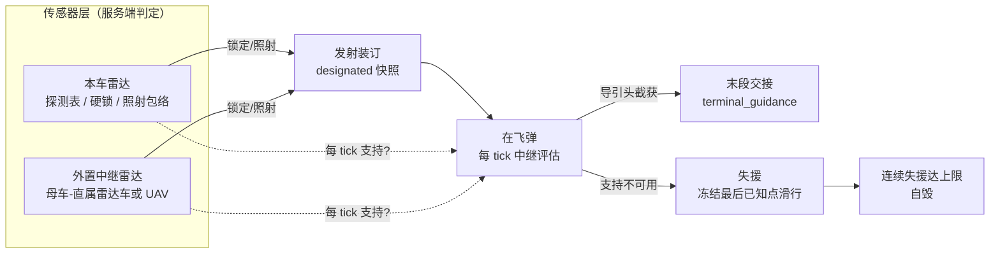

# 导弹数据链运作方式梳理（2026-11-07）

> 范围：`limitless-vehicle-rvp-addon` 当前代码（未改动任何逻辑，仅梳理）。
> 文中的"数据链"指**发射平台/中继平台的传感器 → 在飞弹的目标信息通道**。
> 当前共有三条互相独立的链路：**ARH/AIR 中继制导链**（主链）、**GPS/RADAR 上行改靶链**、**SARH 照射链**。
> 三者共用同一套传感器层与同一套反制层，但判据、门限和断开后的行为各不相同。

---

## 0. 一句话结论

- **服务端权威、每 tick 实时判定、无锁存**：ARH/AIR 弹在飞行中每 tick 询问"我的指定目标此刻是否仍被本车/中继车雷达照射"，可用就重绑目标实时修正，不可用就冻结最后已知点滑行，连续失援达上限自爆。
- **"照射"是物理包络口径而非探测表口径**：只要雷达开机且目标在探测包络内（距离×隐身因子、高度门、安装方位限位），即使探测表里没有该条目、碟正在扫别处，也算中继可用（TWS 语义）。
- **指定目标只在发射瞬间装订**（ARH/AIR），飞行中不跟随换锁；弹群各自持自己的 designated。
- **导引头开机是双阈值**：进入原定开机距离先进入"干扰判定段"（MSL 告警 + 箔条判定），隐身缩放后的真开机距离才让导引头通电；截获后中继分支完全退出。
- **断开路径**：雷达关机/超包络/中继车被毁 → 支持 false；主动 ECM → 支持直接 false；箔条 → 打掉硬锁腿；DIRCM → 直接清 designated。

---

## 1. 链路总图

---

## 2. 传感器层

### 2.1 本车雷达的三种"可用口径"

| 口径 | 判定 | 用途 |
|---|---|---|
| 探测表命中 | `radarCurrentlyDetects` = `getDetectedEntities().containsKey(id)`（`RVP_RadarRoleHelper` L478-480） | ARH 中继的 `tracked` 腿、外置锁确认 |
| 硬锁 | `radar.getLockedEntity() == target` | ARH 中继的 `tracked` 腿、SARH 照射源、发射授权 |
| 照射包络 | `RVP_RadarScanHelper.isWithinIlluminationEnvelope`（L68-96） | ARH/AIR 中继的主判据 |

**照射包络**保留的物理量：雷达开机、目标存活、最大距离（来袭弹按`getRadarSignatureTowards`分角度信号缩放，载具按 `RVP_AspectRcs.detectionFactor` 隐身缩放，封顶 1.0）、扫描高度门（`scan_sea` 对 RCS≥500 的大型水面目标豁免最低高度）、安装方位限位。
**故意排除**：当前碟位扇区、跟踪线、接触超时——这是 2026-10-06 二次修复的核心，避免脱锁后碟回扫掠把探测表条目剪掉导致中继"一拍即断"。

探测表本身由 `RVP_RadarScanService` 维护：每 4 tick 发现新目标、每 tick 保活（在 `tickTargets` 清理前续期）、玩家驾驶车每 20 tick 补扫一次（因为客户端 DETECT 回写只写主雷达）。虚拟中段弹体与真实弹体走同一张表（`RVP_VirtualMissileTargets.allEntities`）。

### 2.2 外置中继（母车 → 直属雷达车/UAV）

- **链路对象**：`RVP_ExternalRadarLinkHelper.getLinkedRelayVehicle`（L37-50）——取 `RVP_LinkedUavStateTable` 的 linked child（可部署 UAV / 直属雷达车），要求存活且未销毁。
- **ARH 中继只认一颗中继雷达**：`getPreferredRelayLockRadar`（L53-73）优先 `radar_role=fire_control`，否则第一颗开机且可锁定的雷达；返回 null 时（如中继车只有 `radar_role=search` 的 96L6）ARH 外置中继自然断开。`radar_role=search` 的雷达另有 `getPreferredRelaySearchRadar`，用于喂探测表、给 AI 炮手指示目标。
- **AIR 中继走另一条通道**：`RVP_AirSeekerRelaySupport` 遍历中继车**全部**雷达（含搜索雷达），判据只看照射包络——因此 AIR 与 ARH 对"哪颗中继雷达算数"并不一致。
- **同步**：`RVP_ExternalRadarSyncService` 每 5 tick 构建 `S2CExternalRadarSnapshot` 发给玩家：刷新中继雷达探测表、条目（位置/速度/NCTR/IFF）、扇区；锁定态 `requested → locked` 的确认条件是**中继雷达探测表命中**（`radarCurrentlyDetects`，L131），不是包络。
- **客户端锁定请求**：C2S `C2SRequestExternalRadarLock` → 服务端写根武器站 `lockedEntity` + `RVP_WeaponLockStateTable.requested` → 确认后写 `lockedEntityId` → 发射时 `getEffectiveRfLockedEntity` 取到该外置锁。
- **注意**：外置锁的确认口径（探测表）比中继支持口径（包络）更严，两者可能不同步——出现"外置锁掉了但中继仍在"。

---

## 3. ARH / AIR 中继制导链（主链）

### 3.1 发射装订：designated 是快照

1. `RVP_ProjectileWeapon.prepareShot`（L230-324）确定本次发射锁：
   - RF 火控站 → `RVP_RadarRoleHelper.getEffectiveRfLockedEntity`（L231-252）：**本车雷达硬锁 → 外置雷达硬锁 → `root.lockedEntity`（软锁/导引头自动跟踪）**；
   - AIR 在雷达链不可用时回退 `RVP_ServerIrSeekerArmedTable` 的红外授权锁（L272-278）；
   - 另有归属门、反舰 RCS 门、离轴角终检等拒射门。
2. `RVP_ProjectileSpawner.applyLockTarget`（L266-292）：`setTargetEntity(lock)`；若为 ARH/AIR 再调用 `rvp$setActiveSeekerDesignatedTarget(lock)`，并写 `targetPos = 最大 OBB 中心`。
3. `RVP_MissileEntity.rvp$setActiveSeekerDesignatedTarget`（L621-636）：归属过滤（`RVP_SeekerTargetFilter.allows`）后存 `activeSeekerDesignatedTargetId`；`targetEntity` 为空时顺手写入；`lastGuidancePos` 记录目标中心。
4. **此后没有任何刷新 designated 的代码路径**（全工程只有发射写入与 DIRCM 清除两处）。设计定版：弹群逐一换锁发射时，不会抢已经在飞的弹。

### 3.2 每 tick 支持评估

`RVP_MissileEntity.tickGuidance`（服务端）→ 阶段更新 → ARH/AIR 进入 `tickActiveSeekerTargetManagement`（L298-406），逐 tick 调用 `rvp$hasActiveSeekerSupportForDesignatedTarget`（L674-739）：

1. **主动 ECM 短路**：`ecmActiveJamRemainTick > 0` → 直接 false。
2. 解析 designated（经 `RVP_VirtualMissileTargets.resolve`，虚拟弹同一会话 ID）。
3. **AIR 分支** → `RVP_AirSeekerRelaySupport.isAvailable`（L17-45）：遍历**本车全部雷达 + 中继车全部雷达**；每颗雷达判据只有照射包络（箔条目标额外要求"包络 ∧ 硬锁"）。**硬锁本身不够**——AIR 必须实时通过目标当前 RCS 包络。
4. **ARH 分支**：
   - 遍历**本车全部 PartUnit 雷达**（母车引用不可得时回退发射站子雷达）：`tracked`（探测表 ∨ 硬锁 ∨ 外置锁）或 `envelope`（仅在未 tracked 时计算）任一成立即支持（`radarSupportsDesignation` L742-747 + `RVP_AirSeekerPolicy.radarSupports` L32-34）；
   - 再查外置中继的 preferred 锁雷达（`externalLock` 为 `RVP_WeaponLockStateTable` 中已确认的外置锁 ID 是否等于 designated），判据同上；
   - 末尾兜底 `anyRadarOn ∧ targetEntity==designated ∧ activeRadarCatch`——能走到这里说明已截获，而 `decide` 的截获豁免会忽略该结果，属历史遗留分支，不影响行为。
5. **结论**：ARH 的"照射即中继"= 雷达开机 + 目标在包络内（没被扫到也算）；AIR 更严格，且 AIR 分支在管理阶段还额外叠加 `!dircmJammed ∧ !isSeekerShutOff ∧ !isJamGracePeriodActive ∧ !hasSmokeBreakLock`。

### 3.3 中继状态机（`RVP_ActiveSeekerRelayPolicy.decide`，L25-32）

| 条件 | 决策 | 弹上动作 |
|---|---|---|
| 已截获（`activeRadarCatch`） | AUTONOMOUS | 中继分支退出，完全自主 |
| 无 designated（LOAL 发射） | 不计失援 | 不承诺中继，计数清零 |
| 有 designated ∧ 支持可用 | rebind | `targetEntity=designated`、`targetPos=OBB中心`、失援计数清零 |
| 有 designated ∧ 支持不可用 | freeze | `targetEntity=null`、失援计数 +1、达 `relay_lost_self_destruct_ticks` 则 `life=0` |

- **无锁存无记忆**：断一拍下一 tick 支持恢复就立即重绑，不会出现旧版"脱锁/关雷达后永久失效"。
- 失援期间弹体按 `targetPos`（最后已知点）飞，**不按目标速度外推**。
- 自毁只是置 `life=0`，由基类下一 tick 走 `LIFE_END`：`detonate_on_life_end` 决定爆炸还是直接移除（`RVP_BaseBullet` L2282-2294）。
- 中继失援/恢复只在状态边沿写生命周期日志：`RADAR_RELAY_LOST` / `RADAR_RELAY_RESTORED` / `RADAR_RELAY_TIMEOUT`（`RVP_ProjectileLifecycleDebug`）。

### 3.4 双阈值开机（干扰判定段 vs 真开机）

`active_radar_activation_range`（`guidance_data` 字段，默认 256 格）。当 `!activeRadarOn` 时（L359-390）：

- **参考点** = `targetPos`（含冻结记忆点）或 `lastGuidancePos`；两者都没有、或配置 ≤0 → **发射即开机**（发射后不管）。
- `countermeasurePhaseActive = dist ≤ 原定距离`：进入后开始**箔条判定**与 **MSL 告警**（每 2 tick 向目标广播本体 `MISSILE_LAUNCH` + RVP 补发），但制导仍是 TWS 中继。
- `effectiveActivation = 原定距离 × RVP_AspectRcs.detectionFactor(target)`（载具目标才缩放）：`dist ≤ effectiveActivation` 才 `setAutonomousSeekerOn(true)`。
- 非隐身目标（因子≈1）两阈值重合，行为不变。

### 3.5 截获、自由搜索与末段交接

- 开机后由 `RVP_RuntimeActiveSeekerGuidance`（L14-108）产生制导意图：
  - 未截获时先把 designated 当候选，过 `RVP_RuntimeSeekerSupport.acquireEntity`：归属过滤、距离/角度/高度门（`passesAcquireLimits`）、反舰 RCS 门、被动 ECM 假目标偏转、干扰物/烟雾判定；成功则 `markAutonomousSeekerCatch`。
  - `freeAcquire`（`rvp$canActiveSeekerFreeAcquire`）= 已截获 ∨ 无 designated ∨ **中继失援**；因此失援后允许导引头自由搜索，不必再等中继。
  - 未截获且不允许自由搜索 → 本刻无意图（继续吃中继点）。
  - 已截获 → `validateEntity` 持续跟踪；ARH 被主动 ECM 干扰时直接 `setTargetEntity(null)` 丢锁。
  - 自主扫描间隔 `scan_interval_tick`（默认 2），半径 = min(配置获取距离, 256 格)；ARH 可把箔条当候选（`chaff_resistance` 罚分），AIR/IR 只认热焰弹。
- **末段相位**：`terminal_guidance`（`guidance_start_tick` / `guidance_start_dist` / `guidance_start_horizontal_dist`）单向切 TERMINAL；`RVP_RuntimeTerminalSeekerHandoff`（L15-77）重新过一遍捕获门（不直接继承主段目标），失败则保留主段制导（`retain_main_guidance_until_capture` 默认 true）。
- **开机后丢目标**：`activeRadarOn ∧ targetEntity==null` 连续 60 tick 自毁；主动 ECM 禁止重获时放宽到 200 tick；DIRCM 干扰期间不计。

### 3.6 失援后的两种表现（重要不对称）

| | ARH | AIR |
|---|---|---|
| 支持判据 | 探测表 ∨ 硬锁 ∨ 包络 | 仅包络（箔条需包络∧硬锁） |
| 失援时制导 | 恒用记忆点 `point` 意图 | 仅当 `enable_inertial_guidance` 或烟雾脱锁时才给记忆点，否则**本刻无意图（直飞）** |
| 自由搜索 | 失援即允许 | 无雷达支持即立即开机搜索（`RVP_AirSeekerPolicy.decide`：`searchOn = searching ∨ !radarSupport ∨ armed`） |
| 失援计数 | 只受 ECM 影响 | 还受 DIRCM/关闭期/干扰保持/烟雾门影响 |

---

## 4. 并列的两条链路

### 4.1 SARH 照射链（`RVP_RuntimeSarhGuidanceSource`，L35-97）

- 照射源**只认手动硬锁**：雷达硬锁或外置雷达硬锁；**明确排除 TWS 探测表与 `WeaponUnit.lockedEntity` 软跟踪**（避免"雷达扫到就制导"以及切换武器清空软锁导致脱锁）。
- 主动 ECM 干扰期间视为无照射，直接 `clearTarget` 并失败；目标还要过 `validateEntity`（反舰 RCS、光学/干扰物等）。
- 2026-10-06 定版：**不把 TWS 放宽给 SARH**，硬锁照射语义保留。

### 4.2 GPS/RADAR 上行改靶链（`RVP_GpsRadarUplinkManager`，L28-185）

- 射手处于 `RADAR` 模式且雷达有**确认硬锁**（`getConfirmedRFHardLockedEntity`，不含 TWS 软航迹）时，每 `radar_update_interval_second`（默认 5 秒）把锁目标的最大 OBB 中心写为在飞 GPS 弹的落点。
- 只更新发射时被标记 `radarUplinkTargeting` 的弹（`RVP_ProjectileSpawner` 置位）。
- 25 格离地门：目标爬高超过门限即停更，各弹保持最后坐标；锁丢失停更，重新锁定自动恢复。
- 实体态 `setGuidanceTargetPos` 直写；虚拟中段 `RVP_VirtualMissileState.updateTargetPosition` 替换 snapshot 目标点，恢复实体后轨迹连续。
- 典型用途：鹰击-20 这类反舰弹道导弹"锁定即打、打后持续修正"。

---

## 5. 链路被切断的路径（对抗层）

### 5.1 箔条

| 位置 | 行为 |
|---|---|
| `RVP_ChaffJamHelper.tryJamLock`（L106-123） | 目标周围记忆窗内箔条数 ≥ `radar_jam_count` → 清雷达硬锁 + 写目标禁锁期 |
| `RVP_ChaffJamHelper.tryJamExternalLock`（L135-157） | 同上但清外置雷达 `locked/requested` |
| 弹端（`RVP_MissileEntity` L376-384） | 进入干扰判定段后每 tick `RVP_CountermeasureState.query`，`decoyed` → 清 `targetEntity`（下一 tick 又被重绑，形成持续对抗） |
| 导引头自主段 | 箔条计入视场锥 + 2 秒记忆，数量超 `seeker_jam_limit` 判定脱锁，按 `chaff_resistance` 决定是否被诱骗转锁 |

对 ARH 中继：箔条只打掉 `tracked` 腿，**包络腿仍在**（所以单纯撒箔条不必然断中继）；对 AIR：当 designated 本身就是箔条（雷达硬锁箔条后发射）时，中继要求"包络 ∧ 硬锁"，硬锁一断中继即断；若 designated 是载具，箔条不影响 AIR 的中继包络判定（只影响弹上导引头自主段）。

### 5.2 主动 ECM（`RVP_EcmActiveManager.tickActiveJamming` L341-420）

- 20 tick 干扰窗，按弹药类型：ARH/AIR/SARH/HITL/ARM 置 `ecmActiveJamRemainTick`，GPS 直接给目标点加随机偏移。
- ARH/AIR **中继期**：`rvp$hasActiveSeekerSupportForDesignatedTarget` 直接返回 false → 失援滑行。
- ARH 尚未开机时被干扰 → `ecmActiveNoReacquire`：即使导引头后来开机也禁止重扫，丢目标自毁阈值从 60 tick 放宽到 200 tick；已开机被干扰 → `RVP_RuntimeActiveSeekerGuidance` 直接丢锁。
- AIR 可重获（不设 noReacquire）。

### 5.3 DIRCM（`RVP_DircmRuntimeManager` L412-423）

`clearTarget` + `clearGuidanceMemory` + **`rvp$setActiveSeekerDesignatedTarget(null)`**（中继语义下必须显式清，否则 designated 还在会被重绑）+ 强制目标改为弹体正下方地面点 + 6 秒禁止重新指定；非 HITL 弹 10 秒后伴爆自毁。

### 5.4 其它断开条件

雷达关机、载具被摧毁/断电、中继车被毁或卸载、目标出包络（距离/高度门/方位限位）、AIR 的烟雾遮挡与干扰保持期。全部表现为"支持 false"，下一 tick 若恢复则自动重绑。

---

## 6. 同步、持久化与虚拟中段

- **全部判定在服务端 tick**；客户端只做显示、HUD、锁定输入（C2S 请求），不存在客户端参与中继判定。外部雷达快照 5 tick 一次。
- **持久化**：中继相关运行态随 `RVP_MissileEntity.saveVirtualRuntimeData` 保存（`activeSeekerRelayLostTicks`、`relayLostSelfDestructTicks`、`activeSeekerRelayLost`、`countermeasurePhaseActive` 等）；designated 用**实体 UUID** 保存，恢复时重新解析成 int id（L1227-1270）。
- **虚拟中段**：导弹转入虚拟态后仍是**同一个计算对象**，`tickVirtualMidcourseFlight` 内执行真实 `tickGuidance`——中继链、导引头、反制全部照常工作；雷达探测表/导引头扫描通过 `RVP_VirtualMissileTargets.allEntities` 把虚拟弹当普通弹体。恢复实体只重建世界索引，不重置制导。
- **客户端没有"链路状态"HUD**：玩家只能从 MSL 告警、命中提示、雷达/战术地图和 `/rvpdebug` 观察。

---

## 7. 参数表（`guidance_data`）

| 字段 | 默认 | 作用 |
|---|---|---|
| `active_radar_activation_range` | 256 | 导引头原定开机距离（格）：干扰判定段 + MSL 告警起点；载具目标再乘隐身因子得真开机距离 |
| `relay_lost_self_destruct_ticks` | 300（15 s） | 连续失援自毁上限；≤0 关闭 |
| `scan_interval_tick` | 2 | 自主搜索/末段捕获尝试间隔 |
| `guidance_target_distance_range` | 无 | 获取/持续跟踪距离区间（同时约束反制扫描半径，封顶 256） |
| `seeker_search_distance_range` | null | 末段首次截获的独立搜索区间 |
| `max_lock_angle` / `max_guidance_angle` | 5 / 60 | 捕获锥半角与制导离轴角 |
| `predict_target_pos`（+ `gain`/`start_tick`/`ppn_lead_feedforward_ticks`） | false | PIP/PPN 提前量（只影响实体寻的，不改链路） |
| `chaff_resistance` | 数据类默认 | 箔条候选罚分（越大越难被导引头选中） |
| `seeker_jam_limit` + `interference_data` | 数据类默认 | 视场锥内干扰物数量阈值（箔条/热焰弹） |
| `terminal_guidance.*` | 无 | 末段相位切换（tick/距离/水平距离）与末段制导类型 |
| `enable_inertial_guidance` | false | 无意图时是否用记忆点兜底（ARH 主段恒用点，不受此门） |
| `radar_update_interval_second`（GPS） | 5 | RADAR 模式在途改靶周期 |
| `anti_ship_seeker` | false | 反舰导引头：截获/（SARH）跟踪要求目标 RCS ≥ 500 |

---

## 8. 时序样例（HQ-9B 拦截 4 km 外 RGM-84 弹群）

1. 052D 雷达 TWS 扫到来袭弹，探测表有条目（客户端回写 + 服务端补扫/保活）。
2. 玩家锁定 → `RadarUnit.lockedEntity` + 服务端雷达锁；发射 HQ-9B。
3. `prepareShot` 取硬锁 → `applyLockTarget` 写 `designated=RGM-84` 与 OBB 中心。
4. 每 tick：雷达开机 ∧ 来袭弹在包络内（弹体分角度信号缩放）→ `rebind`，`targetPos` 跟随来袭弹实时位置。
5. 距离 ≤256 格：进入干扰判定段（MSL 告警 + 箔条判定）；若来袭弹刚撒箔条且数量超阈值 → 本 tick 清 `targetEntity`，下一 tick 仍能重绑（包络腿仍在）。
6. 来袭弹 RCS 因子≈1 → 256 格真开机；开机后捕获 → `activeRadarCatch` → 中继退出，之后完全自主。
7. 若中途关雷达/丢包络：冻结最后点滑行；15 秒（300 tick）仍无支持 → `RADAR_RELAY_TIMEOUT` 自毁。雷达重开或重新进入包络 → 下一 tick `RADAR_RELAY_RESTORED` 继续修正。

---

## 9. 现状边界（只记录，不含改动建议）

1. **designated 不跟随换锁**：发射后换目标不会更新在飞弹（设计定版，避免弹群互抢）。
2. **ARH/AIR 判据不对称**：ARH 接受探测表/硬锁腿，AIR 只认实时包络——同一目标同一雷达，ARH 可能"还在中继"，AIR 已失援。
3. **失援惯性不对称**：ARH 恒有记忆点惯性；AIR 需要 `enable_inertial_guidance`（或烟雾脱锁）才给点，否则本刻无制导。
4. **外置中继是 1:1 且雷达口径不一致**：没有友军公共数据网；ARH 只取中继车一颗 preferred 锁雷达（搜索雷达不算），AIR 则遍历全部雷达（搜索雷达也算）；中继车被毁即整链断。
5. **外置锁确认（探测表）比中继支持（包络）严**：两者可能短暂不一致。
6. **SARH 未放宽 TWS**：必须持续手动硬锁/外置硬锁照射。
7. **无链路状态 HUD**：玩家无法直接看到"中继是否还在"，只能从弹道表现推断。
8. **中继自毁不区分原因**：目标死亡、雷达关机、被 ECM 干扰都计"失援"，300 tick 后一律自爆（除非 `≤0` 关闭）。
9. **失援冻结不外推**：滑行段按最后坐标直飞，不预测目标机动（与 2026-10-06 定版一致）。
10. **ARH 末尾兜底分支**（`anyRadarOn ∧ targetEntity==designated ∧ activeRadarCatch`）只在已截获时成立，而 `decide` 的截获豁免会忽略其结果，属历史遗留，不影响行为。

---

## 10. 观察与验证入口

| 手段 | 用途 |
|---|---|
| `/rvpdebug radar status` / `dump` | 当前车/操作站、requested/externalLocked、本车 preferred 雷达、中继车雷达开机/角色/锁定/扫描参数 |
| `/rvpdebug uav status` | 母车/子机/发射车 UUID、角色、`datalinkRole` |
| `/rvpdebug projectilelife on` | 逐弹生命周期日志，含 `RADAR_RELAY_LOST/RESTORED/TIMEOUT`（中文映射见 `RVP_ProjectileLifecycleDebug`） |
| `/rvpdebug flags jam` / `cm` / `ecm` | 箔条判定、干扰物计数、ECM 命中日志 |
| 单测 | `RVP_ActiveSeekerRelayPolicyTest`、`RVP_AirGuidanceRuntimeTest`、`RVP_RuntimeVirtualRadarTargetTest` |

---

## 11. 代码索引

| 关注点 | 位置 |
|---|---|
| 中继状态机（纯函数） | `guidance/runtime/RVP_ActiveSeekerRelayPolicy.java` L25-40 |
| 逐 tick 中继管理与双阈值开机 | `entity/projectile/RVP_MissileEntity.java` L298-406（ARH）、L409-460（AIR） |
| 支持链与 designated | 同上 L621-751 |
| 照射包络 | `radar/RVP_RadarScanHelper.java` L68-96 |
| 外置中继解析 | `radar/RVP_ExternalRadarLinkHelper.java` L37-99 |
| 外置中继同步/锁定确认 | `network/RVP_ExternalRadarSyncService.java` L59-144 |
| ARH 制导意图 | `guidance/runtime/RVP_RuntimeActiveSeekerGuidance.java` L14-108 |
| AIR 制导意图 | `guidance/runtime/RVP_RuntimeAirGuidanceSource.java` L16-76 |
| 末段交接 | `guidance/runtime/RVP_RuntimeTerminalSeekerHandoff.java` L15-77 |
| 捕获/跟踪门与扫描 | `guidance/runtime/RVP_RuntimeSeekerSupport.java` L48-304 |
| AIR 判据 | `guidance/runtime/RVP_AirSeekerPolicy.java`、`RVP_AirSeekerRelaySupport.java` |
| 发射装订 | `weapon/core/RVP_ProjectileWeapon.java` L230-324、`RVP_ProjectileSpawner.java` L266-292 |
| 箔条 | `countermeasure/RVP_ChaffJamHelper.java` L106-157、`RVP_CountermeasureState.java` L60-88 |
| 主动 ECM | `ecm/RVP_EcmActiveManager.java` L341-420 |
| DIRCM | `dircm/RVP_DircmRuntimeManager.java` L412-423 |
| SARH | `guidance/runtime/RVP_RuntimeSarhGuidanceSource.java` L35-97 |
| GPS 上行改靶 | `weapon/gps/RVP_GpsRadarUplinkManager.java` L28-185 |
| 雷达探测表维护 | `radar/RVP_RadarScanService.java` L48-210 |
| 虚拟中段执行真实制导 | `virtualflight/server/RVP_EntityTrajectoryIntegrator.java` L30-51 |
