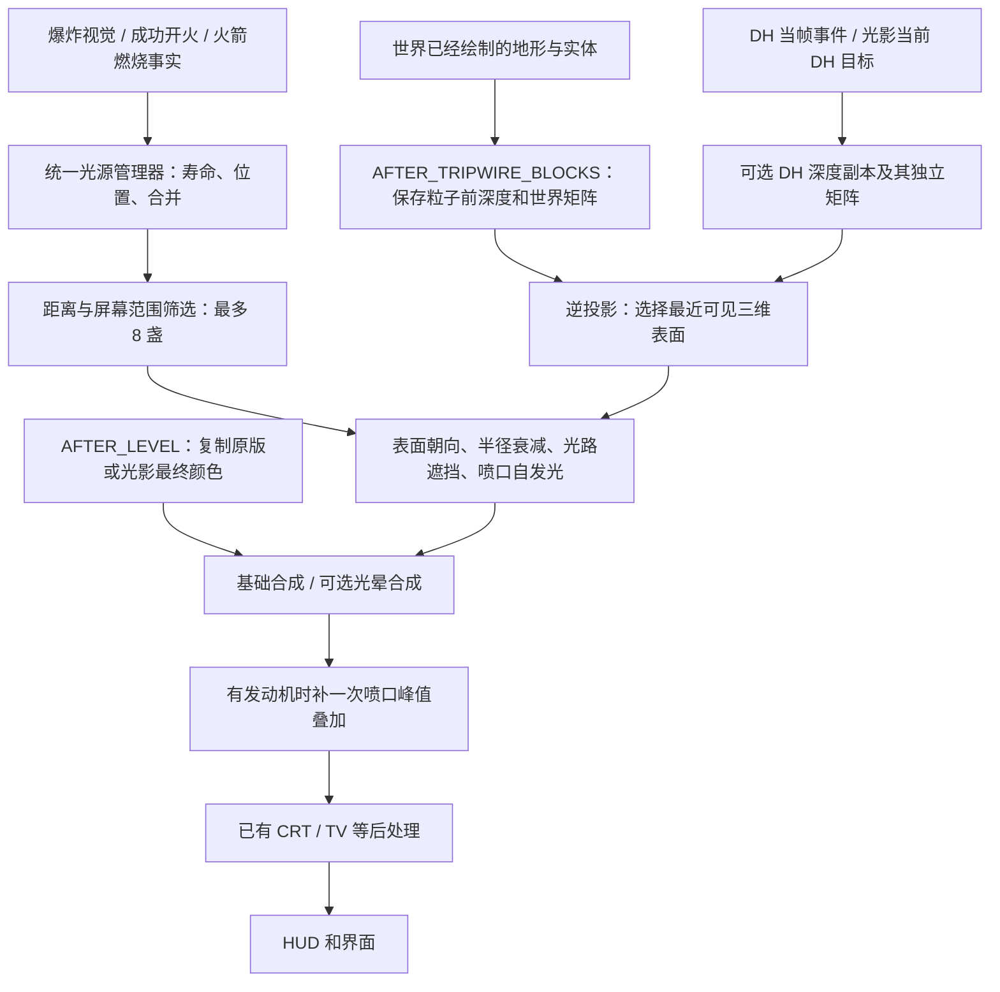

# RVP 屏幕空间光照与实体遮挡实现详解

> 2026-10-31 后续：[光晕与照亮范围分离](../plan/RVP光晕照亮范围分离与调参扩展_20261031.md) 使用另名 `screen_light_ranges` / `rocket_plume_ranges`，照亮结果与光晕来源分别保存；三类光源可独立调整两个半径。下文的共同半径与由受光结果提取光晕属于此前实现记录。

> 2026-10-31 更新：[四层光晕与独立亮度](../plan/RVP多尺度光晕与独立亮度实现_20261031.md) 已接入另名程序 `screen_light_bloom_multiscale` 和 `rocket_plume_glow`。本文的单层模糊流程为原实现记录；当前依次使用宽高 1/2、1/4、1/8、1/16 四层，近层、远层及广域橙晕可分别调节。表面受光和近景/DH 深度原理继续有效。

> 当前新增 [烟雾受光与不遮光](RVP烟雾受光与不遮光实现_20261030.md)：烟雾的实际面片单独受光，粒子烟不再进入遮挡深度；场景捕获改到 `AFTER_TRIPWIRE_BLOCKS`，最终合成仍为 `AFTER_LEVEL`。

> 当前发动机视觉已新增 [RVP 高亮程序喷焰](RVP火箭发动机高亮程序喷焰实现_20261030.md)。本文的表面受光、近景/DH 重建与遮挡原理继续有效；§9 的旧圆形核心和旧模型修复作为保留实现记录，当前在代码中暂停。

> 最新发动机环境照明和广域光晕共同采用 `clamp(20 + 口径毫米数×0.1,20,500)` 格半径，新增一像素可见发光比例与世界半径投影，见[程序喷焰文档第 8 节](RVP火箭发动机高亮程序喷焰实现_20261030.md#8-20500-格广域光晕与环境照明)。细喷焰与广域层仍使用同帧近景/DH 遮挡。

> 日期：2026-10-30。依据当前工作区实现，包含喷口高亮和 DH / Iris / Oculus 兼容。
> 适用：Minecraft 1.20.1 / Forge / `limitless-vehicle-rvp-addon`。
> 用户本轮实测已确认：屏幕空间光能够照亮方块，并出现实体遮挡效果。本文解释这两种现象对应的代码路径；不将这次反馈扩大为全部材质、视角和光影组合均已验收。
> 使用命令与参数概览见 [动态光源使用与验证](../RVP动态光源使用与验证_20261030.md)，本文侧重工作原理、实现细节和后续维护。

## 1. 为什么没有真正的方块光，也能照亮方块和被实体挡住

Minecraft 先把地形和实体画出来。绘制时除了产生颜色，还会在深度图中记下每个像素当前能看见的最近表面。这个表面可能是墙、地面、车身、玩家身体，深度图本身不需要区分它们的类型。

RVP 随后读取这张深度图，把屏幕上的一个像素还原为相机前方的一个三维位置，再计算该位置距离光源多远、朝向是否迎光、到光源的路径有没有可见遮挡，最后只修改对应像素的颜色。

因此，方块表面可以变亮，实体表面可以受光，实体也能参与遮挡。这里没有要求先在世界中放一个光源方块。

需要分清四个现象：

| 画面现象 | 当前实现负责的部分 |
| --- | --- |
| 方块或车身变亮、带上橙色 | 重建可见表面位置、估算法线，再计算表面光贡献 |
| 实体挡住后面的方块 | 当前像素的最近深度已经属于实体，后面的方块没有被当成该像素的受光表面 |
| 实体挡在受光表面与光源之间 | 沿表面到光源的路径做屏幕深度采样，可能检测到实体的可见表面并停止受光 |
| 实体挡住喷口亮点或橙色气团 | 喷口自发光检查光心和当前像素的前景深度，拒绝被挡住的光团 |

**第一种“实体挡住背景”和第二种“实体在光路上挡光”不是同一个检查。** 前者依赖深度图只保存最近可见表面，后者是额外的八步遮挡检查。喷口自发光还有自己的可见性检查。

当前 `RVP_LightingConfig.P5_ENABLED=false`。这种画面受光不会改变世界的方块光等级、实体读取的原版光照值、刷怪判断或服务器光照数据；P5 才是另一路真实方块光功能，目前保持关闭。依据：[配置与固定开关](../../src/main/java/org/ywzj/rvp/config/RVP_LightingConfig.java#L12)。

## 2. 先解释本文使用的术语

| 术语 | 在本实现中具体指什么 |
| --- | --- |
| Shader（着色程序） | 显卡上运行的程序，这里主要负责计算每个屏幕像素增加多少光 |
| 屏幕空间 | 只处理当前相机已经画出来的那张图及其深度，不拥有完整世界几何 |
| UV | 屏幕位置的归一化坐标，横纵通常都是 0～1 |
| 深度图 | 每个屏幕位置最近可见表面的深度；原始数值通常是 0～1，但不是直接的格数，透视投影下也不是线性距离 |
| 观察空间 | 以当前相机为基准的三维坐标；本程序中相机前方通常是负 Z，`z=-5` 比 `z=-10` 更近 |
| 投影 / 逆投影 | 把三维位置变成屏幕位置，以及利用屏幕位置和深度把它还原回三维位置 |
| 法线 | 表面朝外的方向，用来区分迎着光和背着光的表面 |
| FBO / RenderTarget | 显卡上的绘制或读取目标，可以附带颜色纹理、深度纹理等；不是磁盘资源文件 |
| HDR | 内部允许保存高于普通画面亮度的数值，用于高亮核心和光晕计算；最终屏幕仍有自身的最大显示亮度 |
| Bloom（光晕） | 把明亮区域扩散到周围像素的画面效果；它本身不是三维表面照明 |

## 3. 完整链路与每帧时序



### 3.1 帧开始

`RVP_ClientLightEvents.onRenderTick` 在 `RenderTickEvent.START` 调用 `RVP_ScreenLightPass.beginFrame()`，清空上帧输入，并让 `RVP_LightDepthFrame` 进入新的显示帧。

使用显示帧而不是游戏 tick，是因为暂停时游戏时间可能不变，画面却仍在重绘。只看游戏时间会误把旧深度当成新画面。

依据：[客户端渲染事件](../../src/main/java/org/ywzj/rvp/client/light/RVP_ClientLightEvents.java#L30)、[深度来源的帧生命周期](../../src/main/java/org/ywzj/rvp/client/light/RVP_LightDepthFrame.java#L20)。

### 3.2 天气绘制之后保存几何输入

在 `AFTER_TRIPWIRE_BLOCKS` 阶段、粒子烟开始之前，合成器执行以下工作：

1. 检查世界、总开关、画质预算和活动光源。
2. 保存观察矩阵、投影矩阵及相机位置；活动光影优先使用其记录的实际场景矩阵。
3. 筛选光源，执行相机到光心的方块碰撞补查。
4. 保存一次近景深度；DH 有可信的当帧来源时，再保存一次独立远景深度。

在此之前已经写入该深度目标的实体几何，和地形一样进入灯光输入。没有写深度的透明绘制则不具备同样的几何信息。

依据：[capture](../../src/main/java/org/ywzj/rvp/client/light/RVP_ScreenLightPass.java#L108)、[近景深度读取](../../src/main/java/org/ywzj/rvp/client/light/RVP_ScreenFrameResources.java#L57)。

### 3.3 世界结束后合成颜色

`AFTER_LEVEL` 以 `HIGHEST` 优先级执行灯光合成：复制一次完整世界颜色，计算基础光或 HDR 贡献，可选地提取和模糊光晕，最后补喷口峰值。

在当前 Forge / Iris / Oculus 路径中，这个事件发生在世界绘制返回之后，可以读取光影的最终世界颜色。RVP 现有 CRT/过载普通优先级与 TV 的较低优先级随后处理，HUD 尚未绘制，所以不会把准星和界面当作受光表面。

依据：[render](../../src/main/java/org/ywzj/rvp/client/light/RVP_ScreenLightPass.java#L168)。这里描述的是当前已核对的调用顺序，不把任意第三方后处理的执行位置也视作固定事实。

## 4. 光源从视觉工厂和发动机逻辑怎样进入这条链

光源参数由 [RVP_LightParameters](../../src/main/java/org/ywzj/rvp/light/RVP_LightParameters.java) 生成，不要求在武器 JSON 中增加光源对象。

| 来源 | 当前接入方式 | 生命周期依据 |
| --- | --- | --- |
| 默认爆炸 | `RVP_DefaultExplosionEffectInstance` 在事件允许闪光时登记短光 | 既有爆炸位置、半径、开始时间；实例结束时取消其句柄 |
| 其它成功创建的爆炸工厂实例 | dispatcher 在 `event.flash()` 为真时用 `RVP_LitVisualEffect` 包装，默认爆炸除外，避免重复登记 | 原工厂的烟尘、声音、震动和热成像继续转发，附加光独立结束 |
| 载具成功开火 | `VehicleFireEvent.Post` 经共用炮口解析器取得真实炮口位置 | 复用既有本体开火广播，无新增逐发灯光网络包 |
| 火箭 / 导弹发动机 | `RVP_RocketEngineLightQuery.update` 按弹体 UUID 更新持续光 | 实际燃烧窗口、二脉冲与喷口偏移；燃尽或实体移除立即取消 |

相应入口：[默认爆炸](../../src/main/java/org/ywzj/rvp/client/visual/RVP_DefaultExplosionEffectInstance.java)、[工厂包装](../../src/main/java/org/ywzj/rvp/client/visual/RVP_ClientVisualEffectDispatcher.java#L80)、[发动机更新](../../src/main/java/org/ywzj/rvp/client/light/RVP_RocketEngineLightQuery.java#L43)。

统一管理器不按粒子创建光源。持续光每个 UUID 只有一条，没有续期的条目两 tick 失效；短光按来源和时间窗口合并，相邻同类匿名爆炸也可合并。旧取消句柄不能取消已经换代续期的光。

预算分两层：CPU 内存最多保留 128 条；提交显卡最多 8 盏。先过滤无贡献、距离和屏幕范围，再优先 32 格内的光，最后按 `强度 × 半径² / max(1, 相机距离²)` 排序。普通光、喷口自发光和光晕共用这八个槽位。

依据：[管理器](../../src/main/java/org/ywzj/rvp/client/light/RVP_ScreenLightManager.java)、[预算与排序](../../src/main/java/org/ywzj/rvp/client/light/RVP_ScreenLightBudget.java#L17)。

## 5. 显卡真正读取了哪些输入

| 输入 / 中间结果 | 内容 | 当前格式与用途 |
| --- | --- | --- |
| `SceneColor` | 本帧最终世界颜色副本 | RGBA16F，最终合成保留其 Alpha（透明度） |
| `SceneDepth` | 近景深度副本 | DEPTH_COMPONENT32F，最近点采样，防止插值产生不存在的中间表面 |
| `DistantDepth` | 可选 DH 深度副本 | 以 DH 实际尺寸保存，与近景分开使用各自的矩阵 |
| `Projection` / `InverseProjection` | 近景投影与逆投影 | 在屏幕与观察空间之间转换 |
| DH 投影及 `DistantToView` / `ViewToDistant` | 远景重建和两种观察空间之间的变换 | 不能用原版投影解释 DH 原始深度 |
| `LightPositionRadius0..7` | 光心观察空间 XYZ 与影响半径 | 光的世界坐标先用 double 减相机位置，再转 float，避免远坐标抖动 |
| `LightColorIntensity0..7` | RGB 与已采样强度 | 含年龄、推进阶段及客户端全局倍率 |
| `LightShape0..7` | 表面受光权重、空气散射强度、Bloom 许可等 | 空气散射默认关闭 |
| `LightEmission0..7` | 喷口核心/气团半径与 HDR 峰值 | 普通爆炸和炮口槽位为 0，只有发动机使用 |
| `lightTexture` | 灯光自身贡献 | RGB 为 HDR 光贡献；Alpha 是可进入 Bloom 的亮度能量，不是场景透明度 |
| 两张半尺寸 Bloom 纹理 | 提取与横纵模糊结果 | 两张目标交替读写，不同时采样和写同一附件 |

所有光共享一次近景深度、可选一次 DH 深度和一次最终颜色复制，不逐灯复制画面。灯光使用独立资源，没有改变已有冲击波私有 pass 的背景读取。

依据：[输入上传](../../src/main/java/org/ywzj/rvp/client/light/RVP_ScreenLightPass.java#L218)、[纹理分配](../../src/main/java/org/ywzj/rvp/client/light/RVP_ScreenFrameResources.java#L152)。

## 6. 怎样从深度还原方块或实体表面

### 6.1 近景逆投影

`screen_light.fsh::viewPosition` 的核心是：

```glsl
vec4 point = InverseProjection
        * vec4(uv * 2.0 - 1.0, depth * 2.0 - 1.0, 1.0);
vec3 position = point.xyz / point.w;
```

这里先得到 -1～1 的标准化设备坐标（NDC，可理解为显卡统一的屏幕坐标），再以 `w=1` 的齐次形式乘逆投影。`w` 是透视变换使用的中间分量，最后除以它才得到三维位置；实际程序还对过小的 `w` 作保护，防止除零。

得到的 `position` 已经是三维表面位置。例如一堵墙处于相机前方 10 格附近，对应表面可能得到 `z≈-10`，之后就可以用格为单位计算它与光源的距离。

深度图没有实体 ID 或方块 ID。只要表面写入了本帧深度，这段算法就同样适用于地面、车身、玩家模型和其它几何；也因此无需给每种实体单独编写受光分支。

依据：[viewPosition](../../src/main/resources/assets/ywzj_rvp/shaders/core/screen_light.fsh#L60)。

### 6.2 天空和无效数据

`scenePosition` 用与投影配对的 `NearEmptyDepth` 判断是否存在近景表面，而不是把深度的某个固定数值直接认作格数。普通深度和反向深度的空值方向可以不同。

它返回的第四分量作为状态：

| 返回状态 | 含义 | 之后怎样处理 |
| --- | --- | --- |
| `w=1` | 有可见三维表面 | 可计算表面光，也可作为遮挡 |
| `w=0` | 没有有效表面，通常是天空 | 不生成方块/实体表面光；喷口自发光仍可显示 |
| `w=-1` | 光影提前绘制的手持物遮罩 | 不将该像素当作地形受光，也不让喷口峰值叠加改写它 |

### 6.3 DH 为什么要单独处理

原版和 DH 的最近/最远裁剪距离、视野、内部尺寸、深度方向可能不同。同样的原始深度 `0.9`，两者可能表示完全不同的距离。

`scenePosition` 的远景路径是：

1. 根据主画面 UV 还原一条观察射线。
2. 用 `ViewToDistant` 和 DH 投影，把射线换算成 DH 自己的 UV；不是直接假定两张深度图的 UV 总能通用。
3. 读取 DH 深度，用 `InverseDistantProjection` 还原 DH 观察空间位置。
4. 通过 `DistantToView = VIEW × inverse(DH_VIEW)` 转到主观察空间。
5. 与近景比较实际观察空间 Z，选择有效且更靠近相机的表面。负 Z 约定下，`-5` 比 `-20` 更近。

因此近处实体可以挡住 DH 地形，DH 地形也能参与挡光和受光，而不是把整张远景简单当作天空。

光影开启时优先读取其实际使用的 DH 深度及投影；同时必须有 DH 本帧公开事件提供的绘制证明。持有一个正数纹理 ID 不代表它属于本帧，关闭 DH 或切换世界后不能继续用旧图。

依据：[scenePosition](../../src/main/resources/assets/ywzj_rvp/shaders/core/screen_light.fsh#L66)、[DH 只读桥](../../src/main/java/org/ywzj/rvp/client/light/RVP_LightingCompatibility.java#L59)、[DH 事件发布](../../src/main/java/org/ywzj/rvp/client/compat/distanthorizons/RVP_DhApi7Bridge.java#L170)、[投影端点分析](../../src/main/java/org/ywzj/rvp/client/compat/distanthorizons/RVP_DhProjectionMath.java#L53)。

## 7. 方块和实体怎样被照亮

### 7.1 用深度邻居估计表面朝向

程序没有另取一张材质法线图。`surfaceNormal` 读取左、右、上、下邻居的三维位置，每一轴选择与当前 Z 更连续的一侧，构造两条表面切线，再用叉积得到法线。

这样可以减少轮廓边缘把远处背景与近处实体连成一张假斜面的情况。天空/手持物邻居使用回退位置，不参与跨空白的几何估计；叉积过小时回退为朝向相机的方向，最终法线也会统一朝向相机。

这是从可见几何估计出来的表面朝向，不等同于模型原始顶点法线或贴图中的凹凸法线。

依据：[surfaceNormal](../../src/main/resources/assets/ywzj_rvp/shaders/core/screen_light.fsh#L134)。

### 7.2 半径、迎光方向和遮挡共同决定贡献

令 `P` 是表面位置，`X` 是光心，`R` 是光影响半径，`r=length(X-P)`，`N` 是估计法线，`L=normalize(X-P)`。单盏表面光相当于：

```text
半径衰减 = max(0, 1 - (r/R)²)²
迎光系数 = max(0, dot(N, L))
表面贡献 = 光源 RGB × 强度 × 半径衰减 × 迎光系数 × 表面权重 × 可见性
```

超出半径、背向光源或被判为遮挡时，不产生这部分表面光。

以 100 mm 一级发动机为例：强度 4、表面权重 0.8、半径 30 格。假设一个无遮挡、正对光源的表面距离光心 15 格，衰减为 `(1-0.5²)²=0.5625`，颜色贡献就是：

```text
[1, 0.48, 0.12] × 4 × 0.8 × 0.5625 = [1.8, 0.864, 0.216]
```

这是合成前的 HDR 贡献，可以超过 1；不是最终屏幕 RGB，也不是原版光照等级。它与原画面颜色合成后，看起来就是墙面或车身受到橙光照射。

依据：[表面贡献循环](../../src/main/resources/assets/ywzj_rvp/shaders/core/screen_light.fsh#L226)、[代码光参数](../../src/main/java/org/ywzj/rvp/light/RVP_LightParameters.java#L50)。

### 7.3 最后修改的是世界颜色

普通表面光的基础合成形式为：

```text
response = 1 - exp(-max(contribution, 0))
result = background + response × max(1-background, 0) × 0.9
```

较暗背景有较多提亮余量，较亮背景的余量较小。原有颜色中的贴图明暗仍然参与最终画面，但本系统没有重新计算每个材质的反射、金属度或粗糙度。

因此“方块被照亮”是当前画面表面颜色变亮。即使 F3 中原版方块光没有变化，也与该实现相符。

依据：[composite](../../src/main/resources/assets/ywzj_rvp/shaders/core/screen_light.fsh#L192)。

## 8. 实体遮挡究竟发生在哪几层

### 8.1 最近表面：实体挡住相机后方背景

假设同一屏幕像素上，车身在相机前 5 格，墙在前方 12 格。车身已经写入深度后，该像素保留的是车身深度。

RVP 还原得到车身位置并对它计算受光，不会把后面的墙作为这个像素的表面处理。这里没有再查询实体碰撞箱，也没有把同一个像素上的墙和车身同时照亮。

这解释了最直接的“实体挡住背景光照”：被实体覆盖的背景像素本来就不可见。

### 8.2 光路采样：实体或地形在表面到光源之间挡光

`visibility` 在表面与光心之间选择八个采样点，检查它们投影到屏幕后是否落在更近的可见表面之后。

关键流程对应于：

```glsl
start = surface + normal * 0.08;
for (int step = 1; step <= 8; ++step) {
    point = mix(start, light, float(step) / 9.0);
    // 把 point 投影成屏幕 UV。
    sampled = scenePosition(uv);
    bias = clamp(abs(point.z) * 0.001, 0.08, 0.25);
    if (sampled.w > 0.5 && sampled.z > point.z + bias) {
        return 0.0;
    }
}
```

这里是说明性节选；实际代码还有投影位于相机后方、UV 越界和无表面的分支。路径离开屏幕时采取保守拒绝；遇到无有效表面的采样则继续检查其它点。

在负 Z 约定中，假设某采样点 `z=-8`，该 UV 的实体表面 `z=-5`，容差为 0.08。因为 `-5 > -8 + 0.08`，采样点被认为处在可见几何后面，该盏光的这部分表面贡献归零。

相同 UV 上若是方块、地形或 DH 山体，也执行同一逻辑。程序关心的是深度与位置，不是对象名称。

`normal*0.08` 的起点偏移与 0.08～0.25 格的比较容差，用来减轻表面把自己误判为遮挡和深度量化引起的闪烁。它们也意味着这是带容差的近似遮挡，不能精确覆盖任意薄物体。

依据：[visibility](../../src/main/resources/assets/ywzj_rvp/shaders/core/screen_light.fsh#L154)。

### 8.3 CPU 补查：相机到光心的真实方块碰撞

在把光交给显卡之前，`visibleFromCamera` 还调用 `ClientLevel.clip`，从相机到光心检查 `ClipContext.Block.COLLIDER`，忽略流体。

这一步补足深度图无法描述的一些侧墙或屏幕外方块遮挡：光心被真实方块挡住时，整盏光可能直接不提交。靠近相机或命中点靠近光心的判断使用 `distanceToSqr < 0.04`，对应长度约 0.2 格的容差。

**这一层只检查方块，不遍历实体，也不求实体碰撞箱交点。实体参与挡光的依据是前面两节的画面深度，不应把它归因于 CPU 已经做了实体射线追踪。**

整盏剔除会比较保守：某个光心不可见但旁边地面本来可能受光，当前实现仍可能把该光一起剔除。

依据：[visibleFromCamera](../../src/main/java/org/ywzj/rvp/client/light/RVP_ScreenLightPass.java#L295)。

### 8.4 为什么全屏绘制关闭深度测试，遮挡仍然有效

`RVP_ScreenFrameResources.bind` 为全屏三角形关闭硬件 `GL_DEPTH_TEST`，也关闭深度写入。全屏三角形只是承载逐像素计算的画布，没有再次绘制方块和实体模型。

遮挡是在 Shader 内主动采样 `SceneDepth` / `DistantDepth` 并比较重建位置完成的，不能只根据“硬件深度测试关闭”就判断本效果会穿墙。

依据：[全屏目标绑定](../../src/main/java/org/ywzj/rvp/client/light/RVP_ScreenFrameResources.java#L206)。

## 9. 喷口高亮和橙色光晕怎样与遮挡结合

### 9.1 自发光不依赖方块表面

普通表面光必须先找到可见表面。喷口核心由 `sourceEmission` 独立计算：根据相机射线与喷口光心的垂直距离生成两个高斯形发光分布，一个代表白热核心，一个代表橙色气团。

一级代码参数为：环境光 4 / 7 格，核心峰值 60000 / 半径 0.28 格，气团峰值 16 / 半径 0.98 格。二脉冲和燃尽同时减弱自发光与表面光。远处至少保留两个像素半径，避免喷口落在采样点之间时突然消失。

这解释了为什么火箭在天空中也能显示亮点和外晕，却不会把整张天空当作可照亮的方块。可选的空气散射仍默认关闭，喷口不需要借它才能发光。

### 9.2 核心和气团也要过遮挡检查

`sourceEmission` 同时执行两类比较：

- 投影光心并读取该位置的最近表面。如果前景明显比喷口核心前缘更近，拒绝整个光团；手持物遮住光心也会拒绝。
- 对当前像素比较可见表面距离与喷口沿射线的距离，避免把光团直接画到更近的前景表面上。

比较使用核心的物理半径和 0.04 格容差，不因为远处像素覆盖被放大，就允许光从更厚的墙后穿出来。这里同样可以读到实体前景，因为使用的仍是统一近景/DH 深度。

喷口核心被实体遮住，不等于同一光源的所有表面照明都必须消失：`sourceEmission` 拒绝的是光团自身，附近仍可见的墙面继续逐像素执行表面光和光路遮挡计算。方块补查若剔除整盏光，则是另一种更保守的处理。

依据：[sourceEmission](../../src/main/resources/assets/ywzj_rvp/shaders/core/screen_light.fsh#L109)。

### 9.3 Bloom 只扩散灯光贡献

启用光晕时，基础程序先把本系统 HDR 光贡献写入自有纹理，而不是对整个世界颜色提亮。Alpha 保存允许进入光晕的亮度能量；提取时由它决定哪些贡献可以扩散。

目前提取使用亮度权重 `[0.2126,0.7152,0.0722]`、门槛 0.08 和 0.04 的平滑过渡。然后在半分辨率目标上横向、纵向各模糊一次，方向步长分别为 `2/bloomWidth` 和 `2/bloomHeight`。最终以 2.0 倍强度合成，并按 RGB 共同峰值映射，保留橙色外晕。

原来默认发动机光强度 0.75、表面权重 0.8 时，单灯最大亮度约 0.339，低于旧门槛 0.55，虽允许 Bloom 却不实际提取。现在独立喷口核心在天空也有 HDR 贡献，且门槛已降低，消除了这个来源不足的问题。

Bloom 是图像扩散：光源已经可见时，扩散可能跨过局部物体轮廓，表现为镜头式光晕；不能把这部分外扩理解成每一个光晕像素都重新做了三维光路追踪。被拒绝的喷口自发光不会作为独立亮点进入光晕，但同一发动机照亮的其它可见表面仍可能提供光晕能量。

依据：[光晕 Shader](../../src/main/resources/assets/ywzj_rvp/shaders/core/screen_light_bloom.fsh#L12)。

### 9.4 独立峰值叠加与透明度

有发动机时再执行一次 `OutputMode=2`，只输出喷口自发光的显示响应，并按下面方式混合：

```text
RGB: result = source × (1-background) + background
Alpha: 保留 backgroundAlpha
```

对应 RGB 混合因子为 `ONE_MINUS_DST_COLOR, ONE`，Alpha 为 `ZERO, ONE`。这样核心可以达到显示白点，不受普通表面光 0.9 提亮上限限制；关闭 Bloom 后它仍然能亮。

整个过程不需要再复制一遍背景，也没有同时读取和写入同一场景纹理。HDR 贡献在写 RGBA16F 前统一限制为 60000，防止八灯与全局两倍强度叠加产生浮点溢出。

依据：[renderEmission](../../src/main/java/org/ywzj/rvp/client/light/RVP_ScreenLightPass.java#L268)、[独立混合](../../src/main/java/org/ywzj/rvp/client/light/RVP_ScreenFrameResources.java#L233)。

### 9.5 真实尾焰为什么会挡住自己的高亮，以及本次修复

2026-10-30 实机反馈：开启 DH、未开启光影，BMPT 两类导弹能照亮方块和实体，直接看尾焰却没有白热核心和橙晕；同一环境朝天空执行 `/rvplight engine` 可以看到两者。预览不绘制真实尾焰模型，这个差别把排查范围缩到真实弹体的绘制和遮挡输入。

旧 `renderMotorFlame` 给方块面使用 `RenderType.entityTranslucent`。这个名称表示半透明混合，**并不表示禁止写入深度**；其默认状态 `COLOR_DEPTH_WRITE` 同时写颜色和深度。三角网格原来使用的 `polyMeshCutout` 也会写深度。

本体现有尾焰模型的一片面，在默认 0.3 缩放、尚未计入动画拉伸时，距喷口约 `40.4/16×0.3≈0.76` 格。从弹尾看喷口，这片面在喷口与相机之间；动画还会拉长尾焰。喷口遮挡只容许核心半径 0.28 格加 0.04 格误差，因此自己的火焰也会满足“前景比喷口更近”的拒绝条件。表面照明与喷口自发光分别计算，所以周围墙面仍亮，核心和为橙晕提供的独立亮点却变为零。

修复落在 Java 绘制通道：方块面复用 `texturedTranslucentNoDepthWrite`，三角网格新增同等的 `polyMeshTranslucentNoDepthWrite`。两者均使用 `COLOR_WRITE`，只更新颜色；继续使用 `LEQUAL_DEPTH_TEST`，仍然与已绘制的墙体、地面和实体比较先后距离。**接受别人的遮挡与把自己写成遮挡物是两件事**，只关闭后者就能避免火焰自遮挡，而无需放宽光心检查的穿墙容差。

尾焰仍全亮绘制，仍在实体阶段立即提交，早于烟尘粒子。半透明烟与火焰的相互覆盖继续依赖绘制顺序；尾焰不再借深度剔除后画的远侧烟。没有修改尾焰模型、贴图、武器配置或光照 Shader，也没有新增 Mixin。

新增显卡回读使用实际 Minecraft 的写掩码、深度测试状态及生产 `screen_light` 程序，在相机前 3 格放喷口、2.24 格放模拟尾焰面：

| 输入 | 回读结果 |
| --- | --- |
| 旧写颜色与深度状态 | 场景深度变为 `0.9563135`，喷口核心为 0，复现缺亮点 |
| 修复后的只写颜色状态 | 天空深度保持 1，核心恢复 60000，供光晕提取的能量为 33856 |
| 修复状态，前方另有真实不透明墙 | 火焰颜色与喷口核心仍被墙遮住 |

这个测试用薄片模拟尾焰的深度，不加载整个导弹模型，也不启动 Forge 游戏世界；它验证故障机制和修复状态，不代表 BMPT 已完成修复后的实机验收。原有天空预览测试没有包含真实尾焰写深度，因而没有发现这项集成问题。

依据：[尾焰绘制](../../src/main/java/org/ywzj/rvp/client/render/RVP_BedrockProjectileEntityRenderer.java)、[只写颜色的渲染类型](../../src/main/java/org/ywzj/rvp/client/render/RVP_RenderTypes.java)、[尾焰深度显卡回归](../../scripts/diagnostics/MotorFlameDepthGpuRegression.java)。

## 10. 怎样保证借用深度和第三方渲染状态不被破坏

同日高度变化黑屏的最终定位见[排查记录 §6](../plan/DH屏幕空间特效黑屏排查修复_20261030.md#6-高度变化后的根因过载滤镜与两份不同的混合状态)：还必须通过 `RVP_BlendModeState` 原样保存 Shader/Effect 共用的混合调用历史。这个 Java 历史与实际 `GL_BLEND` 开关本来就可能不同，不能从显卡开关合成一份历史；只恢复显卡也不完整。真实本体过载滤镜回归证明，漏掉这份历史会在离地激活滤镜后，把 Alpha 为零但 RGB 有效的天空/DH 混成黑色；近景 Alpha 为一则正常。

2026-10-30 补充：[DH 开启时屏幕空间特效黑屏修复](../plan/DH屏幕空间特效黑屏排查修复_20261030.md) 已统一深度、混合、纹理、FBO 和程序的双向状态交接：先设置实际 GL，再经过引擎入口同步缓存。不能只依赖 `RenderSystem` 的缓存判断，也不能只恢复原生 GL；后者在旧 DH/冲击波作用域中确实会留下错误缓存，前者随后可能跳过必要的关闭混合操作。新增显卡测试包含构造残留减法混合下的黑色像素复现及修复对照；用户原游戏场景仍待实机验收。

近景/DH 纹理只作为输入。RVP 把它们临时挂在自己的读取 FBO 上，复制进自己的深度纹理后立即解除借用附件，不修改外部纹理的过滤、比较模式或颜色内容。

每次借用都重新挂接，而不只比较纹理数值 ID。原因是外部模组调整窗口大小后，可能销毁旧纹理并复用同一个编号；只看编号容易继续读到 FBO 仍引用的旧对象或旧尺寸。

所有显卡操作在状态作用域内进行，退出时恢复：绘制/读取 FBO、MRT（多张颜色输出）列表、视口、裁剪、程序、顶点数组/缓冲、三个纹理单元及采样器、深度/剔除/模板状态、颜色写掩码、混合因子和 RGB/Alpha 混合方程。

FBO 和程序绑定通过 Minecraft 引擎入口恢复，避免 Oculus 自己记录的状态与实际 OpenGL 不一致。世界卸载、资源重载和尺寸改变时，只释放 RVP 自有资源。

依据：[只读深度复制](../../src/main/java/org/ywzj/rvp/client/light/RVP_ScreenFrameResources.java#L100)、[State 恢复](../../src/main/java/org/ywzj/rvp/client/light/RVP_ScreenFrameResources.java#L295)。

## 11. 当前能力的边界

| 场景 | 应如何理解结果 |
| --- | --- |
| 不透明方块、写入深度的实体表面 | 可作为受光表面，也可参与当前相机深度遮挡 |
| 已接入的原版/本体/RVP 烟雾与自绘云 | 通过实际面片单独受光；不进入光照遮挡快照，天空背景前也可受光 |
| 玻璃或未接入的其它透明材质 | 能看见颜色不代表深度图有它；不能保证像实体不透明外壳一样受光、挡光 |
| 采集深度之后才绘制的几何 | 没有进入这份深度输入，无法按其真实表面重建 |
| 实体背面、被其它物体完全遮住的几何 | 相机深度通常没有记录，不能据此得到完整几何关系 |
| 屏幕外实体或离屏光路 | 不存在完整的实体三维阴影求解，当前部分路径采取保守拒绝，可能少照 |
| 薄物体、很小的遮挡或快速轮廓变化 | 八步采样和容差可能漏检或误判，不保证稳定、连续的完整投影阴影 |
| 一堵墙完全挡住光心 | CPU 方块补查或喷口中心深度检查可能直接拒绝该光，结果偏保守 |
| 热成像 | 让出普通彩色光通道，继续使用本体现有热源绘制 |
| 任意光影包、任意透明管线 | 已有兼容代码不等于全部材质和每个光影包均通过实机验收 |

它没有为每盏光重画一套完整世界阴影图，没有遍历所有实体三角形，也没有为实体逐个分配原版动态光。当前实测的实体遮挡是屏幕深度算法的有效结果，应与完整三维实体投影阴影区分。

## 12. 怎样验证“受光”和“遮挡”分别走通

先用固定相机、小范围场景区分变量，再用真实武器检查生命周期。

| 检查 | 操作 | 重点观察 |
| --- | --- | --- |
| 表面受光 | 用 `/rvplight preview` 对准无遮挡墙面/地面 | 位置和半径是否合理，背向表面是否仍被错误照亮 |
| 最近表面 | 把写深度的实体放到相机与墙之间 | 实体覆盖的像素应属于实体，不能继续把背景墙当成该像素的表面 |
| 表面到光源的遮挡 | 保持受光墙面可见，把实体移入墙面至光源的路径，尽量不完全遮住光心 | 检查墙上受光区域是否因实体进入路径而变化；改变视角复查是否存在屏幕空间限制 |
| 喷口自发光 | 朝天空执行 `/rvplight engine` | 无受光表面时仍应有白热核心和橙晕 |
| 真实尾焰自遮挡 | DH 开启、光影关闭，分别从弹尾和侧后方观察 BMPT 两类导弹，再用不透明墙遮挡 | 燃烧期应有核心与橙晕，墙后应隐藏；预览正常不能替代这一项 |
| 光心被遮挡 | 用真实发动机喷口，把实体/墙放到相机和喷口之间 | 完整遮住时核心应消失；不能用直接看见喷口时的轮廓外晕冒充穿墙 |
| DH | 对远景重复检查，预览后运行 `/rvplight status` | 应显示本帧 DH 深度已捕获；近景实体与远景的先后关系正确 |
| 光影 | 开关/切换光影，检查手持物与 HUD | 世界受光还在，手持物遮罩和界面保持正确 |
| 真实生命周期 | 点火、二脉冲、燃尽、移除、换维度 | 核心与环境光应同步减弱/熄灭，没有旧深度或 UUID 残留 |

`/rvplight engine` 在准星处生成两秒无伤害预览；`/rvplight preview` 默认是一秒短光。这些预览位置不是持久的世界灯具，测试移动遮挡物时应适当重复触发，或使用真实燃烧发动机。

已有自动验证包括：987 项单元测试；生产 GLSL 的深度平面/遮挡条像素回读；DH 正反深度及不同投影；天空喷口 60000 峰值；橙色外晕；手持物遮罩；八灯两倍强度；生产帧资源和混合状态恢复。最近记录在：

- `build/lighting-engine-emission-build-20261030.log`
- `build/screen-light-gpu-regression/result.txt`
- `build/lighting-engine-frame-gpu-20261030.log`
- `build/motor-flame-self-occlusion-before-fix-20261030.log`：尾焰自遮挡机制复现及只写颜色状态对照。
- `build/lighting-motor-flame-depth-build-20261030.log`：尾焰修复后的完整构建，987 项测试全部通过。
- `build/motor-flame-self-occlusion-after-fix-20261030.log`：修复后重跑尾焰深度对照与生产帧资源回归，OpenGL 错误为 0。

显卡回读中的遮挡几何由测试构造，不等同于重放用户的全部载具和模型。用户的“实体遮挡、方块受光”和“天空发动机预览正常”反馈补充了真实游戏场景证据；真实尾焰修复、透明材质、离屏实体和所有光影组合仍应按各自场景检查。

## 13. 后续改动应从哪里入手

| 目标 | 首先检查的代码 |
| --- | --- |
| 调整颜色、照地范围、强度、喷口峰值 | [RVP_LightParameters](../../src/main/java/org/ywzj/rvp/light/RVP_LightParameters.java)；不按武器 ID 分支，不新增武器光源 JSON |
| 修复喷口偏移或燃尽时机 | [RVP_RocketEngineLightQuery](../../src/main/java/org/ywzj/rvp/client/light/RVP_RocketEngineLightQuery.java)；与真实推进和既有模型喷口对齐 |
| 预览正常、真实尾焰缺少核心和橙晕 | [尾焰绘制](../../src/main/java/org/ywzj/rvp/client/render/RVP_BedrockProjectileEntityRenderer.java)、[尾焰深度回归](../../scripts/diagnostics/MotorFlameDepthGpuRegression.java)；先查尾焰是否错误写深度 |
| 修改方块/实体受光、法线、深度遮挡 | [screen_light.fsh](../../src/main/resources/assets/ywzj_rvp/shaders/core/screen_light.fsh)；分别检查近景、DH、轮廓和透明对象 |
| 调整光晕提取/扩散/色相 | [screen_light_bloom.fsh](../../src/main/resources/assets/ywzj_rvp/shaders/core/screen_light_bloom.fsh) 和 [bloomPass](../../src/main/java/org/ywzj/rvp/client/light/RVP_ScreenLightPass.java#L277) |
| 处理光影矩阵、DH 来源或手持物 | [RVP_LightingCompatibility](../../src/main/java/org/ywzj/rvp/client/light/RVP_LightingCompatibility.java)、[RVP_LightDepthFrame](../../src/main/java/org/ywzj/rvp/client/light/RVP_LightDepthFrame.java) |
| 处理窗口重建、旧纹理或状态污染 | [RVP_ScreenFrameResources](../../src/main/java/org/ywzj/rvp/client/light/RVP_ScreenFrameResources.java) |
| 处理重复光、闪光时长或同屏数量 | [RVP_ScreenLightManager](../../src/main/java/org/ywzj/rvp/client/light/RVP_ScreenLightManager.java)、[RVP_ScreenLightBudget](../../src/main/java/org/ywzj/rvp/client/light/RVP_ScreenLightBudget.java) |
| 验证真实显卡结果 | [Shader 像素回归](../../scripts/diagnostics/ScreenLightGpuRegression.java)、[生产帧资源回归](../../scripts/diagnostics/ScreenLightFrameGpuRegression.java) |

修改 Shader 前继续遵守资源检查、授权和备份要求；不要通过新增 Mixin、改本体或修改结构模型来绕过这里已有的公开事件与独立合成管线。
