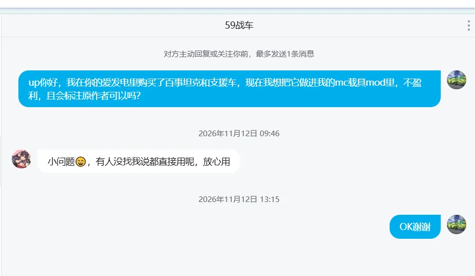

[← Back to Wiki Home](../index.html)

## 13. Configuration and Performance

- Client rendering and effects: `config/ywzj_rvp-client.toml`
  - Sight sensitivity, LOD scale, thermobaric particle quality/volume/flash/shake, explosion screen shake, volumetric trails, maximum distant vehicle renders, Distant Horizons compatibility mode.
- Client visual toggles: `config/ywzj_rvp-lighting-client.toml`
  - Screen-space lighting, explosion/muzzle/engine lighting, bloom, missile halo, EO jammer red glow, plume and air scattering.
- Common (client and server): `config/ywzj_rvp-common.toml`
  - Sight-axis acceleration, wreck lifetime, beyond-visual-range vehicle sync/authorization/distance, chunk leases and lookahead.
- HITL remote observation budget: `config/ywzj_rvp-hitl-remote.toml`
  - Session count, camera chunk radius, maximum control distance, chunk tickets/sends per tick, pending chunks, and extra entity limits.
- Server gameplay parameters: `config/ywzj_rvp-server.toml`

Performance recommendations:

- Allocate 6–8 GB of memory to the client.
- First launch extracts the vehicle pack from the ~234 MB jar; slower disks increase startup time.
- If performance drops, reduce thermobaric particle quality, screen shake, and distant vehicle renders; volumetric trails are off by default.
- When using Distant Horizons, select compatibility mode in the client configuration.

---

## 14. Compatibility

- Minecraft 1.20.1 / Forge 47.4.x; Fabric is not supported.
- Requires Limitless Vehicle 0.6.2.1.
- RVP, the Limitless Vehicle base mod, and the vehicle pack versions must match on client and server.
- Vehicle models, textures, sounds, and data are bundled in the `-full.jar`; no extra resource pack is required.
- Distant Horizons is an optional compatibility feature; related options are in the client configuration.

---

## 15. License and Credits

### 15.1 License

- **Code license**: This project's code is distributed under the **GNU General Public License v3.0 (GPL-3.0)**.

- **Art assets**: Vehicle models, textures, sounds, and other art assets remain the property of their respective authors and are **All Rights Reserved (ARR)** by default. Do not extract, sell, or redistribute them separately without permission. Models with a stated license follow that license.

- **Base project**: **Limitless Vehicle (GPL-3.0)** by YWZJ. RVP is a submod/add-on; this project is distributed under GPL-3.0 and complies with the base project's license.

- **Third-party code/assets**:
  - Some explosion, particle, and nuclear-visual code is referenced or ported from **HBM's Nuclear Tech (GPL-3.0)** and **HBM's Nuclear Tech Mod: Rebirth (LGPL-3.0)**; those parts follow GPL-3.0 and LGPL-3.0 respectively, and the project as a whole is distributed under GPL-3.0.
  - The tactical map implementation references the equivalent feature in **Superb Warfare (GPL-3.0)**; this project is distributed under GPL-3.0 and complies with SBW's GPL-3.0 license.

### 15.2 Credits

- **Vehicle pack authors**: DTC10, fishking0721, TV90, Walrus.

- **Partial model sources:**

| Model | Source / author | License and notes |
| --- | --- | --- |
| ZTZ100 | [Afdian](https://ifdian.net/item/b994864484f711f0b64452540025c377), original author **59 战车** | Purchased with authorization; see the authorization record below |
| EBRC | [Sketchfab](https://sketchfab.com/3d-models/ebrc-jaguar-infantry-fighting-vehicle-f7972bf5f63a4676bacac015ef4f33c0), original author **Muhamad Mirza Arrafi** | **CC Attribution (CC BY)**; attributed as required. The model and textures were modified |
| S400 radar vehicle | [Sketchfab](https://sketchfab.com/3d-models/s400-trioumf-radar-9446194719de47ee849117b29dadbba4), original author [**HWHNL**](https://sketchfab.com/HWHNL) | **CC BY-NC (Attribution-NonCommercial)**; this is a non-commercial project and attribution is provided as required |
| T-90M | CGmodel creator **空中火车** | Purchased; the original release page has been removed |
| M1A2 SEP, J-16, J-10C, J-20A, VT4, AbramsX | CGmodel creator **C5银河/冰是沉默的水** | Purchased |

**ZTZ100 authorization record.**

---

## 16. Versions

| Item | Version |
| --- | --- |
| RVP | `1.0.0_preview_0.6.2.1` |
| Minecraft | `1.20.1` |
| Forge | `47.4.x` |
| Limitless Vehicle | `0.6.2.1` |
| Vehicle pack | `1.0.0_preview_0.6.2.1` |
