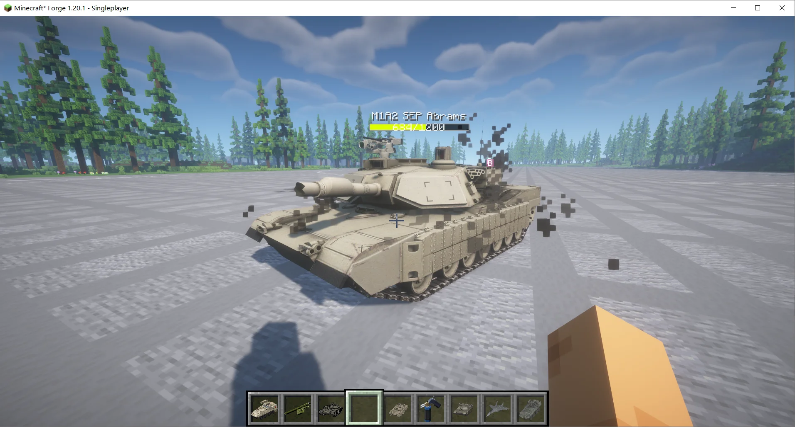
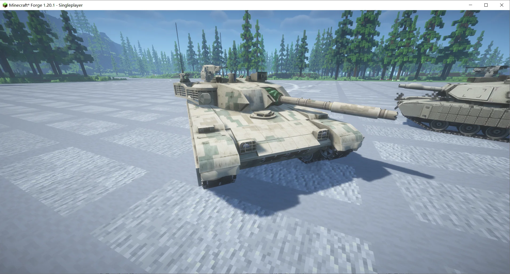

[← Back to Wiki Home](../index.html)

## 7. Modular Damage

RVP resolves damage by part and module; different parts have independent durability, damage multipliers, and failure effects.

| Part/module | Failure effect |
| --- | --- |
| ERA | The hit block fails after being penetrated, loses its protection, and changes appearance |
| Engine | Severe damage greatly reduces power and halves top speed; complete destruction removes all power and mobility |
| Barrel | Severe damage may cause firing failures or a barrel burst; even successful shots lose accuracy. Complete destruction prevents firing. At stage-1 damage, missile-type weapons only succeed or fail; they do not cause a barrel burst |
| Traverse | Severe damage greatly reduces traverse speed; complete destruction prevents rotation |
| Fire control system (FCS) | Stabilizer fails, ballistic calculation and CCIP stop, thermal/night vision and EO search become unavailable; the crosshair remains but provides no valid ballistic solution |
| Radar | Destroyed radar cannot search or track targets |
| APS/jammer/DIRCM/countermeasure launcher | Destroyed equipment loses its function |
| Maintenance equipment | Destroyed maintenance equipment cannot perform quick repairs |

Damage calculation uses part OBBs and independent damage multipliers; explosion direction, impact angle, armor reduction parameters, distance, ammunition type, and ERA state all affect final damage.

The repair panel restores parts by priority; ERA and support-equipment repair orders can be set separately.

**Figures 7.1/7.2 Severely damaged tanks.**

---
