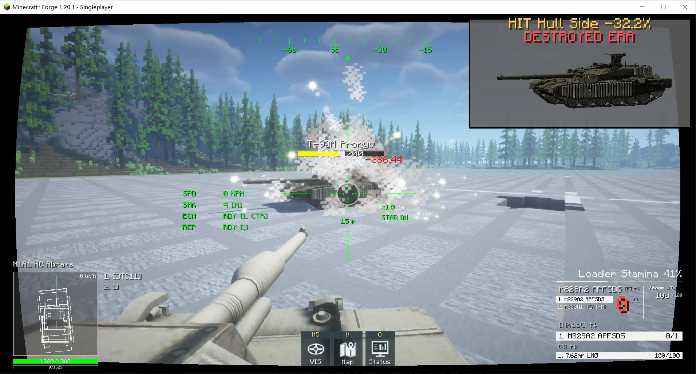
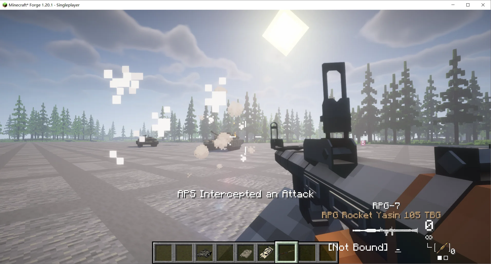
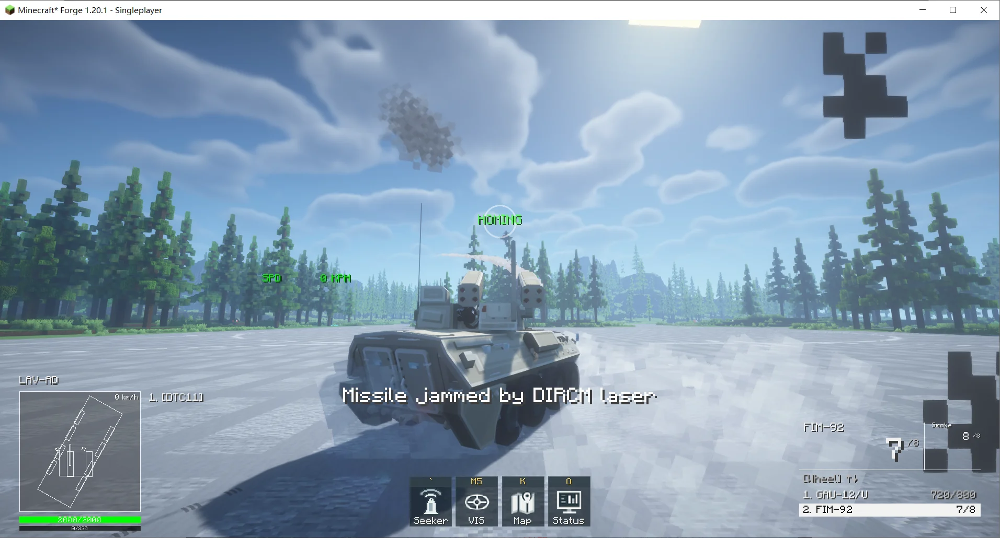
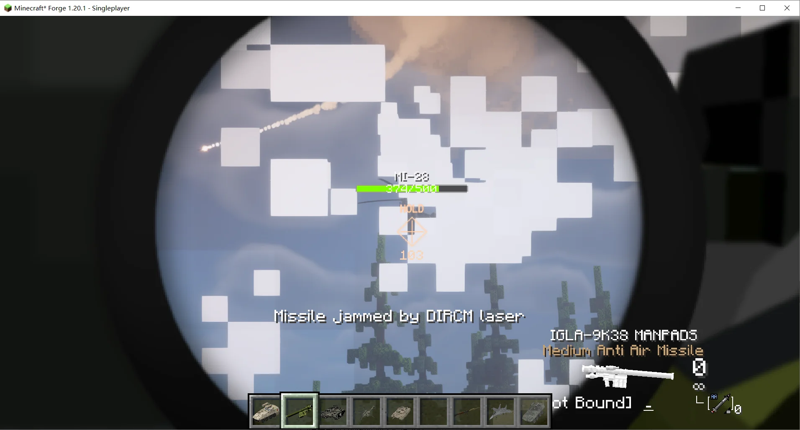

[← Back to Wiki Home](../index.html)

## 6. Support Equipment

RVP support equipment is configured by bone module and has independent durability and functional state. Destroyed equipment stops working and can be restored by repair.

| Equipment | Function |
| --- | --- |
| ERA | High damage-reduction multiplier; explodes and disappears after absorbing enough damage |
| APS | Detects and intercepts incoming ammunition by sector; if a sensor bone is destroyed, that sector stops intercepting |
| Active ECM | Jams radar/satellite/radio-guided missiles in range and becomes the strongest radiation source, attracting anti-radiation missiles. Powerful ECM on electronic-warfare aircraft can generate false signals that interfere with fighter radar and RWR |
| Passive ECM | Generates false targets when illuminated by enemy radar; stops when the bone is destroyed |
| Electro-optical jammer | Jams SACLOS missiles entering its sector, making them deviate |
| DIRCM | Directional infrared countermeasure against IR, AIR, man-in-the-loop missiles, and SBW's SA18; limited engagement channels can be saturated by multiple incoming IR missiles |
| Flares/chaff/smoke | Configured per vehicle with independent ammunition and cooldowns; flares decoy IR/AIR missiles, chaff decoys radar-guided missiles and breaks radar locks, smoke blocks laser spots and IR seekers |
| Maintenance equipment | Repairs parts and equipment |

The equipment panel shows support-equipment status and lets you set repair order. ERA and other support equipment use separate repair queues; when a bone has both ERA and another device, they recover together in the ERA queue.

**Figure 6.1 Explosive reactive armor.**

**Figure 6.2 Active protection system.**

**Figure 6.3 DIRCM jamming.**

**Figure 6.4 DIRCM jamming an SBW missile.**

---
