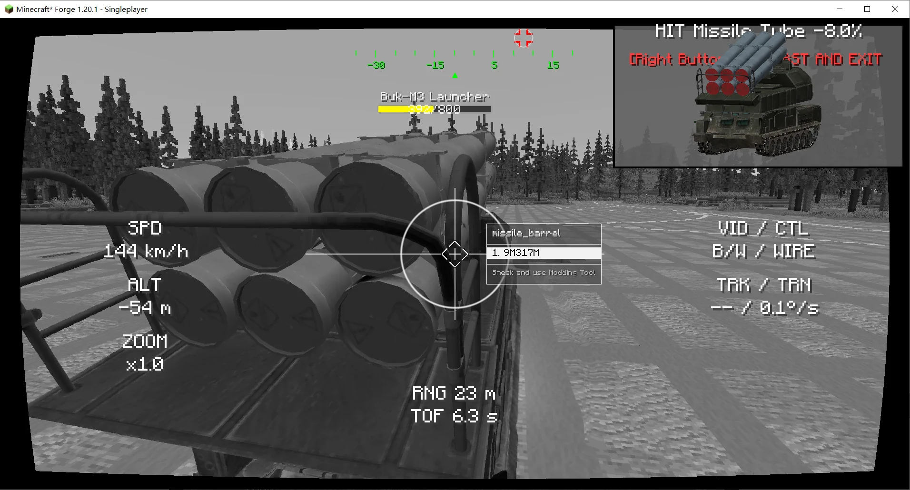

[← Back to Wiki Home](../index.html)

## 10. Interface and Controls

### 10.1 Man-in-the-Loop

- One of RVP's signature weapon features.
- Two interfaces: TV guidance (HITL_TV) and command-line TV guidance (HITL_CLOS_TV).

**HITL_TV**

- After launch, the missile's TV/thermal video feed opens.
- The operator selects a target point with the crosshair and presses the anchor key (default `R`) to anchor or re-anchor; the missile tracks that point.
- The HUD shows speed, altitude, distance, flight time, lock state, and operation hints.
- Supports color/black-and-white/thermal switching, mouse-wheel zoom, airburst detonation, and exit.

**Figure 10.1 Man-in-the-loop missile.**

**HITL_CLOS_TV**

- After launch, the same TV/thermal video feed opens.
- The operator directly controls the missile's control surfaces; a steering cursor is shown at the screen center, with no target anchoring step.
- The HUD shows speed, altitude, distance, flight time, turn rate, and operation hints.
- Also supports video-mode switching, mouse-wheel zoom, airburst detonation, and exit.

**Figure 10.2 Man-in-the-loop missile (command-line TV).**

### 10.2 HMD

- IR-guided missiles support HMD acquisition and off-boresight launch.
- Radar weapon stations support a radar HMD for quickly locking the direction being looked at.

### 10.3 Warnings and Indicators

- Laser illumination warning.
- Lock warning and missile-approach warning.
- Support equipment, DIRCM, ECM, APS, and countermeasure status.
- Hit markers, creature damage numbers, and module damage indicators.
- Action cards showing currently available actions and shortcuts.

---
