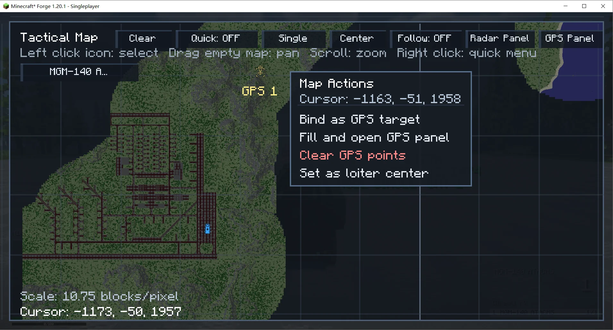
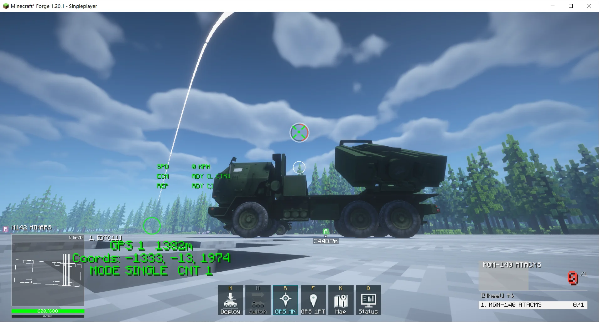
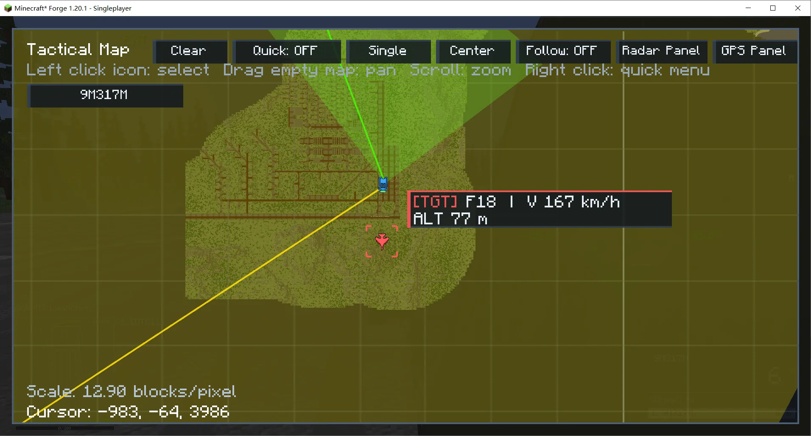
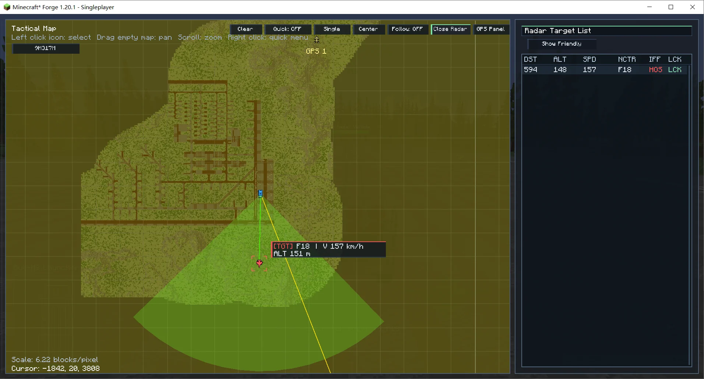
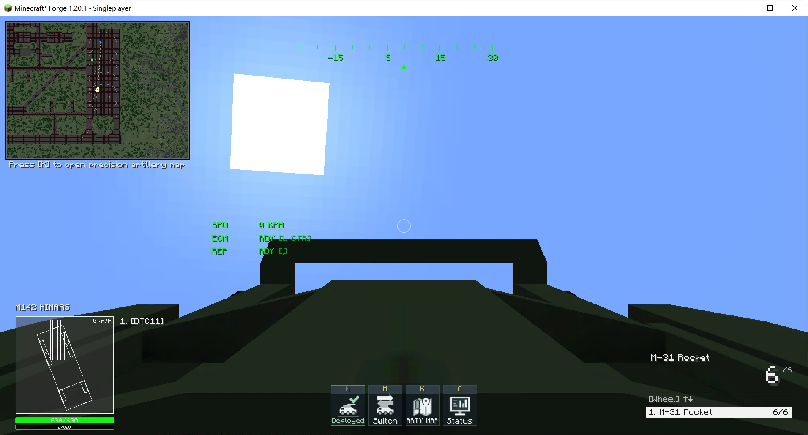
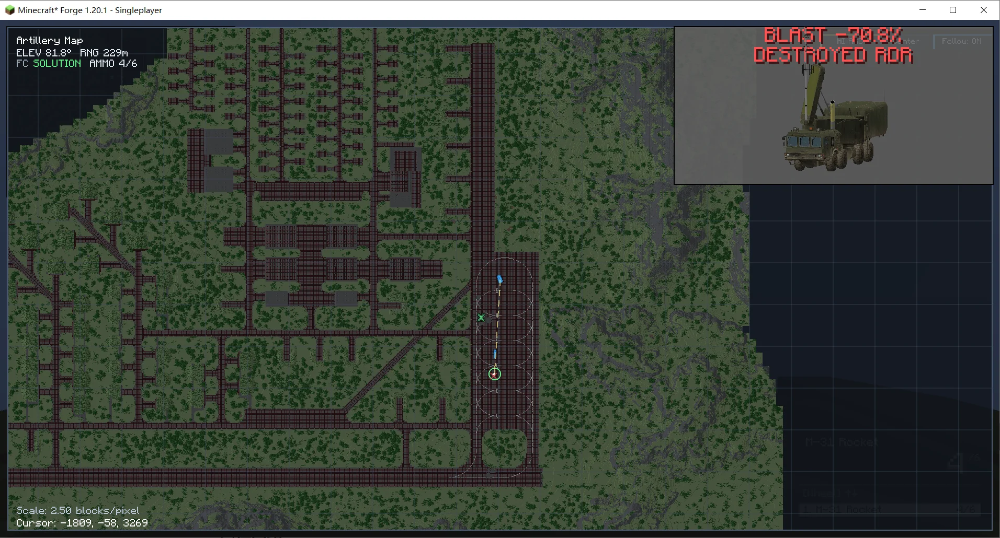

[← Back to Wiki Home](../index.html)

## 9. Tactical Map

The tactical map shows terrain, players, vehicles, missiles, and GPS target points, and supports zooming, dragging, following, and quick marking. Right-click a target to bind it as a GPS target or fill its position into the GPS panel.

### 9.1 GPS-Guided Weapon Integration

- Select a target point on the tactical map and designate it as a GPS target.
- Supports single-point and multi-point marking.
- Multi-point mode manages multiple target points; radar mode selects targets from the radar panel.

**Figures 9.1/9.2 Tactical map integrated with GPS-guided weapons.**

### 9.2 Radar Target List Integration

- The tactical map can open the radar target list, showing distance, altitude, speed, NCTR identification, IFF, and lock state.
- Targets can be locked, and the current missile can be quick-fired if it meets the lock conditions.
- The radar target list can hide friendly targets.

**Figures 9.3/9.4 Tactical map integrated with the radar panel.**

### 9.3 Artillery Map and Mini Artillery Map

- **Artillery map**: after selecting a target, calculates elevation and impact distance with high/low ballistic solutions; left-click to fire; intended for RVP artillery weapons.
- **Mini artillery map**: shows a compact map in the screen corner when an artillery weapon is selected, computing the impact point from the current muzzle direction and elevation; left-click fires along the normal firing path. Accuracy is lower, so it is only for emergencies.

**Figures 9.5/9.6 Artillery map.**

---
