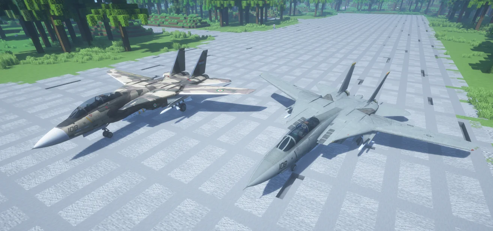
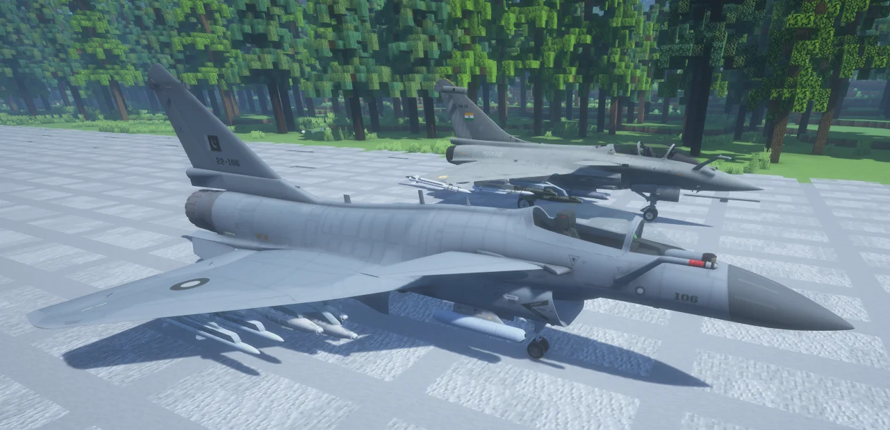

[← Back to Wiki Home](../index.html)

## 12. Vehicles

The main pack contains 39 controllable vehicles:

| Category | Count | Examples |
| --- | ---: | --- |
| Tanks | 6 | M1A2 SEPv2, M1A1 HC, AbramsX, T-90M, VT4A1, ZTZ100 |
| IFVs | 3 | BMPT-72, LAV-25, ZBL-08A |
| Air-defense vehicles | 7 | M1 AGDS, Pantsir-S1SM, Buk-M3, 96L6 radar vehicle, LAV-AD, EBRC AA, CS/SA-5 |
| Fighters | 11 | F-22A, F-14D, Iranian F-14A, F/A-18F, EA-18G, J-20A, J-16, J-16D, J-15T, J-10C, Rafale |
| Attack helicopters | 4 | AH-64E, Mi-28NE, AH-1Z, Z-10 |
| UAVs | 4 | Light reconnaissance UAV, quadcopter reconnaissance UAV, quadcopter bombing UAV, quadcopter suicide UAV (all vehicle-deployable) |
| Destroyers | 2 | 052D Kunming, DDG-51 Arleigh Burke |
| Other vehicles | 2 | M142 HIMARS, RAWR unmanned combat vehicle |
| Total | **39** | Plus one Switchblade UCAV launcher and deployed variants |

The F-14A and F-14D support variable-sweep wings. Fourteen air vehicles support custom pylons; some vehicles have weapon bays and variants.

---

