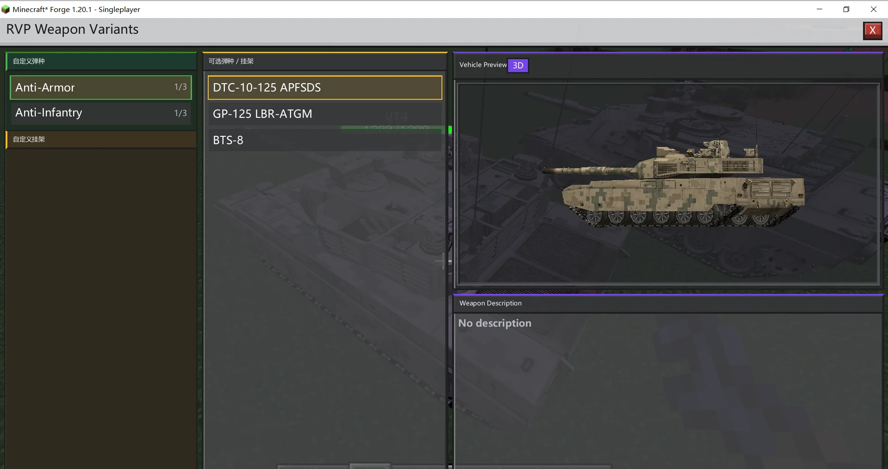
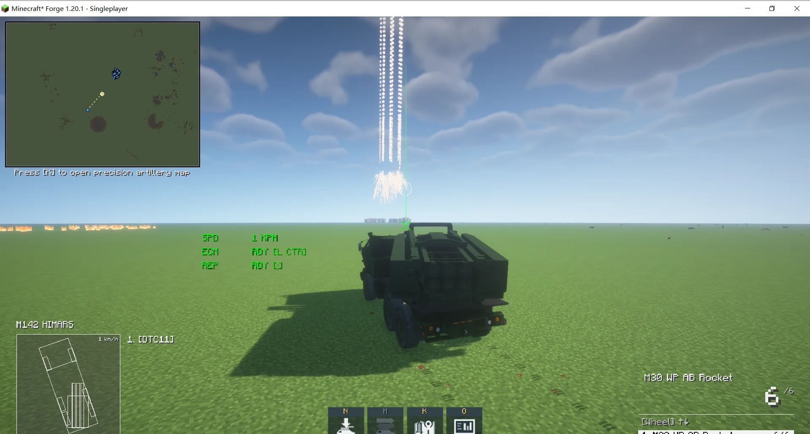
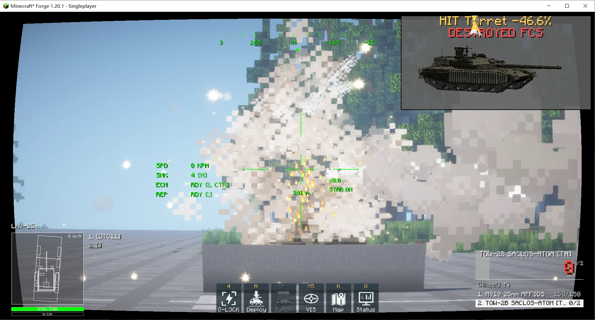
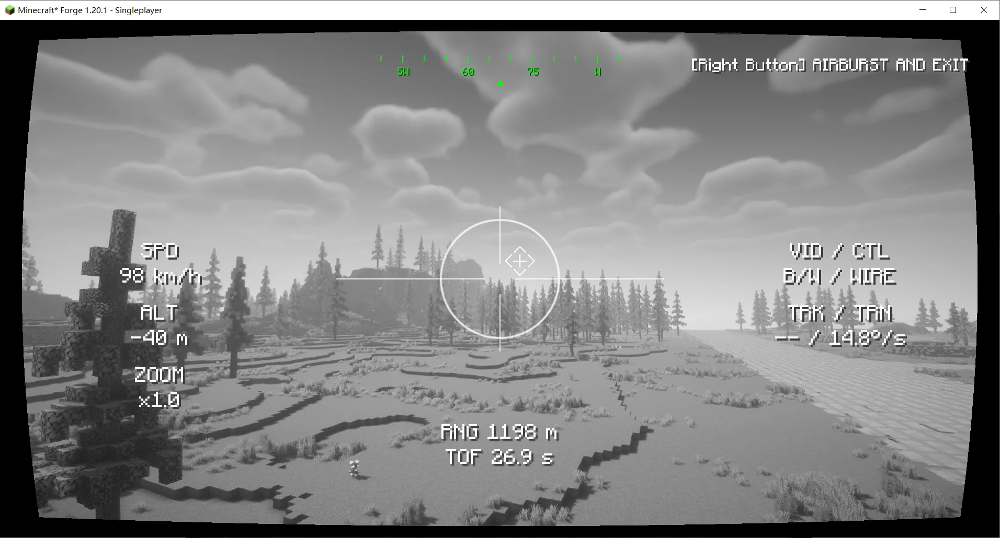
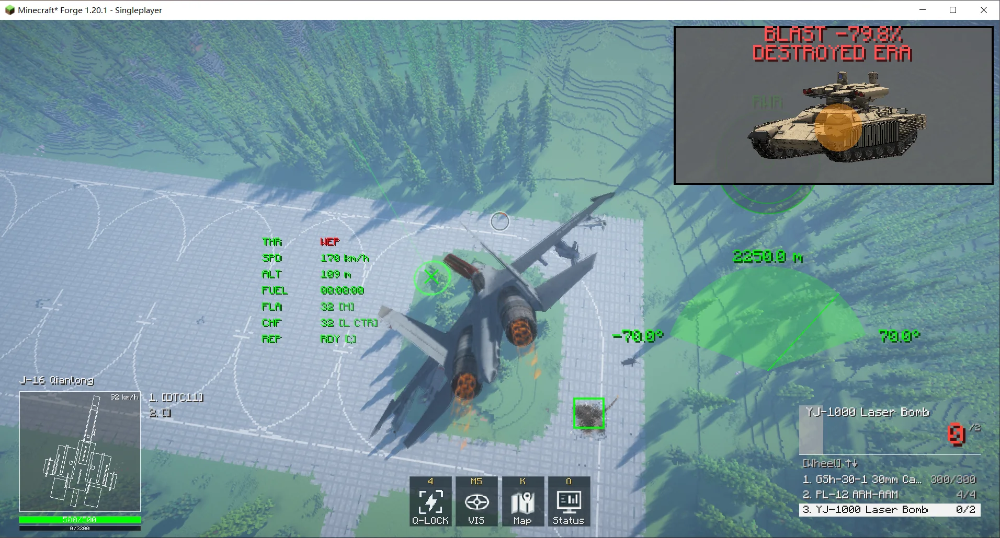
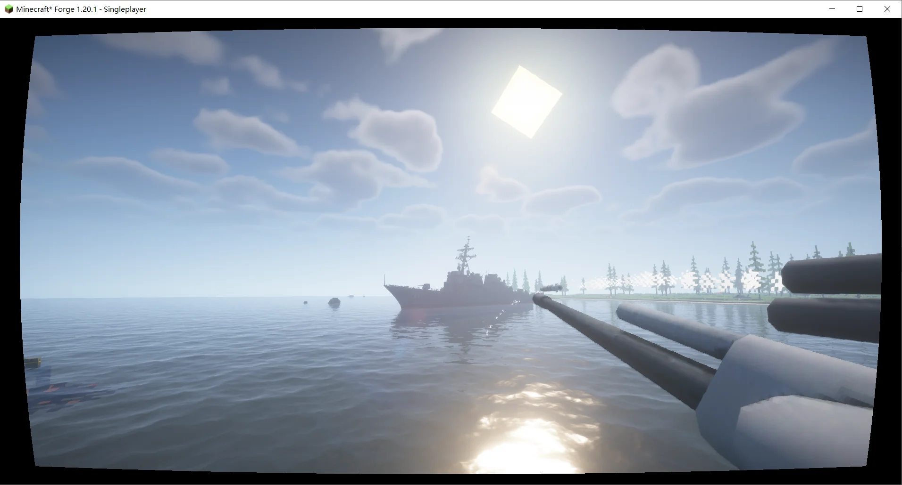
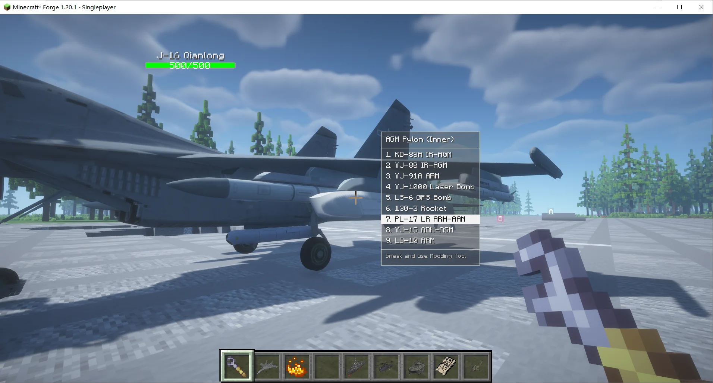
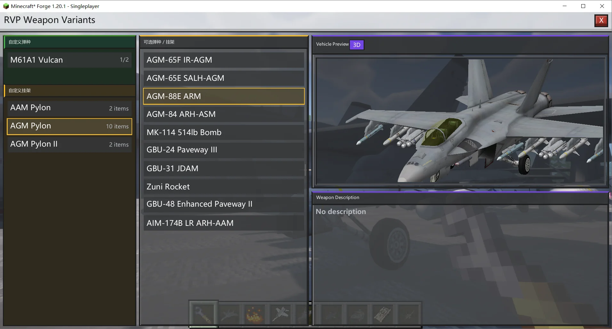

[← Back to Wiki Home](../index.html)

## 5. Weapon Systems

The RVP data directory contains 231 weapon and ammunition definition files, including subordinate entries such as warheads and submunitions. RVP vehicles generally have multiple weapon stations for the main gun, secondary guns, machine guns, missiles, and rockets. Fourteen fixed-wing and rotary-wing vehicles support custom pylons; the F/A-18F and J-16 offer the widest selection.

### 5.1 Guns and Ammunition

RVP's guns include vehicle- and aircraft-mounted machine guns, autocannons and close-in weapon systems, tank guns, naval guns, and a vehicle-mounted laser suppression system. Different weapons use different ammunition; below is a summary of the main ammunition types by their actual in-game behavior.

- **APFSDS**: Fin-stabilized discarding-sabot armor-piercing round. High direct damage with no explosive payload; can penetrate 2 blocks, with direct damage falling off after passing through a wall. Effective against armored targets and highly resistant to explosive reactive armor.
- **HEAT**: Shaped-charge round. Higher direct damage plus a small explosion; the hit damage is reduced by ERA. Overall performance against both direct and explosive damage falls between APFSDS and HE. Extremely effective against lightly armored targets such as IFVs. Tank HEAT has no tandem warhead; tandem warheads are found only on missiles.
- **HE**: High-explosive round. Low direct damage, large blast damage and radius; relies on the explosion to kill soft and lightly armored targets.
- **PELE**: Penetrator with enhanced lateral effect. Lower direct damage, but releases a large number of fragments when hitting a vehicle or block; effective against light armor and infantry in enclosed spaces, limited against heavy armor.
- **AHEAD**: Programmable ammunition. Requires a radar or weapon-station lock to calculate lead and set the airburst fuze automatically. Without a lock it does not program an airburst and flies as a normal direct-fire round.
- **Programmable airburst**: Press the lock key (default `R`) to range the aim point (it must hit a block). The round detonates after traveling “measured range + offset” along its trajectory, useful for airbursts above cover or near a target.
- **SAP**: Wall-breaching high-explosive round with 1-block penetration; it can pass through a wall and detonate on a target behind it, mainly against infantry behind cover.
- **Shotgun**: Fires multiple pellets per shot, covering soft targets at close range; pellet damage falls off with distance.
- **Railgun**: ZTZ100 and AbramsX are equipped with an experimental railgun. It must be charged before firing; once fully charged, it launches a projectile at extremely high muzzle velocity.

**Figure 5.1 RVP tanks carry a wide range of ammunition types for different situations.**

### 5.2 Rockets

- **Unguided**: Hydra 70, Zuni, S-13, S-8KO, FS70B, 130-2 and other rocket pods. The ballistic computer provides continuous impact calculation.
- **Guided**: APKWS, FS70A and other laser-guided rockets. They follow the laser spot and can engage moving targets.
- **Cluster**: M30, M261, FS70B cluster types. They disperse many submunitions near the ground, with strong area effects against soft targets and limited anti-armor capability.
- **White phosphorus/incendiary**: M30 white-phosphorus airburst types. They scatter a white-phosphorus barrage near the ground for large-area incendiary effect.

**Figure 5.2 M142 HIMARS white-phosphorus rocket example.**

### 5.3 Missiles

Missiles are grouped by guidance type.

| Guidance | Description and examples |
| --- | --- |
| Infrared (IR) | Seeker tracks the target's heat signature; AIM-9M, PL-10, FIM-92K, KD-88A, etc. HMD support enables high-off-boresight acquisition, lock, and launch |
| Active radar homing (ARH) | Midcourse datalink guidance, then the onboard radar seeker activates and acquires the target; AIM-120D, PL-15, AIM-54C, YJ-19, etc. |
| Semi-active radar homing (SARH) | Requires continuous illumination from the aircraft/vehicle radar; AIM-7P, R-27R, ESSM, etc. |
| Semi-active laser homing (SALH) | A laser designates the target; the illuminated target triggers a laser warning; AGM-114K, AGM-65E, LAHAT, AKD-10, etc. |
| Laser beam riding (LBR) | Flies along a laser beam; the illuminated target triggers a laser warning; 9M119M1, GP-125, 9M127, etc.; 9M119M1 and GP-125 are gun-launched missiles |
| Anti-radiation (ARM) | Homes on an emitting radar; shutting down the radar can evade it; AGM-88E, LD-10, YJ-91, etc. |
| Active infrared (AIR) | Radar or datalink midcourse correction, then an IR seeker searches autonomously in the terminal phase; HHQ-10, HQ-13, etc. |
| GPS/INS | Satellite and inertial navigation with tactical-map designation; AKF-98A, Storm Shadow, ATACMS, YJ-20, etc. GBU-31, LS-6, and GB-3 GPS are satellite-guided bombs, covered in 5.4 |
| Man-in-the-loop TV (HITL_TV) | After launch, the seeker video feed opens; the operator selects and locks a target in the feed, similar to War Thunder's man-in-the-loop missiles; KH-39, KD-88, etc. |
| Man-in-the-loop command-line TV (HITL_CLOS_TV) | After launch, the operator directly controls the missile's control surfaces to steer it, similar to Battlefield 4 TV missiles; TL-17, CM-502KG, Switchblade loitering munitions, etc. |
| SACLOS | The operator aims at the target and the missile follows the line of sight by command; harder to use than LBR but does not trigger a laser warning; TOW-2A/2B, HJ-73E, 95Ya6M, etc. TOW-2B uses an EFP top-attack warhead: it flies over the target and detonates downward, scattering fragments, effective against targets behind cover |

Some missiles have multi-mode seekers: for example, Brimstone uses a semi-active laser/active radar dual-mode seeker, flying toward the laser spot in the first phase and then activating its active radar seeker to acquire the target autonomously. Some missiles support dual-pulse motors, cold launch, high-loft/over-the-top trajectories, and proximity/impact fuzes.

**Figure 5.3 TOW-2B with an EFP top-attack warhead can hit tanks behind cover.**

**Figure 5.4 Anti-radiation missiles can strike emitting radar targets.**

**Figure 5.5 Man-in-the-loop missile (TV missile).**

### 5.4 Aerial Bombs

- **Conventional bombs**: MK-84 and similar unguided gravity bombs; the ballistic computer provides continuous impact calculation.
- **Semi-active laser-guided bombs**: GBU-24, GBU-48, GB-3 laser, GB-500, YJ-1000. Modified from conventional bombs; the carrying aircraft illuminates the laser spot and the bomb flies toward it, allowing engagement of moving targets.
- **Satellite/inertial-guided bombs**: GBU-31, LS-6, GB-3 GPS. GPS coordinates can be marked on the tactical map; after release the bomb flies toward the coordinates.
- **Infrared-guided bombs**: GB-3 IR. The IR seeker tracks target heat signatures and can engage moving targets.

**Figure 5.6 Laser-guided bombs.**

### 5.5 Torpedoes

Torpedoes can travel 1–2 meters below the water surface and deal massive damage to large ships.

**Figure 5.7 Torpedo launch.**

### 5.6 Pods

| Type | Description |
| --- | --- |
| Targeting pod | Marks targets; marked targets are displayed on the tactical map. |
| Coordinate designation pod | Obtains and marks target coordinates for the GPS panel or fire support; some models integrate “call fire strike / call airstrike” |

TGP is used by the EA-18G, F/A-18F, and J-16D; EOTS by the J-20A; the SUAV pod by the light reconnaissance UAV and quadcopter reconnaissance UAV. Coordinate designation pods with integrated fire support are used by the MBT co-pilot station, EA-18G, J-16D, and reconnaissance UAVs.

### 5.7 Laser Weapons

- ZTZ100's 10 kW laser suppression system can illuminate enemy vehicles; after enough hits it blinds players and AI gunners.
- While blinded, AI gunners can only use radar-guided or radar-midcourse weapons; players see a white screen that obstructs observation.
- Laser illumination triggers the corresponding warning and HUD indication.

### 5.8 Fire Support

- **RVP fire support terminal**: Hold it in the main or off hand and right-click, or press `K` to open the fire support map; supports call, impact area, round count, and ceasefire.
- **Fire support modes**: Hasty, effective, surveillance, and aerial strike.
- **Barrage patterns**: Point, linear, and creeping barrage.
- **Support ammunition**: Aerial bombs, rockets, cluster rockets, white phosphorus, ATACMS, 9M723, GPS cruise missiles, etc., depending on the fire support configuration.
- **Pod integration**: Targeting pods can mark entities or coordinates; vehicles carrying “call fire strike”/“call airstrike” can select a strike entry in the pod interface and automatically call it after marking coordinates.

### 5.9 Weapon Customization and Ammunition Selection

Most RVP vehicles support extensive weapon customization. Players can choose different ammunition or loadouts for the mission, for example:

- **SEAD**: aircraft carry anti-radiation missiles to suppress radar air-defense vehicles.
- **DEAD**: aircraft carry IR- or laser-guided missiles to strike air-defense systems with their radars off.
- **Ground vehicles**: use PELE against many lightly armored targets and APFSDS against heavy armor.

**Figures 5.8/5.9 RVP vehicles offer extensive customization.**

---
