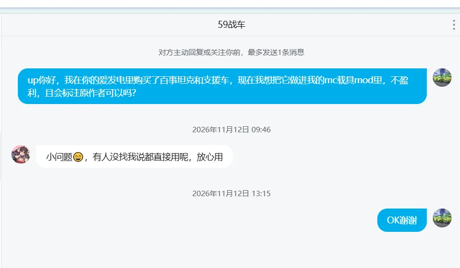

[← 返回 Wiki 首页](../index.html)

## 13. 配置与性能

- 客户端渲染与特效：`config/ywzj_rvp-client.toml`
  - 观瞄灵敏度、LOD 缩放、温压粒子质量/音量/闪光/震动、爆炸屏幕震动、体积尾烟、远距载具渲染上限、Distant Horizons 兼容模式。
- 客户端画质开关：`config/ywzj_rvp-lighting-client.toml`
  - 屏幕空间照亮、爆炸/炮口/发动机照亮、光晕、导弹外圈、光电干扰机红光、喷焰与空气散射。
- 双端通用：`config/ywzj_rvp-common.toml`
  - 观瞄轴加速、残骸保留时间、超视距载具同步/授权/距离、区块租约与前瞻。
- HITL 远程观察预算：`config/ywzj_rvp-hitl-remote.toml`
  - 会话数、相机区块半径、最大控制距离、每 tick 区块票据/发送量、待处理区块与额外实体上限。
- 服务端玩法参数：`config/ywzj_rvp-server.toml`
- 性能建议：
  - 为客户端分配 6–8 GB 内存。
  - 首次启动会从约 234 MB 的 jar 中解压载具包；磁盘较慢时启动时间会延长。
  - 卡顿时可降低温压粒子质量、屏幕震动和远距载具渲染数量；体积尾烟默认关闭。
  - 使用 Distant Horizons 时，可在客户端配置中选择兼容模式。

---

## 14. 兼容性

- Minecraft 1.20.1 / Forge 47.4.x；不支持 Fabric。
- 需要 Limitless Vehicle 0.6.2.1。
- 客户端与服务端的 RVP、LV本体和载具包版本需保持一致。
- 载具模型、贴图、音效和数据均内置于 `-full.jar`，无需额外资源包。
- Distant Horizons 为可选兼容项，相关选项位于客户端配置。

---

## 15. 许可与致谢

### 15.1 许可

- **代码许可**：本项目代码以 **GNU General Public License v3.0（GPL-3.0）** 分发。

- **美术资源**：载具模型、贴图、音效等美术资源版权归各自作者所有，默认 **All Rights Reserved（ARR，保留所有权利）**；未经作者许可，请勿单独提取、商用或再分发。已注明授权方式的模型按对应条款使用。

- **基座项目**：**Limitless Vehicle（GPL-3.0）**，作者 YWZJ。RVP 是其 Submod/addon；本项目按 GPL-3.0 开源分发，并遵守基座项目的开源许可。

- **第三方代码/素材**：
  - 部分爆炸、粒子与核爆视觉代码参考或移植自 **HBM's Nuclear Tech（GPL-3.0）** 与 **HBM's Nuclear Tech Mod: Rebirth（LGPL-3.0）**；相关部分分别遵守 GPL-3.0 与 LGPL-3.0，本项目整体以 GPL-3.0 开源分发。
  - 战术地图功能的代码实现参考了 **卓越前线 Superb Warfare（GPL-3.0）** 的同类型功能；本项目以 GPL-3.0 开源分发，并遵守 SBW 的 GPL-3.0 许可。

### 15.2 致谢

- **载具包作者**：DTC10、fishking0721、TV90、Walrus。

- **载具包部分模型来源：**

| 模型 | 来源 / 作者 | 授权与说明 |
| --- | --- | --- |
| ZTZ100 | [爱发电](https://ifdian.net/item/b994864484f711f0b64452540025c377)，原作者 **59 战车** | 已购买并获得授权使用；下图为授权记录 |
| EBRC | [Sketchfab](https://sketchfab.com/3d-models/ebrc-jaguar-infantry-fighting-vehicle-f7972bf5f63a4676bacac015ef4f33c0)，原作者 **Muhamad Mirza Arrafi** | **CC Attribution（CC BY）**，已按协议署名；本项目对模型和贴图有改动 |
| S400 雷达车 | [Sketchfab](https://sketchfab.com/3d-models/s400-trioumf-radar-9446194719de47ee849117b29dadbba4)，原作者 **HWHNL** | **CC BY-NC（Attribution-NonCommercial）**；本项目为非商业项目，已按协议署名 |
| T-90M | CGmodel 创作者 **空中火车** | 已购买；原始发布页面已被删除 |
| M1A2 SEP、J-16、J-10C、J20A、VT4、AbramsX | CGmodel 创作者 **C5银河/冰是沉默的水** | 已购买 |

  

  

---

## 16. 版本

| 项目 | 版本 |
| --- | --- |
| RVP | `1.0.0_preview_0.6.2.1` |
| Minecraft | `1.20.1` |
| Forge | `47.4.x` |
| Limitless Vehicle | `0.6.2.1` |
| 载具包 | `1.0.0_preview_0.6.2.1` |
