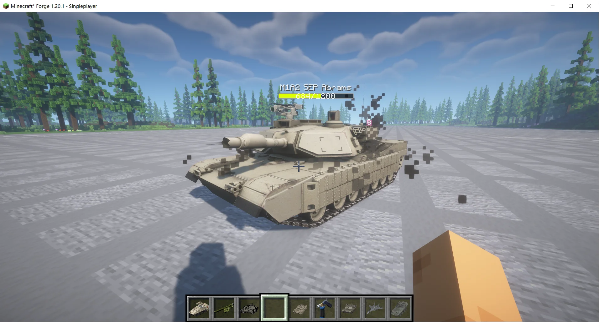
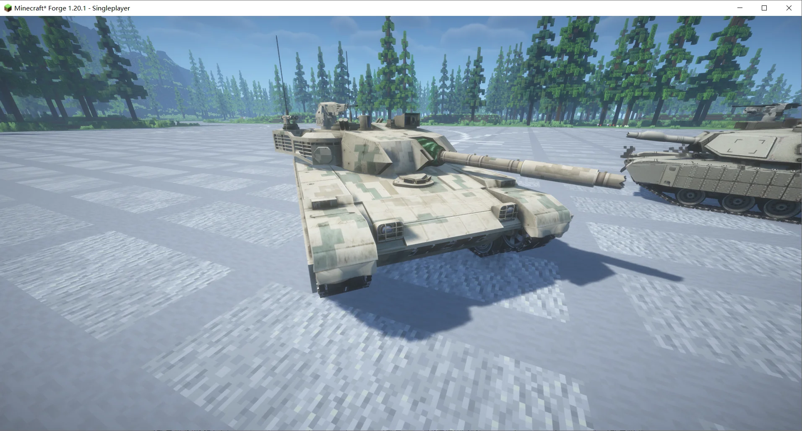

[← 返回 Wiki 首页](../index.html)

## 7. 模块化损伤

RVP 的损伤按部位和模块结算。不同部位具有独立耐久、伤害倍率和失效效果。

| 部位/模块 | 失效效果 |
| --- | --- |
| ERA 爆反 | 被击穿后该块失效，失去防护弹药能力，外观同步变化 |
| 发动机 | 受损严重时失去大量动力，极速减半； 被彻底摧毁时失去全部动力无法移动。 |
| 炮管 | 受损严重时射击有概率失败，甚至炸膛，即使射击成功也会导致精度大幅度下降； 被彻底摧毁时无法射击。 |
| 方向机 | 受损严重时方向机转速大幅度下降； 彻底损坏时无法转动方向机 |
| 火控系统（FCS） | 损坏后稳定器损坏、弹道解算与 CCIP 停止、热成像/夜视与光电搜索不可用； |
| 雷达 | 被击毁后无法搜索/跟踪目标 |
| APS/干扰机/DIRCM/干扰弹发射器 | 被击毁后失去对应功能 |
| 维修设备 | 被击毁后无法使用快速维修 |

损伤计算使用部位 OBB 与独立伤害倍率；爆炸方向、入射角、装甲减伤参数、距离、弹种和 ERA 状态都会影响最终伤害。

维修面板按优先级恢复部件；可分别设置爆反维修顺序与辅助设备维修顺序。

**图7.1/7.2 损坏严重的坦克**

---
