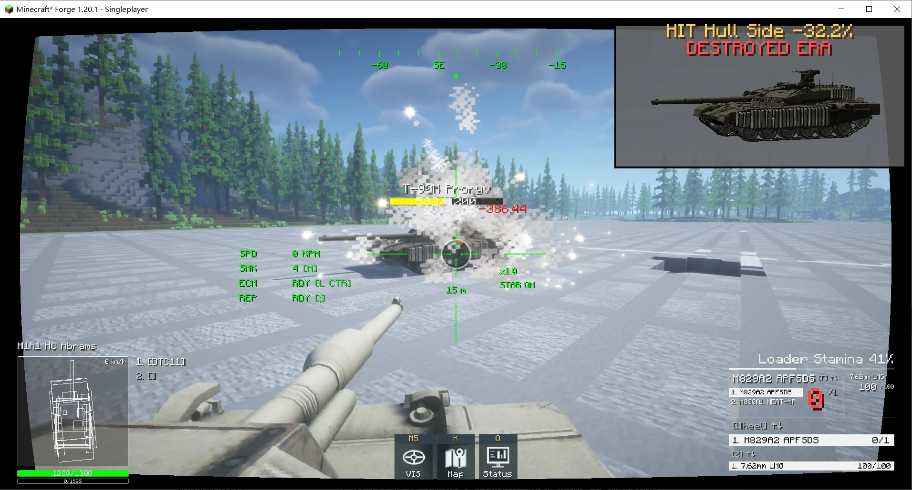
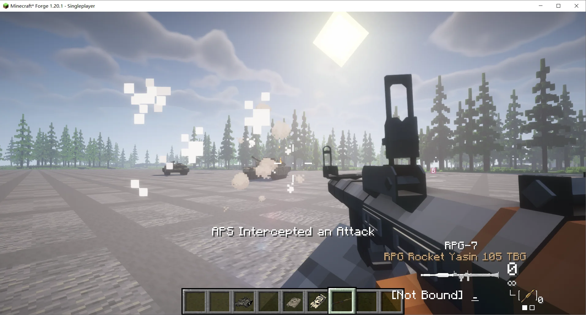
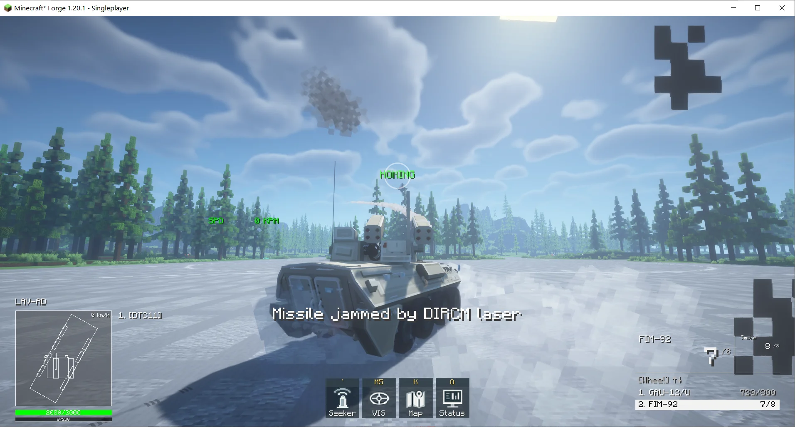
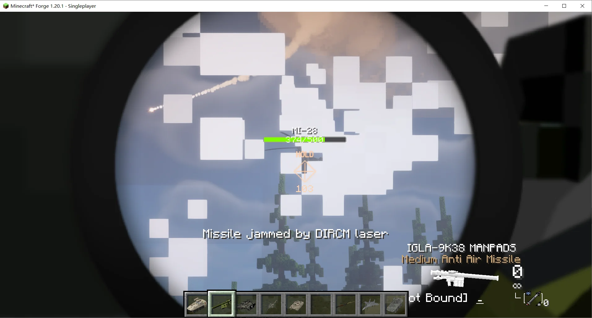

[← 返回 Wiki 首页](../index.html)

## 6. 辅助设备

RVP 的辅助设备按骨块模块配置，具有独立耐久和功能状态。设备被击毁后对应功能停止，可通过维修恢复。

| 设备 | 功能 |
| --- | --- |
| ERA 爆炸反应装甲 | 拥有较高的免伤倍率，承担一定伤害后爆炸消失 |
| APS 主动防护 | 按扇区探测并拦截来袭弹药；传感器骨块被击毁后，对应扇区停止拦截 |
| ECM 主动干扰 | 释放后干扰一定范围内的雷达/卫星/无线电制导导弹，同时成为最高辐射源吸引反辐射导弹。电子战机的强效ECM甚至产生虚假信号能干扰战斗机的雷达与RWR |
| 被动 ECM | 被敌方雷达照射时生成假目标，干扰对方雷达判断；骨块失效后停止生成 |
| 光电干扰机（软杀伤干扰机） | 对进入干扰扇区的 SACLOS 导弹进行干扰，使其偏离攻击弹道 |
| DIRCM 定向红外对抗 | 对 IR、AIR，人在回路导弹以及**SBW**模组的SA18单兵弹实施定向干扰，使其偏离攻击弹道，但是火力通道有限，会被同时来袭的多枚红外导弹突防 |
| 热焰弹/箔条/烟幕 | 按载具配置抛洒，各自独立备弹和冷却；热焰弹能干扰IR导弹和AIR导弹；箔条可以干扰雷达制导导弹以及让战机雷达脱锁；烟幕可遮挡激光点，屏蔽红外制导导弹，使得对应导弹失准。 |
| 维修设备 | 修复部件和设备； |

设备面板显示辅助设备状态，并可设置维修顺序。ERA 与辅助设备使用独立的维修队列；同骨同时具有 ERA 和其它设备时，按爆反队列捆绑恢复。

**图6.1 爆炸反应装甲**

**图6.2 主动防御系统**

**图6.3 DIRCM干扰**

**图6.4 DIRCM干扰SBW导弹**

---
