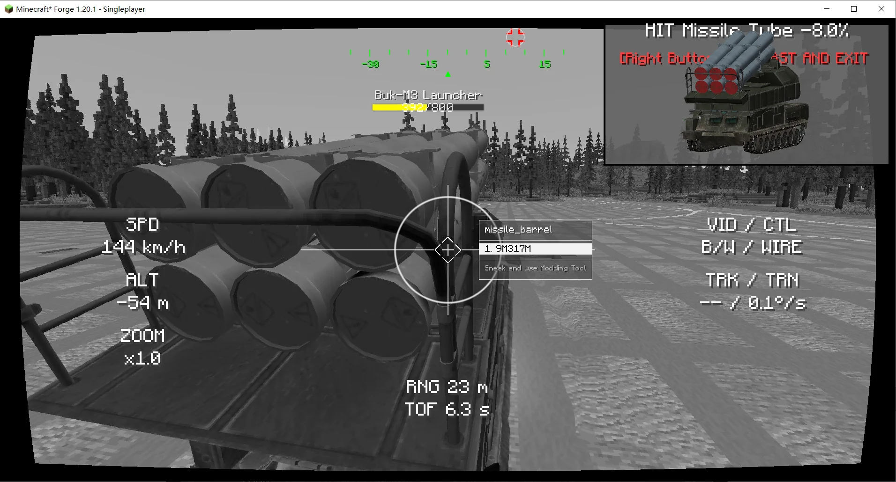

[← 返回 Wiki 首页](../index.html)

## 10. 界面与操作

### 10.1 人在回路

- RVP特色武器之一
- 分为电视制导（HITL_TV）和指令线电视制导（HITL_CLOS_TV）两种界面。

**人在回路电视制导（HITL_TV）**

- 发射后进入弹载电视/热成像回传画面。
- 发射手在画面中用准星选择目标点，按锚定键（默认 R）锚定或重新锚定，导弹跟踪该目标点。
- HUD 显示速度、高度、距离、飞行时间、锁定状态和操作提示。
- 支持彩色/黑白/热成像切换、滚轮缩放、空爆引爆和退出。

**图10.1 人在回路导弹**

**人在回路指令线电视制导（HITL_CLOS_TV）**

- 发射后进入同样的电视/热成像回传画面。
- 发射手直接控制导弹舵面转向，屏幕中心显示操纵游标；没有目标锚定流程。
- HUD 显示速度、高度、距离、飞行时间、转向速率和操作提示。
- 同样支持画面模式切换、滚轮缩放、空爆引爆和退出。

**图10.2 人在回路导弹2**

### 10.2 头瞄

- 红外制导导弹支持头瞄捕获与离轴发射。
- 雷达武器站支持雷达头瞄方便快速锁定指向位置。

### 10.3 告警与提示

- 激光照射告警。
- 锁定告警与导弹逼近提示。
- 辅助设备、DIRCM、ECM、APS、干扰物状态显示。
- 命中指示、生物伤害飘字与模块损伤提示。
- 动作卡显示当前可用操作与快捷键。

---
