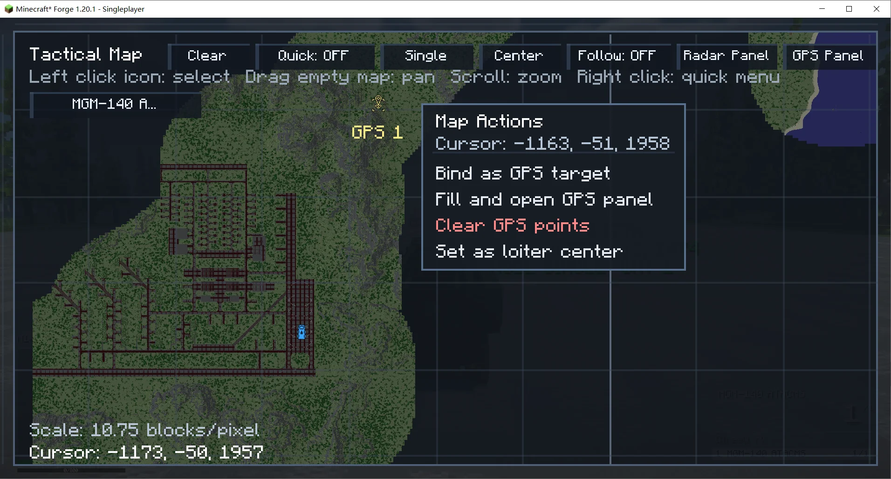
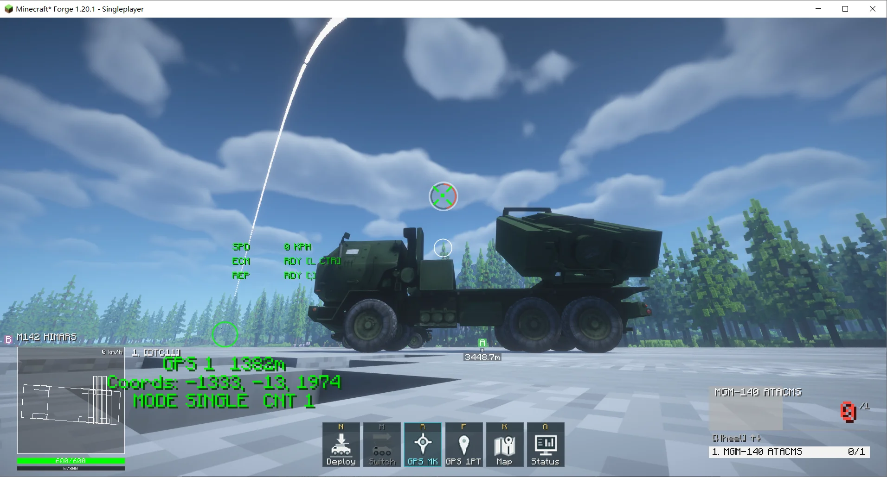
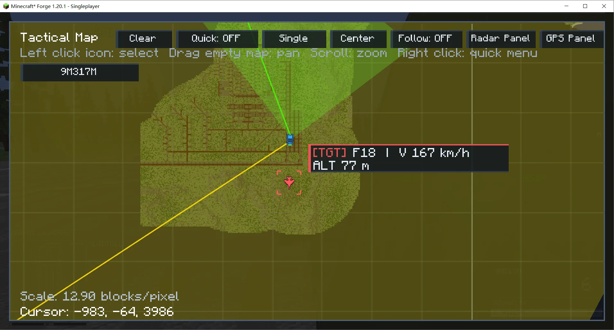
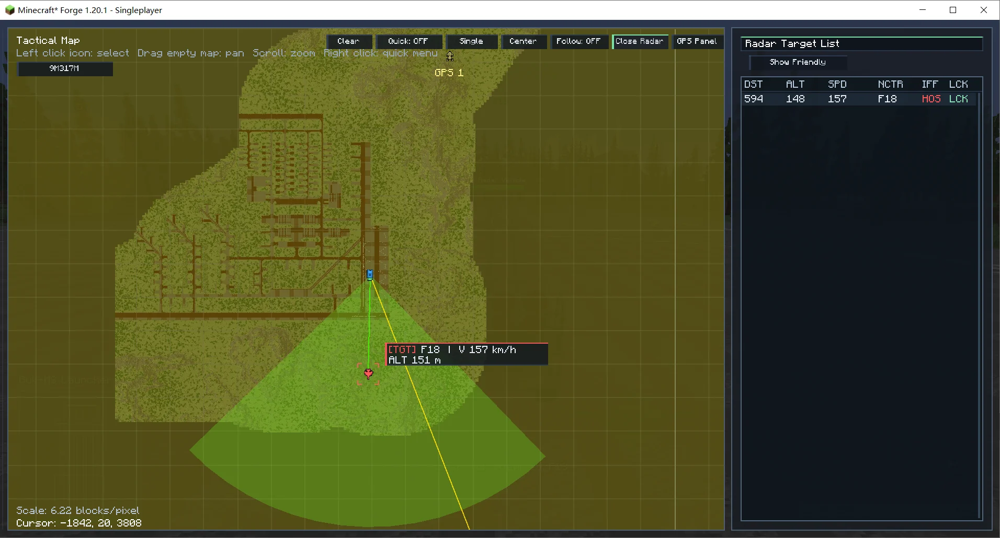
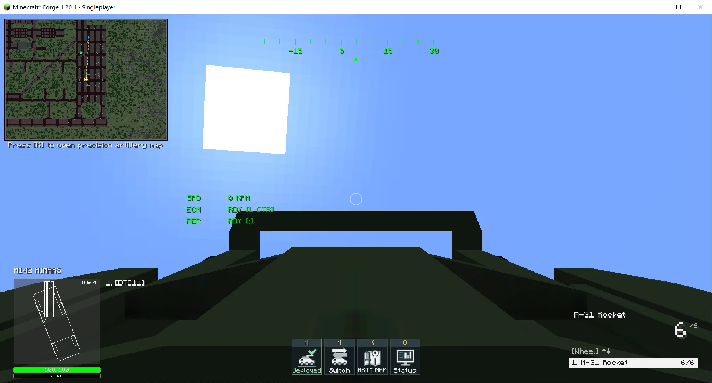
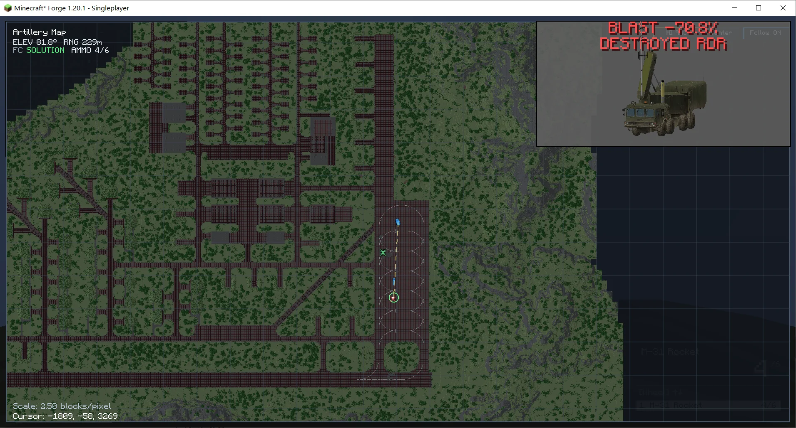

[← 返回 Wiki 首页](../index.html)

## 9. 战术地图

战术地图显示地形、玩家、载具、导弹和 GPS 目标点，支持缩放、拖动、跟随和快捷标记。右键目标可绑定为 GPS 目标，或将目标位置填入 GPS 面板。

### 9.1 与 GPS 制导武器联动

- 在战术地图上选择目标点并装订为 GPS 目标。

- 支持单点和多点标记。

- 多点模式可管理多个目标点；雷达模式可在雷达面板中选择目标。

  

**图9.1/9.2 战术地图联动GPS制导武器**

### 9.2 与雷达目标列表联动

- 战术地图可打开雷达目标列表，显示距离、高度、速度、NCTR 识别、敌我识别和锁定状态。
- 可锁定目标，并对满足锁定条件的当前导弹执行快捷发射。
- 雷达目标列表支持隐藏友方目标。

**图9.3/9.4 战术地图联动雷达面板**

### 9.3 炮兵地图与小型炮兵地图

- **炮兵地图**：选择目标后计算仰角和落点距离，提供高/低弹道解算，左键开火；适用于 RVP 的炮兵武器。
- **小型炮兵地图**：选中炮兵武器时在屏幕角落显示紧凑地图，按当前炮口朝向与俯仰正算落点；左键按常规开火路径射击，但清晰的较低，只适合应急使用。

**图9.5/9.6 炮兵地图**

---
