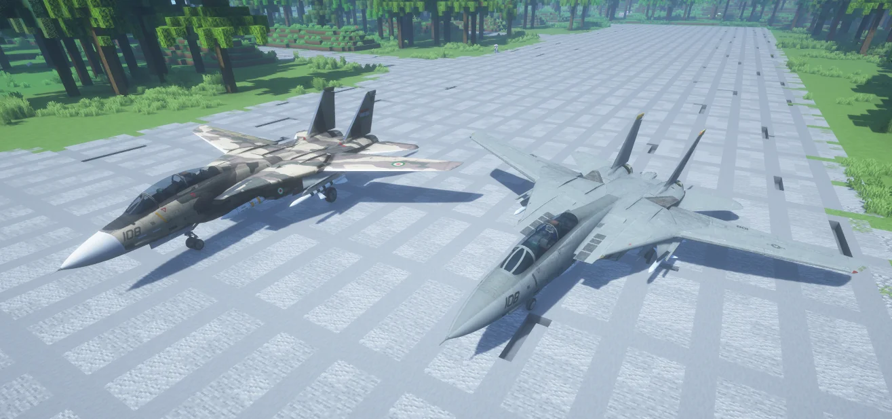
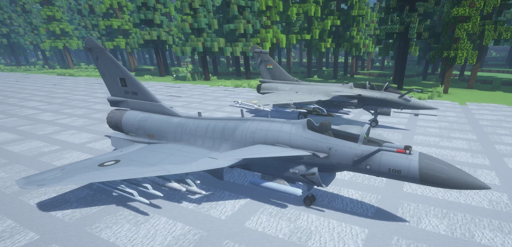

[← 返回 Wiki 首页](../index.html)

## 12. 载具

主包包含 39 台可操控载具：

| 类别 | 数量 | 示例 |
| --- | ---: | --- |
| 坦克 | 6 | M1A2 SEPv2、M1A1 HC、AbramsX、T-90M、VT4A1、ZTZ100 |
| 步战车 | 3 | BMPT-72、LAV-25、ZBL-08A |
| 防空车 | 7 | M1 AGDS、铠甲-S1SM、山毛榉-M3、96L6 雷达车、LAV-AD、EBRC AA、CS/SA-5 |
| 战斗机 | 11 | F-22A、F-14D、伊朗F-14A、F/A-18F、EA-18G、J-20A、J-16、J-16D、J-15T、J-10C、Rafale |
| 武装直升机 | 4 | AH-64E、Mi-28NE、AH-1Z、Z-10 |
| 无人机 | 4 | 轻型侦察无人机、四轴侦察无人机、四轴投弹无人机、四轴自爆无人机（均可由载具部署） |
| 驱逐舰 | 2 | 052D 昆明号、DDG-51 阿利·伯克 |
| 其余载具 | 2 | M142 海马斯、龙吼卫 无人战车 |
| 合计 | **39** | 另有 1 个弹簧刀 UCAV 发射器与部署版变体 |

F-14A 与 F-14D 支持可变后掠翼。14 台空中载具支持自定义挂架；部分载具配置武器舱和变体。

---

