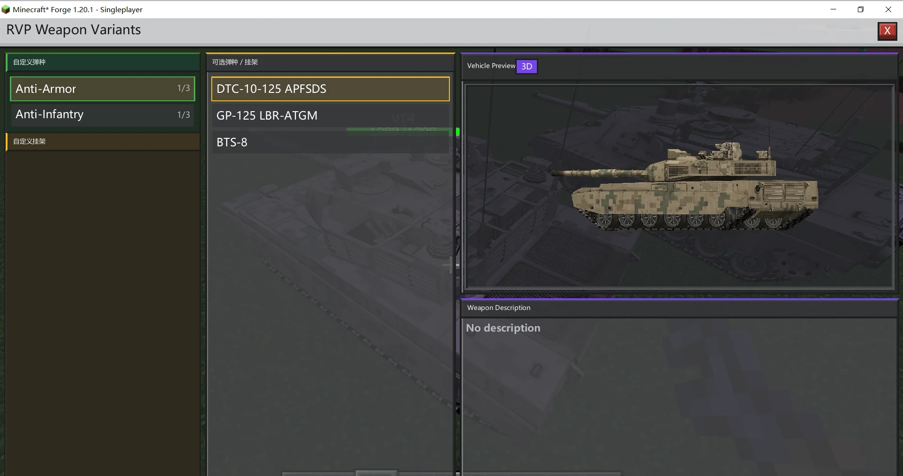
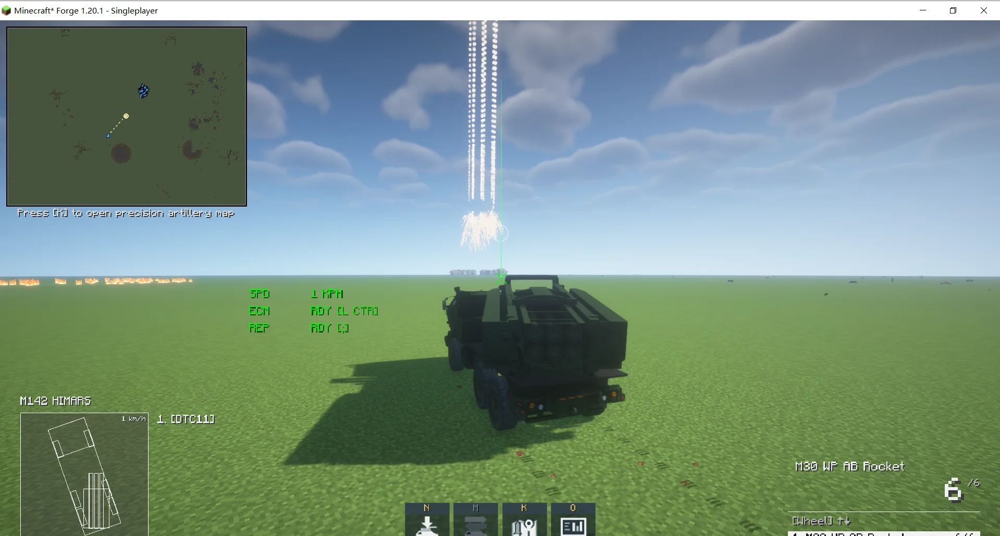
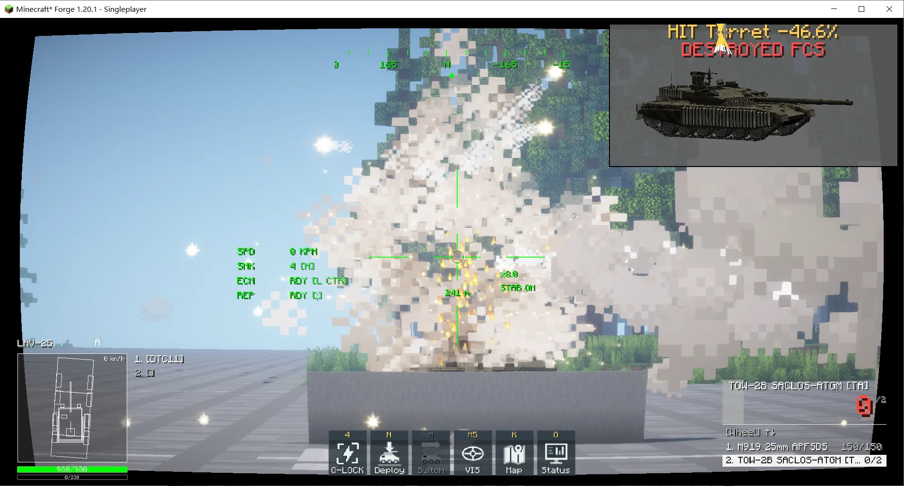
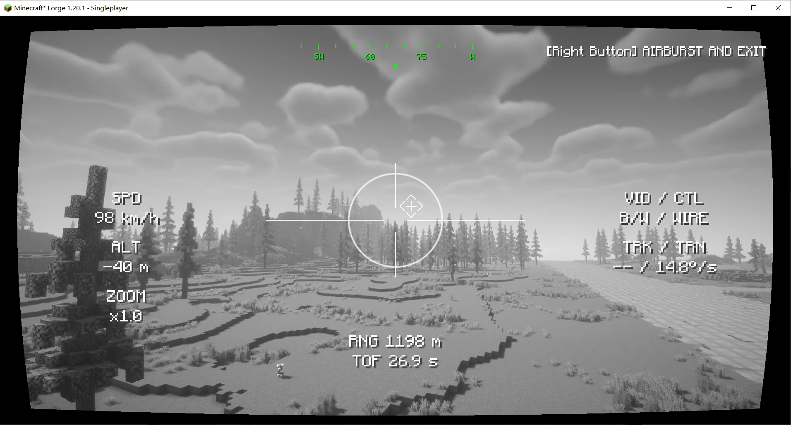
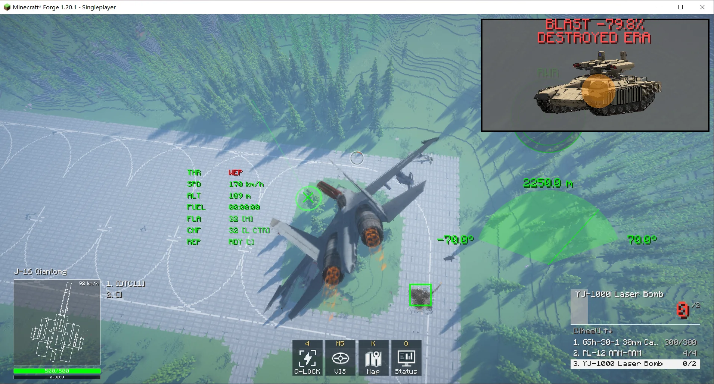
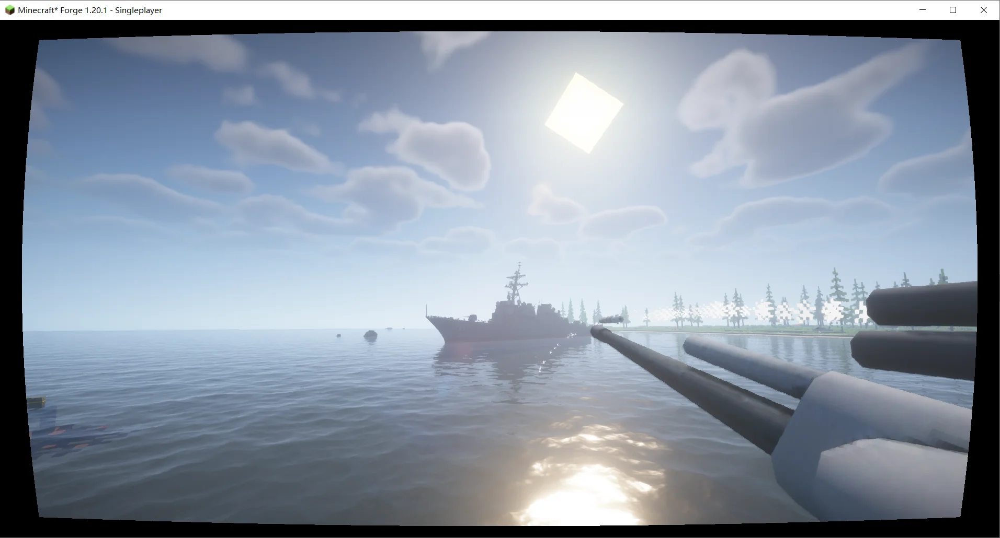
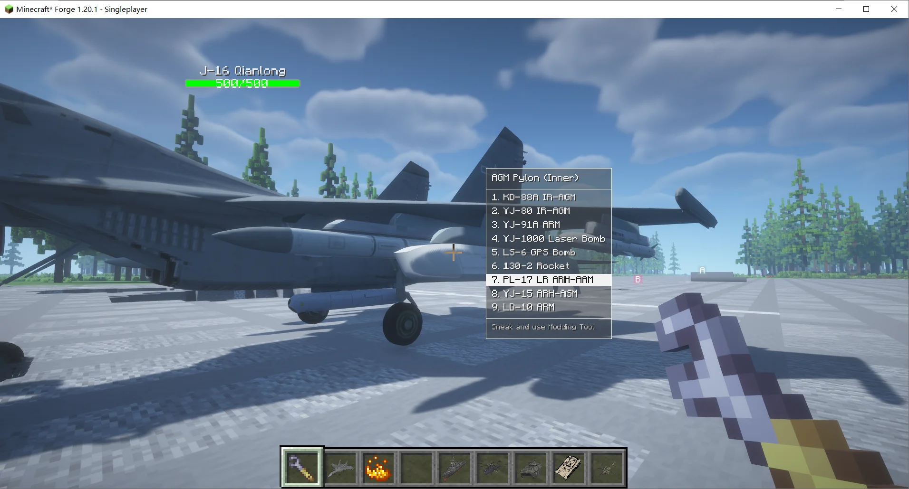
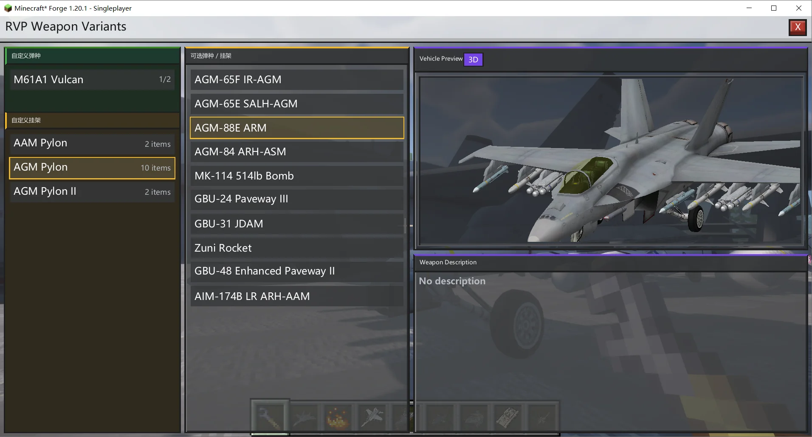

[← 返回 Wiki 首页](../index.html)

## 5. 武器系统

RVP 的武器数据目录包含 231 个武器与弹药定义文件，其中含战斗部、子弹药等从属条目。RVP 载具普遍配置多个武器站，可分别操作主炮、副炮、机枪、导弹、火箭等武器站；14 台固定翼/旋翼载具支持自定义挂架，F/A-18F 与 J-16 的可选武器种类最多。

### 5.1 枪炮与弹药

RVP 的枪炮包括车载/机载机枪、机炮与近防炮、坦克炮、舰炮和车载激光压制系统。不同武器使用的弹种不同，下面按游戏内实际行为说明主要弹药类型。

主要弹药类型：

- **APFSDS**：尾翼稳定脱壳穿甲弹。 APFSDS 为高直击、无爆破的动能穿甲弹，可穿透 2 格方块；穿墙后直击伤害会衰减，适合打装甲目标，且APFSDS对爆炸反应装甲有较高的抗性。
- **HEAT**：破甲弹。较高直击伤害并附带小范围爆炸，会被爆炸反应装甲削弱命中伤害。直击与爆炸的综合性能介于 APFSDS 与 HE 之间。对步战车等轻装甲目标可以造成巨额伤害。
- **HE**：高爆榴弹。直击伤害低、爆炸伤害和半径大；主要靠爆炸杀伤软目标和轻装甲目标，可以对轻装甲目标造成巨额伤害。
- **PELE**：横向效应增强弹。由APFSDS改造来的弹药，直击伤害较低，但命中载具或方块后释放大量弹射破片，破片能够有效破坏轻装甲和杀伤步兵；适合打击轻装甲目标和密闭空间的步兵，对重装甲杀伤效果有限。
- **AHEAD**：可编程弹药。需要雷达或武器站锁定目标自动解算提前量并装订空爆引信；开火时按提前量和弹道自动装订空爆距在目标前方约 40 米释放大量破片，在敌人行进路径中抛洒弹幕。未锁定时不装订空爆，弹丸按普通直射飞行。
- **定距空爆弹**：按锁定键（默认 R）对瞄准点测距（瞄准点需命中方块），沿弹道累计飞行到“测距 + 偏移”时起爆；用于在掩体上方或目标附近空爆，可以有效打击。
- **SAP**：破障榴弹。具有 1 格穿墙能力的高爆弹，可穿过墙体命中墙后/掩体内的目标并在目标处起爆，主要用于杀伤墙后步兵目标。
- **霰弹**：一次发射多枚弹丸，近距离覆盖软目标；弹丸伤害随距离衰减。
- **轨道炮：**ZTZ100和艾布拉姆斯X装备有实验性质的轨道炮，发射前需要蓄力，蓄力完成后可以发射初速极高的弹丸
  
  **图5.1 RVP坦克具有丰富的弹种以应付不同状况**

### 5.2 火箭弹

- **无制导火箭弹**：Hydra 70、Zuni、S-13、S-8KO、FS70B、130-2 等火箭巢。弹道计算机会进行连续计算命中，确保打击的准确。

- **制导火箭弹**：APKWS、FS70A 等激光制导火箭弹。装备激光导引头的火箭弹，能跟随激光点移动，具备打击移动目标能力。

- **集束火箭弹**：M30、M261、FS70B 集束型等。发射后在接近地面的位置，散布大量子弹药，具有较强的面杀伤软目标能力，但是反装甲能力较弱。

- **白磷/燃烧火箭弹**：M30 白磷空爆型等。发射后在接近地面时，布撒大量白磷弹幕，进行大范围纵火

  

  **图5.2 RVP海玛斯火箭炮白磷火箭弹示例**

### 5.3 导弹

导弹按制导方式分类。

| 制导方式 | 说明与示例 |
| --- | --- |
| 红外制导（IR） | 红外导引头跟踪目标热源；AIM-9M、PL-10、FIM-92K、KD-88A 等。配合头瞄可在大离轴角内捕获、锁定和发射 |
| 主动雷达制导（ARH） | 发射初段接受机载雷达数据链引导，到底主动雷达导引头开机距离后，弹载导引头主动开机捕获目标；AIM-120D、PL-15、AIM-54C、YJ-19 等 |
| 半主动雷达制导（SARH） | 依赖载机/载车雷达持续照射；AIM-7P、R-27R、ESSM 等 |
| 激光半主动制导（SALH） | 由激光照射指示目标，被照射目标会被触发激光告警；AGM-114K、AGM-65E、LAHAT、AKD-10 等 |
| 激光架束制导（LBR） | 沿激光束架束飞行，被照射目标会触发激光告警；9M119M1、GP-125、9M127 等；9M119M1、GP-125 为炮射导弹 |
| 反辐射制导（ARM） | 追踪开启的雷达辐射源，关闭雷达可规避反辐射导弹；AGM-88E、LD-10、YJ-91 等 |
| 主动红外制导（AIR） | 雷达或数据链中段修正，末段红外导引头自主搜索；HHQ-10、HQ-13 等 |
| GPS/INS 制导 | 卫星与惯性组合导航，配合战术地图装订；AKF-98A、Storm Shadow、ATACMS、YJ-20 等。GBU-31、LS-6、GB-3 GPS 型为卫星制导炸弹，见 5.4 |
| 人在回路电视制导（HITL_TV） | 发射后进入人在回路导引头回传界面，发射手可以在人在回路界面不断选择导引头锁定目标，类似战争雷霆的人在回路导弹；KH-39、KD-88 等。 |
| 人在回路指令线电视制导（HITL_CLOS_TV） | 发射后进入人在回路导引头回传界面，发射手可以手动控制导弹舵面，进行转向，类似战地4的TV弹；TL-17、CM-502KG、弹簧刀巡飞弹等 |
| SACLOS 半自动指令线制导 | 操作员瞄准目标，导弹沿视线指令飞行，相较于LBR，操作性较难，但是不会触发激光告警；TOW-2A/2B、HJ-73E、95Ya6M 等；TOW-2B 采用自锻破片攻顶战斗部，导弹略顶后会爆炸并向下抛洒大量破片，适合打击墙后目标 |

部分弹种具有多模导引头模式：如Brimstone为半主动激光/主动雷达双模导引头，前半段使用激光照射，导弹往激光点飞行，后半段主动雷达导引头开机自主捕获目标。部分导弹支持双脉冲发动机、冷发射、高抛/掠顶弹道和近炸/触发引信。

**图5.3 配备自锻破片攻顶战斗部的TOW 2B导弹能够打击掩体后的坦克**

**图5.4 反辐射导弹能打击开启雷达的目标**

**图5.5 人在回路导弹（TV弹）**

### 5.4 航空炸弹

- 常规航空炸弹：MK-84 等。无制导的重力炸弹，弹道计算机会进行连续计算命中，确保打击的准确。
- 激光半主动制导炸弹：GBU-24、GBU-48、GB-3 激光型、GB-500、YJ-1000。由普通航空炸弹改装而来，载机照射激光点，炸弹会向着激光点飞行，具有打击动目标的能力。
- 卫星/惯性制导炸弹：GBU-31、LS-6、GB-3 GPS 型。可以在战术地图上标记GPS坐标，投掷后弹药会朝着GPS坐标点飞行
- 红外制导炸弹：GB-3 红外型。可以开启红外导引头跟踪目标热源，具有打击动目标的能力。

**图5.6 激光制导炸弹**

### 5.5 鱼雷

鱼雷可以在水下1-2米航行，可以对大型舰艇照成巨额伤害。

**图5.7 鱼雷发射**

### 5.6 吊舱

| 类型 | 说明 |
| --- | --- |
| 目标指示吊舱 | 可以标记目标，被标记的目标会显示在战术地图上。 |
| 坐标指示吊舱 | 获取并标记目标坐标，可填入 GPS 面板或用于火力支援；部分型号集成“呼叫火力打击/呼叫空袭”功能 |

TGP 见 EA-18G、F/A-18F、J-16D；EOTS 见 J-20A；SUAV 吊舱见轻型侦察无人机与四轴侦察无人机。集成火力支援的坐标指示吊舱见主战坦克副驾位、EA-18G、J-16D 和侦察无人机。

### 5.7 激光武器

- ZTZ100 的 10kW 激光压制系统可照射敌方载具，累计命中后致盲玩家与 AI 炮手。
- AI 炮手被致盲期间只能使用雷达制导或雷达中段武器；玩家被致盲时白屏影响视线。
- 激光照射会触发对应的告警与 HUD 提示。

### 5.8 火力支援

- **RVP 炮火支援终端**：主手/副手持有时右键，或按 K 打开炮火支援地图；支持呼叫、落区、弹数与停火。
- **火力支援模式**：急促打击、效力打击、监视打击、空中打击。
- **弹幕样式**：点状弹幕、条状弹幕、徐进弹幕。
- **支援弹药**：航空炸弹、火箭弹、集束火箭、白磷弹、ATACMS、9M723、GPS 巡航导弹等，具体条目由火力支援配置决定。
- **吊舱联动**：目标指示吊舱可标记实体或坐标；挂载“呼叫火力打击”/“呼叫空袭”的载具可在吊舱界面选择打击条目，标记坐标后自动呼叫。

### 5.9 武器改装与弹药选择

RVP 的大部分载具支持较丰富的武器改装，玩家可以根据任务选择不同弹种或挂载：
例如：

- **SEAD任务**：战机可选择反辐射导弹，压制敌方雷达防空车。
- **DEAD任务**：战机可携带红外制导导弹或激光制导导弹，打击关闭雷达的防空系统。
- **地面载具**：面对较多轻装甲目标时选择 PELE 弹；打击重装甲目标时选择 APFSDS。

**图5.8/5.9 RVP载具拥有丰富的改装**

---
